# House price regression analysis

> **TL;DR**
>
> - **Role:** Marketing Data Analyst (Nov 2020)
> - **Question:** how much will a house sell for, given its features? (plus a separate SQL test in `sql_test/`)
> - **What I did:** cleaned the data, looked at what moves the price, and compared linear models (Ridge, Lasso) against other models (Random Forest, XGBoost).
> - **Result:** Lasso won. Its average error is 1,162 USD, against 12,817 USD for the baseline (a simple guess used as the bar to beat), for houses that cost 178,777 USD on average.

## 1. Introduction

### 1.1 Problem description

The aim is to predict the house prices from a specific dataset using a regression analysis.

1. **Data management**, i.e. you have to:
   * Manage the N/A in some fields
   * You have some variables starting with a number (1stFlrSF and 2ndFlrSF)
   * GarageYrBlt has invalid year entry, i.e. 2207, which needs to be 2007
   * Exterior1st and Exterior2nd have entries which are having spaces between the two words, i.e. Wd Sdng, Brk Cmn, that needs to be handled. As well as amongst the Exterior2nd variable there is an entry containing a typo, i.e. instead of WdShing as another similar entry, it's written Wd Shng.

2. **Descriptive statistics** (explore your data and the variables relationships you think are important to look at)

3. **Regression analysis**, i.e. which are the factors that influence the sale price of a house? You'll need to define those and then interpret the results. (NB: As mentioned, you could choose to test in your model just few of all variables in the dataset, but if you choose to do so, please justify your choice.)

**Note**: we assume the prices are constant prices (already adjusted for inflation), not current prices.

### 1.2 Executive brief

**1. Data management**

- Missing values were replaced.
- Columns where (almost) every house has the same value were deleted, because they can't explain differences in price.
- Categories with fewer than 30 houses were merged into "Other": with so few houses we can't draw reliable conclusions about them.
- Some text variables were turned into scores (an ordinal scale), for example: ('No':0, 'Po':1, 'Fa':2, 'TA':3, 'Gd':4, 'Ex':5), from "none" to "excellent".
- Some years were fixed so they make sense together (for example, a house can't be sold before it was built): garage year built, remodel year (*YearRemodAdd*) and year sold (*YrSold*).
- Variables whose name starts with a number were renamed.
- Variables that can be calculated from other variables were deleted (they add no new information).
- Variables that are zero for almost every house were deleted.
- When two variables carried almost the same information (high correlation), one of them was deleted. This avoids multicollinearity, which makes the model's numbers unstable and hard to read.
- Outliers (values much bigger than the rest) were capped: above a chosen cut-off, the value is set to the cut-off.

**2. Descriptive statistics**

- From the correlation plot between the explanatory variables (X, the features of the house):
  - *OverallQual* (overall quality) goes up together with the year the house was built or remodelled (*YearRemodAdd*) and with the quality of the kitchen (*KitchenQual*), the exterior (*ExterQual*) and the basement (*BsmtQual*). So, to raise a house's overall quality, a remodel focused on the kitchen, the basement or the exterior is a good idea.
  - Garage quality goes up together with garage area.
- From the correlation plot with the sale price (y):
  - The sale price is highly correlated with the number of bedrooms above the basement and with the lot size, and these two are not correlated with each other. So both should play a key role in the final model. In plain words: to raise a house's price, add bedrooms or buy more land.
  - The sale price is moderately correlated with *GrLivArea* (living area above ground, in square feet) and *TotRmsAbvGrd* (rooms above ground, not counting bathrooms). But these two carry almost the same information, so probably only one of them will matter in the model.
- Houses sold from February to April are, on average, cheaper than those sold from May to August. After that, prices rise again until December.
- Looking at averages, these features go with a **higher** price:
  - Residential Low Density houses.
  - Houses on a cul-de-sac (a dead-end street).
  - Duplexes.
  - Properties with two stories or more.
  - Hip roofs.
  - Brick or plywood exterior covering.
  - Standard circuit breaker (Romex) electrical system.
  - Having a shed.
  - New houses.
- And these go with a **lower** price:
  - Floating Village Residential and Residential Medium Density houses.
  - Houses with a paved alley.
  - Townhouses.
  - Split Foyer houses.
  - Cement board or metal siding exterior covering.
  - Fuse-based electrical system.
  - Houses sold by contract.

These features may or may not end up in the final model: the averages look at each feature alone, while the model looks at all of them together.

**3. Regression analysis**

- Lasso has the smallest error on the test set (houses the model never saw), and the smallest gap between its training and test errors. A small gap means less overfitting: the model learned general patterns instead of memorizing the training houses. So lasso was chosen for this data.
- Another plus of lasso: when a variable barely helps, lasso sets its coefficient (its weight in the formula) to zero, which removes it from the model and keeps the model simple.
- The model meets the main assumptions of linear regression (checked in section 4.3.3).
- The model beats the baseline (giving every house the average price) by far. Its Mean Absolute Error (MAE) is 1,162 USD: on average it misses a house's price by 1,162 USD, against 12,817 USD for the baseline. With an average price of 178,777 USD, that is a very good estimate.
- The factors that influence the sale price of a house are:
  - **LotFrontage**: Linear feet of street connected to property.
  - **LotArea**: Lot size in square feet.
  - **BsmtFullBath**: Basement full bathrooms.
  - **BedroomAbvGr**: Number of bedrooms above basement level.
  - **MoSold**: Month Sold.
  - **Neighborhood**: Physical locations.
  - **BldgType**: Type of dwelling.
  - **Exterior2nd**: Exterior covering on house (if more than one material).
  - **MasVnrType**: Masonry veneer type.
  - **Foundation**: Type of foundation.
  - **GarageType**: Garage location.
  - **SaleType**: Type of sale.

How to read each coefficient ($\beta_{k}$): it is how much the price changes when that variable goes up by one unit, **while all the other variables stay the same**:

- **LotFrontage**: each extra foot of street touching the property adds 2.29 USD to the price.
- **LotArea**: each extra square foot of land adds 1.87 USD.
- **BsmtFullBath**: each full bathroom in the basement lowers the price by 149.08 USD. A possible reason: a house with more bathrooms in the basement has fewer in the rest of the house, and a basement bathroom is less comfortable.
- **BedroomAbvGr**: each extra bedroom above the basement adds 12,906.88 USD.
- **Neighborhood**: a house in Mitchel is worth 241.27 USD more than in the other neighbourhoods.
- **BldgType**: a townhouse is worth 350.55 USD more than other types of dwelling.
- **Exterior2nd**: if the second exterior covering (when there is more than one material) is vinyl siding, the price drops by 116.38 USD compared with other coverings.
- **MasVnrType**: a stone masonry veneer (a decorative stone layer on the walls) lowers the price by 199.17 USD compared with other types.
- **Foundation**: a cinder block foundation adds 35.08 USD compared with other foundations.
- **GarageType**: a garage in the basement, a car port, or more than one type of garage adds 732.28 USD.
- **SaleType**: a sale by contract lowers the price by 727.83 USD, and a brand-new house adds 673.28 USD (both compared with warranty, court and other sales).
- **MoSold**: for each month later in the year (January = 1 to December = 12), the price goes up by 1,137 USD on average. Prices follow supply and demand, so months with more buyers bring higher prices.

Other models (Random Forest and XGBoost) were also tested, but they did worse than lasso.

## 2. Data management

### 2.1 Read files

> **In this section** we load the Excel file from the gamblingCompany drive folder: one sheet with the sale price and another one with the characteristics of each valued house, both indexed by the house Id. The first rows and the size of the characteristics table were checked.

First, we read the Excel file. One sheet has the sale price and the other has the features of each house.

The dataset contains 1,459 houses and 79 variables.

### 2.2 Categorical variables treatment

#### 2.2.1 Summary measures

> **In this section** we describe the text (categorical) variables: how many houses have a value (count), how many different values exist (unique), which value is the most frequent (top) and how many times it appears (freq). The gaps between count and 1,459 are the missing values that the next sections deal with.

**Output (summary of the categorical variables):**

| Variable      |   count |   unique | top     |   freq |
|:--------------|--------:|---------:|:--------|-------:|
| MSZoning      |    1455 |        5 | RL      |   1114 |
| Street        |    1459 |        2 | Pave    |   1453 |
| Alley         |     107 |        2 | Grvl    |     70 |
| LotShape      |    1459 |        4 | Reg     |    934 |
| LandContour   |    1459 |        4 | Lvl     |   1311 |
| Utilities     |    1457 |        1 | AllPub  |   1457 |
| LotConfig     |    1459 |        5 | Inside  |   1081 |
| LandSlope     |    1459 |        3 | Gtl     |   1396 |
| Neighborhood  |    1459 |       25 | NAmes   |    218 |
| Condition1    |    1459 |        9 | Norm    |   1251 |
| Condition2    |    1459 |        5 | Norm    |   1444 |
| BldgType      |    1459 |        5 | 1Fam    |   1205 |
| HouseStyle    |    1459 |        7 | 1Story  |    745 |
| RoofStyle     |    1459 |        6 | Gable   |   1169 |
| RoofMatl      |    1459 |        4 | CompShg |   1442 |
| Exterior1st   |    1458 |       13 | VinylSd |    510 |
| Exterior2nd   |    1458 |       15 | VinylSd |    510 |
| MasVnrType    |    1443 |        4 | None    |    878 |
| ExterQual     |    1459 |        4 | TA      |    892 |
| ExterCond     |    1459 |        5 | TA      |   1256 |
| Foundation    |    1459 |        6 | PConc   |    661 |
| BsmtQual      |    1415 |        4 | TA      |    634 |
| BsmtCond      |    1414 |        4 | TA      |   1295 |
| BsmtExposure  |    1415 |        4 | No      |    951 |
| BsmtFinType1  |    1417 |        6 | GLQ     |    431 |
| BsmtFinType2  |    1417 |        6 | Unf     |   1237 |
| Heating       |    1459 |        4 | GasA    |   1446 |
| HeatingQC     |    1459 |        5 | Ex      |    752 |
| CentralAir    |    1459 |        2 | Y       |   1358 |
| Electrical    |    1459 |        4 | SBrkr   |   1337 |
| KitchenQual   |    1458 |        4 | TA      |    757 |
| Functional    |    1457 |        7 | Typ     |   1357 |
| FireplaceQu   |     729 |        5 | Gd      |    364 |
| GarageType    |    1383 |        6 | Attchd  |    853 |
| GarageFinish  |    1381 |        3 | Unf     |    625 |
| GarageQual    |    1381 |        4 | TA      |   1293 |
| GarageCond    |    1381 |        5 | TA      |   1328 |
| PavedDrive    |    1459 |        3 | Y       |   1301 |
| PoolQC        |       3 |        2 | Ex      |      2 |
| Fence         |     290 |        4 | MnPrv   |    172 |
| MiscFeature   |      51 |        3 | Shed    |     46 |
| SaleType      |    1458 |        9 | WD      |   1258 |
| SaleCondition |    1459 |        6 | Normal  |   1204 |

#### 2.2.2 Delete columns

> **In this section** we drop six columns: *Utilities*, *Street*, *Condition2*, *RoofMatl*, *Heating* and *PoolQC*.

- Variables with only one value (*Utilities*: one category plus a few blanks), because a column that never changes can't explain anything and only adds noise (it can lead to overfitting).
- Variables where the vast majority of houses share one value (*Street*, *Condition2*, *RoofMatl*, *Heating*).
- Variables that are mostly empty (NaN = missing value), like *PoolQC*.

#### 2.2.3 Replace missing values

> **In this section** we fill the missing values of every categorical variable. When the gap means that the house does not have the thing (no alley, no basement, no fireplace, no garage, no fence), the gap is filled with a "No" category; when the gap is simply unknown, it is filled with the most typical value (*TA* for the kitchen quality, *Typ* for functionality) or with an "Other" category. The counts below show how each variable looks after filling it. There is one house without kitchen quality and it does have a kitchen, so the average value was used.

**Output (value counts after replacing the missing values):**

```text
Alley              MSZoning           Exterior1st        Exterior2nd
No      1352       RL         1114    VinylSd    510     VinylSd    510
Grvl      70       RM          242    MetalSd    230     MetalSd    233
Pave      37       FV           74    HdBoard    220     HdBoard    199
                   C (all)      15    Wd Sdng    205     Wd Sdng    194
                   RH           10    Plywood    113     Plywood    128
                   Other         4    CemntBd     65     CmentBd     66
                                      BrkFace     37     Wd Shng     43
                                      WdShing     30     BrkFace     22
                                      AsbShng     24     Stucco      21
                                      Stucco      18     AsbShng     18
                                      BrkComm      4     Brk Cmn     15
                                      CBlock       1     ImStucc      5
                                      AsphShn      1     CBlock       2
                                      Other        1     AsphShn      1
                                                         Other        1
                                                         Stone        1

MasVnrType         BsmtQual           BsmtCond           BsmtExposure
None       894     TA    634          TA    1295         No    951
BrkFace    434     Gd    591          Fa      59         Av    197
Stone      121     Ex    137          Gd      57         Gd    142
BrkCmn      10     Fa     53          No      45         Mn    125
                   No     44          Po       3         Nb     44

BsmtFinType1       BsmtFinType2       KitchenQual        Functional
GLQ    431         Unf    1237        TA    758          Typ     1359
Unf    421         Rec      51        Gd    565          Min2      36
ALQ    209         Nb       42        Ex    105          Min1      34
Rec    155         LwQ      41        Fa     31          Mod       20
BLQ    121         BLQ      35                           Maj1       5
LwQ     80         ALQ      33                           Maj2       4
Nb      42         GLQ      20                           Sev        1

FireplaceQu        GarageType         GarageFinish       GarageQual
No    730          Attchd     853     Unf    625         TA    1293
Gd    364          Detchd     392     RFn    389         No      78
TA    279          BuiltIn     98     Fin    367         Fa      76
Fa     41          No          76     No      78         Gd      10
Po     26          Basment     17                        Po       2
Ex     19          2Types      17
                   CarPort      6

GarageCond         Fence              MiscFeature        SaleType
Ex       1         No       1169      No      1408       WD       1258
Fa      39         MnPrv     172      Shed      46       New       117
Gd       6         GdPrv      59      Gar2       3       COD        44
No      78         GdWo       58      Othr       2       ConLD      17
Po       7         MnWw        1                         CWD         8
TA    1328                                               Oth         5
                                                         ConLI       4
                                                         Con         3
                                                         ConLw       3
```

#### 2.2.4 Transform

> **In this section** we turn the quality and condition variables into numbers (an ordinal scale), so the model uses one column per variable instead of one column per category.

Some text variables were turned into scores (an ordinal scale), for example: ('No':0, 'Po':1, 'Fa':2, 'TA':3, 'Gd':4, 'Ex':5). This way each variable is one number instead of one 0/1 column per category, so the model has fewer parameters (numbers to learn).

#### 2.2.5 Analyse the rest of the categorical variables

> **In this section** we count the values of the categorical variables that are still text, in order to discover small categories (the ones with very few houses).

**Output (value counts of the remaining categorical variables):**

```text
LotConfig          LandContour        Condition1         HouseStyle
Inside     1081    Lvl    1311        Norm      1251     1Story    745
Corner      248    HLS      70        Feedr       83     2Story    427
CulDSac      82    Bnk      54        Artery      44     1.5Fin    160
FR2          38    Low      24        RRAn        24     SLvl       63
FR3          10                       PosN        20     SFoyer     46
                                      RRAe        17     2.5Unf     13
                                      PosA        12     1.5Unf      5
                                      RRNe         4
                                      RRNn         4

RoofStyle          Foundation         Electrical         SaleCondition
Gable      1169    PConc     661      SBrkr    1337      Normal     1204
Hip         265    CBlock    601      FuseA      94      Partial     120
Gambrel      11    BrkTil    165      FuseF      23      Abnorml      89
Flat          7    Slab       25      FuseP       5      Family       26
Mansard       4    Stone       5                         Alloca       12
Shed          3    Wood        2                         AdjLand       8

Neighborhood
NAmes      218     Sawyer      77     Crawfor     52     MeadowV     20
OldTown    126     SawyerW     66     BrkSide     50     ClearCr     16
CollgCr    117     Mitchel     65     Timber      34     NPkVill     14
Somerst     96     NWAmes      58     NoRidge     30     BrDale      14
Edwards     94     IDOTRR      56     StoneBr     26     Veenker     13
NridgHt     89                        SWISU       23     Blmngtn     11
Gilbert     86                                           Blueste      8
```

#### 2.2.6 Group (small) categories

> **In this section** we merge the small categories into bigger ones, either with a similar category (the *Wd Sdng* / *WdShing* / *Wd Shng* entries become one *Wood* category, which also solves the spaces and the typo of the exterior covering) or into an *Other* category. After the grouping, none of the 24 categorical variables that are left has a tiny category.

Categories with fewer than 30 houses were merged into "Other" (or into a similar category), because with so few houses we can't draw reliable conclusions.

**Output (summary of the categorical variables after the grouping):**

| Variable      |   count |   unique | top      |   freq |
|:--------------|--------:|---------:|:---------|-------:|
| MSZoning      |    1459 |        4 | RL       |   1114 |
| Alley         |    1459 |        3 | No       |   1352 |
| LandContour   |    1459 |        4 | Lvl      |   1311 |
| LotConfig     |    1459 |        4 | Inside   |   1081 |
| Neighborhood  |    1459 |       17 | NAmes    |    218 |
| Condition1    |    1459 |        5 | Norm     |   1251 |
| BldgType      |    1459 |        5 | 1Fam     |   1205 |
| HouseStyle    |    1459 |        5 | 1Story   |    750 |
| RoofStyle     |    1459 |        3 | Gable    |   1169 |
| Exterior1st   |    1459 |        8 | VinylSd  |    510 |
| Exterior2nd   |    1459 |        8 | VinylSd  |    510 |
| MasVnrType    |    1459 |        3 | None     |    894 |
| Foundation    |    1459 |        4 | PConc    |    661 |
| BsmtFinType1  |    1459 |        7 | GLQ      |    431 |
| BsmtFinType2  |    1459 |        5 | Unf      |   1237 |
| CentralAir    |    1459 |        2 | Y        |   1358 |
| Electrical    |    1459 |        2 | SBrkr    |   1337 |
| GarageType    |    1459 |        5 | Attchd   |    853 |
| GarageFinish  |    1459 |        4 | Unf      |    625 |
| PavedDrive    |    1459 |        3 | Y        |   1301 |
| Fence         |    1459 |        4 | No       |   1169 |
| MiscFeature   |    1459 |        2 | No       |   1413 |
| SaleType      |    1459 |        4 | Warranty |   1271 |
| SaleCondition |    1459 |        4 | Normal   |   1204 |

### 2.3 Numeric variables treatment

#### 2.3.1 Summary measures

> **In this section** we describe the numeric variables (how many values, average, standard deviation — how spread the values are — minimum, the three quartiles and maximum) and then we fix the years that are not coherent: the invalid *GarageYrBlt* 2207 becomes 2007, a garage built before the house takes the construction year of the house, and the same idea is applied to the remodel year and to the year sold.

**Output (summary of the numeric variables):**

| Variable      |   count |     mean |      std |   min |     25% |    50% |      75% |   max |
|:--------------|--------:|---------:|---------:|------:|--------:|-------:|---------:|------:|
| MSSubClass    |    1459 |   57.378 |   42.747 |    20 |   20    |   50   |    70    |   190 |
| LotFrontage   |    1232 |   68.58  |   22.377 |    21 |   58    |   67   |    80    |   200 |
| LotArea       |    1459 | 9819.16  | 4955.52  |  1470 | 7391    | 9399   | 11517.5  | 56600 |
| LotShape      |    1459 |    1.392 |    0.558 |     1 |    1    |    1   |     2    |     4 |
| LandSlope     |    1459 |    2.955 |    0.218 |     1 |    3    |    3   |     3    |     3 |
| OverallQual   |    1459 |    6.079 |    1.437 |     1 |    5    |    6   |     7    |    10 |
| OverallCond   |    1459 |    5.554 |    1.114 |     1 |    5    |    5   |     6    |     9 |
| YearBuilt     |    1459 | 1971.36  |   30.39  |  1879 | 1953    | 1973   |  2001    |  2010 |
| YearRemodAdd  |    1459 | 1983.66  |   21.13  |  1950 | 1963    | 1992   |  2004    |  2010 |
| MasVnrArea    |    1444 |  100.709 |  177.626 |     0 |    0    |    0   |   164    |  1290 |
| ExterQual     |    1459 |    3.398 |    0.586 |     2 |    3    |    3   |     4    |     5 |
| ExterCond     |    1459 |    3.088 |    0.393 |     1 |    3    |    3   |     3    |     5 |
| BsmtQual      |    1459 |    3.466 |    0.934 |     0 |    3    |    3   |     4    |     5 |
| BsmtCond      |    1459 |    2.902 |    0.597 |     0 |    3    |    3   |     3    |     4 |
| BsmtExposure  |    1459 |    1.618 |    1.073 |     0 |    1    |    1   |     2    |     4 |
| BsmtFinSF1    |    1458 |  439.204 |  455.268 |     0 |    0    |  350.5 |   753.5  |  4010 |
| BsmtFinSF2    |    1458 |   52.619 |  176.754 |     0 |    0    |    0   |     0    |  1526 |
| BsmtUnfSF     |    1458 |  554.295 |  437.26  |     0 |  219.25 |  460   |   797.75 |  2140 |
| TotalBsmtSF   |    1458 | 1046.12  |  442.899 |     0 |  784    |  988   |  1305    |  5095 |
| HeatingQC     |    1459 |    4.158 |    0.957 |     1 |    3    |    5   |     5    |     5 |
| 1stFlrSF      |    1459 | 1156.54  |  398.166 |   407 |  873.5  | 1079   |  1382.5  |  5095 |
| 2ndFlrSF      |    1459 |  325.968 |  420.61  |     0 |    0    |    0   |   676    |  1862 |
| LowQualFinSF  |    1459 |    3.544 |   44.043 |     0 |    0    |    0   |     0    |  1064 |
| GrLivArea     |    1459 | 1486.05  |  485.566 |   407 | 1117.5  | 1432   |  1721    |  5095 |
| BsmtFullBath  |    1457 |    0.434 |    0.531 |     0 |    0    |    0   |     1    |     3 |
| BsmtHalfBath  |    1457 |    0.065 |    0.252 |     0 |    0    |    0   |     0    |     2 |
| FullBath      |    1459 |    1.571 |    0.555 |     0 |    1    |    2   |     2    |     4 |
| HalfBath      |    1459 |    0.378 |    0.503 |     0 |    0    |    0   |     1    |     2 |
| BedroomAbvGr  |    1459 |    2.854 |    0.83  |     0 |    2    |    3   |     3    |     6 |
| KitchenAbvGr  |    1459 |    1.042 |    0.208 |     0 |    1    |    1   |     1    |     2 |
| KitchenQual   |    1459 |    3.51  |    0.661 |     2 |    3    |    3   |     4    |     5 |
| TotRmsAbvGrd  |    1459 |    6.385 |    1.509 |     3 |    5    |    6   |     7    |    15 |
| Functional    |    1459 |    4.903 |    0.4   |     1 |    5    |    5   |     5    |     5 |
| Fireplaces    |    1459 |    0.581 |    0.647 |     0 |    0    |    0   |     1    |     4 |
| FireplaceQu   |    1459 |    1.711 |    1.801 |     0 |    0    |    0   |     4    |     5 |
| GarageYrBlt   |    1381 | 1977.72  |   26.431 |  1895 | 1959    | 1979   |  2002    |  2207 |
| GarageCars    |    1458 |    1.766 |    0.776 |     0 |    1    |    2   |     2    |     5 |
| GarageArea    |    1458 |  472.769 |  217.049 |     0 |  318    |  480   |   576    |  1488 |
| GarageQual    |    1459 |    2.792 |    0.709 |     0 |    3    |    3   |     3    |     4 |
| GarageCond    |    1459 |    2.809 |    0.705 |     0 |    3    |    3   |     3    |     5 |
| WoodDeckSF    |    1459 |   93.175 |  127.745 |     0 |    0    |    0   |   168    |  1424 |
| OpenPorchSF   |    1459 |   48.314 |   68.883 |     0 |    0    |   28   |    72    |   742 |
| EnclosedPorch |    1459 |   24.243 |   67.228 |     0 |    0    |    0   |     0    |  1012 |
| 3SsnPorch     |    1459 |    1.794 |   20.208 |     0 |    0    |    0   |     0    |   360 |
| ScreenPorch   |    1459 |   17.064 |   56.61  |     0 |    0    |    0   |     0    |   576 |
| PoolArea      |    1459 |    1.744 |   30.492 |     0 |    0    |    0   |     0    |   800 |
| MiscVal       |    1459 |   58.168 |  630.807 |     0 |    0    |    0   |     0    | 17000 |
| MoSold        |    1459 |    6.104 |    2.722 |     1 |    4    |    6   |     8    |    12 |
| YrSold        |    1459 | 2007.77  |    1.302 |  2006 | 2007    | 2008   |  2009    |  2010 |

The years in *GarageYrBlt*, *YearRemodAdd* and *YrSold* were fixed so they make sense together (for example, a house can't be sold before it was built).

#### 2.3.2 Replace NA

> **In this section** we fill the missing values of the numeric variables with zero, because in all of them the gap means that the house does not have that element (no lot frontage, no masonry veneer, no basement, no garage).

#### 2.3.3 Rename variable

Variables whose name starts with a number were renamed (*1stFlrSF* to *FstFlrSF*, *2ndFlrSF* to *SndFlrSF* and *3SsnPorch* to *ThrSsnPorch*), because a name that starts with a number cannot be used directly in formulas.

#### 2.3.4 Variables creations

> **In this section** we add the three porch areas into a single *EnclosedPorch* variable and drop the other two, and we build an auxiliary flag that marks the houses that have a garage (it is only used for the checks of the next section, it is not a variable of the model).

The enclosed porch, three-season porch and screen porch areas (in square feet) were added up into one variable, because they are basically the same thing: an enclosed porch.

#### 2.3.5 Drop variables

> **In this section** we check the reasons to drop six variables and then drop them: how many houses have miscellaneous worth more than 1,000 USD, how many have low quality finished area, how strongly the year the garage was built follows the year the house was built, and whether the basement areas add up exactly to the total basement area. The sum matches in the 1,459 houses, so *TotalBsmtSF* carries no extra information.

- **PoolArea**: almost no house in the data has a pool.
- **TotalBsmtSF**: it is just the sum of the other basement areas.
- **GarageYrBlt**: it almost always matches *YearBuilt* (the garage is built with the house), and it has missing values.
- **MSSubClass**: it is a mix of *HouseStyle* and *YearBuilt*, so it repeats information.
- **MiscVal**: only a few houses have extras (miscellaneous features) worth more than 1,000 USD, which is tiny next to an average price of about 175,000 USD. Also, this value is part of the price itself, so using it would be like knowing part of the answer in advance. And most houses have no extras at all.
- **LowQualFinSF**: only 14 houses have a value above zero.

**Output (houses with miscellaneous value above 1,000 USD, and houses with low quality finished area):**

```text
MiscVal            LowQualFinSF
1500     3         only 14 houses have a value above zero
2000     3         (140, 697, 312, 436, 114, 80, 431,
3000     2          205, 108, 362, 1064, 259, 450, 512
4500     2          square feet, one house each)
2500     1
17000    1
12500    1
1512     1
6500     1
1200     1
```

**Output (correlation between the year the house was built and the year the garage was built):**

```text
             YearBuilt  GarageYrBlt
YearBuilt     1.000000     0.862234
GarageYrBlt   0.862234     1.000000
```

#### 2.3.6 Replace values

> **In this section** we deal with unusual values and with outliers (values much bigger than the rest, which pull the model towards them). The very rare values are brought back to a normal level: the two houses with 2 half bathrooms in the basement are set to 1, the house with 3 full bathrooms in the basement is set to 2, and the two houses with no kitchen are set to 1. Then outliers are detected with the interquartile rule (a value is an outlier when it falls more than 1.5 interquartile ranges below the first quartile or above the third one), the distribution of the affected variables is plotted, and a cut-off point is read from each plot: everything above it is truncated to the cut-off. Finally we check whether a house says it has something (a basement, a fireplace) while its size is zero or the other way around: only one house was inconsistent (a basement with living quarters of zero square feet) and its basement type was set to unfinished.

Unusual values, values that don't make sense, and outliers were checked and replaced.

**Output (variables with outliers, with the lower and upper limits of the interquartile rule):**

|               |   Outliers |   inferior |   superior |   Maximum |
|:--------------|-----------:|-----------:|-----------:|----------:|
| LotFrontage   |       15.0 |      -7.00 |     129.00 |     200.0 |
| LotArea       |       60.0 |    1201.25 |   17707.25 |   56600.0 |
| MasVnrArea    |      104.0 |    -243.00 |     405.00 |    1290.0 |
| BsmtFinSF1    |        8.0 |   -1128.00 |    1880.00 |    4010.0 |
| BsmtFinSF2    |      180.0 |       0.00 |       0.00 |    1526.0 |
| BsmtUnfSF     |       26.0 |    -648.75 |    1665.25 |    2140.0 |
| FstFlrSF      |       23.0 |     110.00 |    2146.00 |    5095.0 |
| SndFlrSF      |        5.0 |   -1014.00 |    1690.00 |    1862.0 |
| GrLivArea     |       44.0 |     212.25 |    2626.25 |    5095.0 |
| TotRmsAbvGrd  |       21.0 |       2.00 |      10.00 |      15.0 |
| GarageArea    |       21.0 |     -70.25 |     963.75 |    1488.0 |
| WoodDeckSF    |       35.0 |    -252.00 |     420.00 |    1424.0 |
| OpenPorchSF   |       79.0 |    -108.00 |     180.00 |     742.0 |
| EnclosedPorch |      290.0 |     -60.75 |     101.25 |    1012.0 |

The outlier check says these variables need a closer look, to cap their extreme values and get a more robust model (one that a few big values can't pull around):

- LotArea
- MasVnrArea
- FstFlrSF
- BsmtFinSF1
- GrLivArea
- WoodDeckSF
- OpenPorchSF

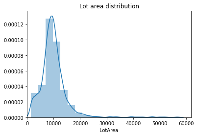

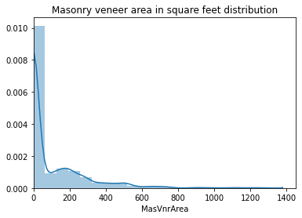

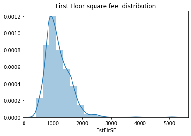

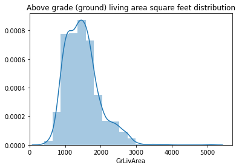

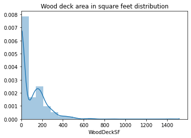

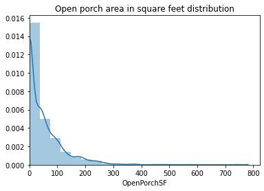

From the previous charts we determine the cut-off points from which the data will be truncated: 30,000 square feet for *LotArea*, 600 for *MasVnrArea*, 3,000 for *FstFlrSF*, 3,000 for *GrLivArea*, 600 for *WoodDeckSF* and 300 for *OpenPorchSF*.

We also check for houses that say they have something (like a basement) but its size is 0, or the other way around. The pairs checked are:

- no basement and BsmtFinSF1
- no basement and BsmtFinSF2
- no basement and BsmtUnfSF
- Fireplaces and FireplaceQu

## 3. Descriptive analysis

### 3.1 Sales distribution

> **In this section** we look at how the sale price is distributed, with a histogram and with a QQ plot (a chart that compares the real data against a perfect normal distribution: the closer the points are to the 45 degree line, the more normal the data is).

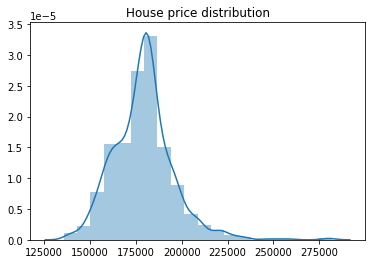

Good news: the sale price (the variable we predict) looks quite close to a normal distribution (the classic bell curve). This helps, because linear regression assumes that its errors follow a normal distribution with mean zero and constant variance.

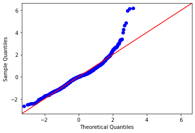

*The horizontal axis is the value expected under a normal distribution and the vertical axis is the value observed in the data, both standardized.*

However, the QQ plot shows that the sale price leans slightly to the right (a few very expensive houses), with 7 points above what a normal distribution would expect. It is better to remove those houses if they end up in the training set.

### 3.2 Correlation analysis - between the independent variables

> **In this section** we compute the correlation between every pair of explanatory variables and print the pairs above 0.8 (in absolute value). Three pairs appear, and the crosstabs below confirm that in each pair the two variables carry almost the same information. The full correlation matrix is plotted as a heat map afterwards.

Correlation is useful, but it only measures straight-line (linear) relationships. A correlation near zero does not prove that two variables are unrelated: they could be linked in a curved way that correlation misses.

**Output (pairs of variables with a correlation above 0.8):**

```text
Fireplaces      FireplaceQu    0.860074
FireplaceQu     Fireplaces     0.860074
GarageCars      GarageArea     0.897022
GarageArea      GarageCars     0.897022
GarageQual      GarageCond     0.933789
GarageCond      GarageQual     0.933789
```

**Output (fireplace quality by number of fireplaces):**

| FireplaceQu / Fireplaces |   0 |   1 |  2 |  3 |  4 |
|:-------------------------|----:|----:|---:|---:|---:|
| 0                        | 730 |   0 |  0 |  0 |  0 |
| 1                        |   0 |  26 |  0 |  0 |  0 |
| 2                        |   0 |  35 |  6 |  0 |  0 |
| 3                        |   0 | 236 | 39 |  3 |  1 |
| 4                        |   0 | 303 | 58 |  3 |  0 |
| 5                        |   0 |  18 |  1 |  0 |  0 |

**Output (garage quality by garage condition):**

| GarageQual / GarageCond |  0 |  1 |  2 |    3 |  4 |  5 |
|:------------------------|---:|---:|---:|-----:|---:|---:|
| 0                       | 78 |  0 |  0 |    0 |  0 |  0 |
| 1                       |  0 |  1 |  1 |    0 |  0 |  0 |
| 2                       |  0 |  4 | 19 |   53 |  0 |  0 |
| 3                       |  0 |  2 | 19 | 1268 |  4 |  0 |
| 4                       |  0 |  0 |  0 |    7 |  2 |  1 |

Main conclusions from the correlations:

- As expected, *GarageCars* (garage size in cars) and *GarageArea* (garage size in square feet) are highly correlated, so *GarageCars* was deleted.
- *Fireplaces* (number of fireplaces) and *FireplaceQu* (fireplace quality) are highly correlated. *Fireplaces* was deleted, because quality matters more than quantity (a fireplace can be in poor condition), and most houses have one or zero fireplaces anyway.
- Also as expected, *GarageQual* (garage quality) and *GarageCond* (garage condition) are highly correlated. *GarageCond* was deleted, because *GarageQual* varies more between houses, so it carries more information.

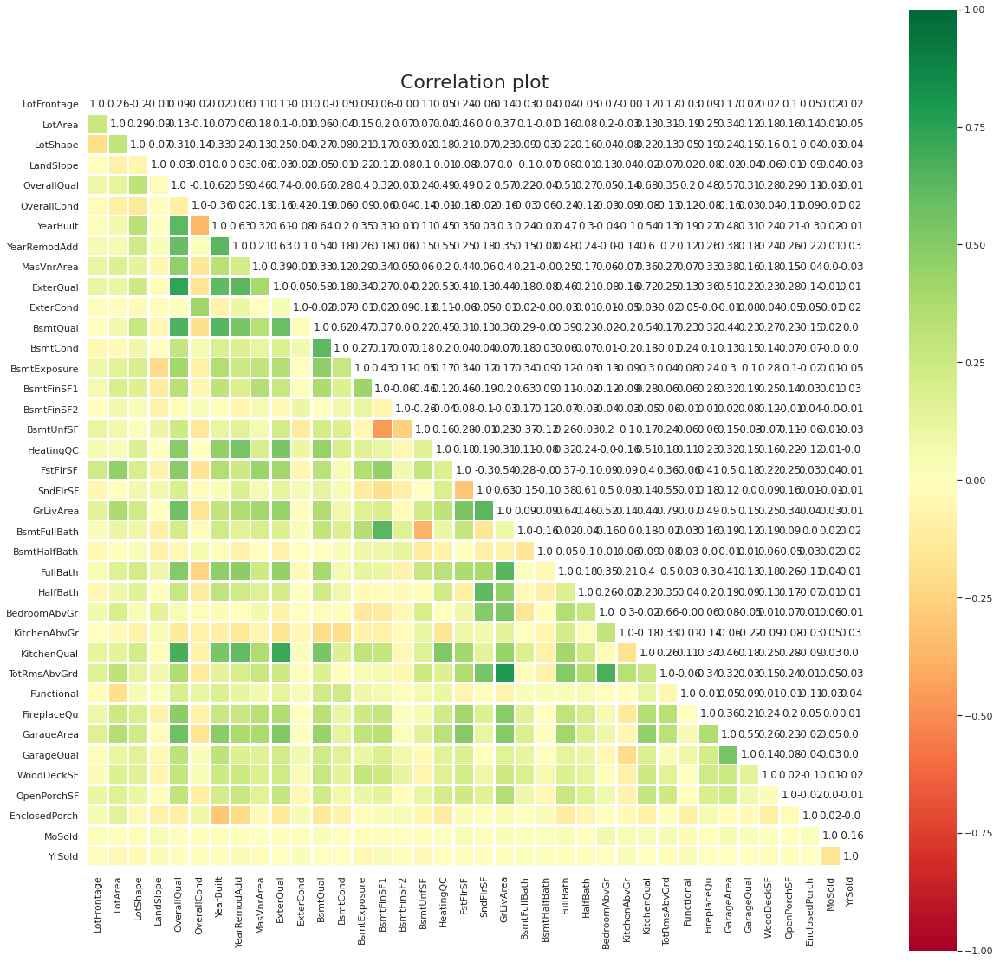

Some variables are clearly correlated with others:

- *OverallQual* (overall quality) goes up together with the year the house was built or remodelled (*YearRemodAdd*) and with the quality of the kitchen (*KitchenQual*), the exterior (*ExterQual*) and the basement (*BsmtQual*). So, to raise a house's overall quality, a remodel focused on the kitchen, the basement or the exterior is a good idea. Also, houses with good overall quality tend to have a good kitchen, exterior and basement too (and the other way around).
- Basement condition goes up together with basement quality.
- Garage quality goes up together with garage area.

### 3.3 Correlation with the sale price - numerical variables

> **In this section** we join the characteristics with the sale price and sort the numeric variables by their correlation with it, grouping them in four bands (high above 0.7, moderate between 0.4 and 0.7, low between 0.2 and 0.4, very low below 0.2). We also plot the average sale price by month of sale, and the variables with a very low correlation are plotted one by one against the sale price to decide whether to keep them.

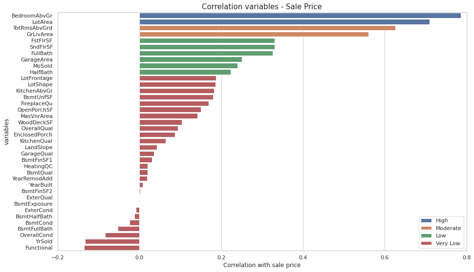

The sale price is highly correlated with the number of bedrooms above the basement and with the lot size, and these two are not correlated with each other. So both should play a key role in the final model. In plain words: to raise a house's price, add bedrooms or buy more land.

The sale price is moderately correlated with *GrLivArea* (living area above ground, in square feet) and *TotRmsAbvGrd* (rooms above ground, not counting bathrooms). But these two carry almost the same information, so probably only one of them will matter in the model.

Variables with a very low correlation with the sale price need a closer look, to decide whether to delete them.

A negative correlation between home functionality (*Functional*) and the sale price makes no sense (a more functional house should not be cheaper). The same happens with *OverallCond* (the overall condition of the house). So both variables were deleted.

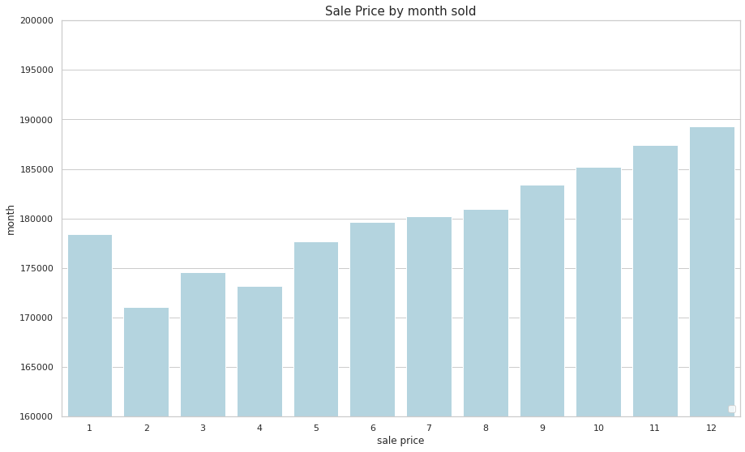

*The horizontal axis is the month the house was sold (1 = January to 12 = December) and the vertical axis is the average sale price in USD. The axis labels on the chart are swapped.*

Houses sold from February to April are, on average, cheaper than those sold from May to August. After that, prices rise again until December.

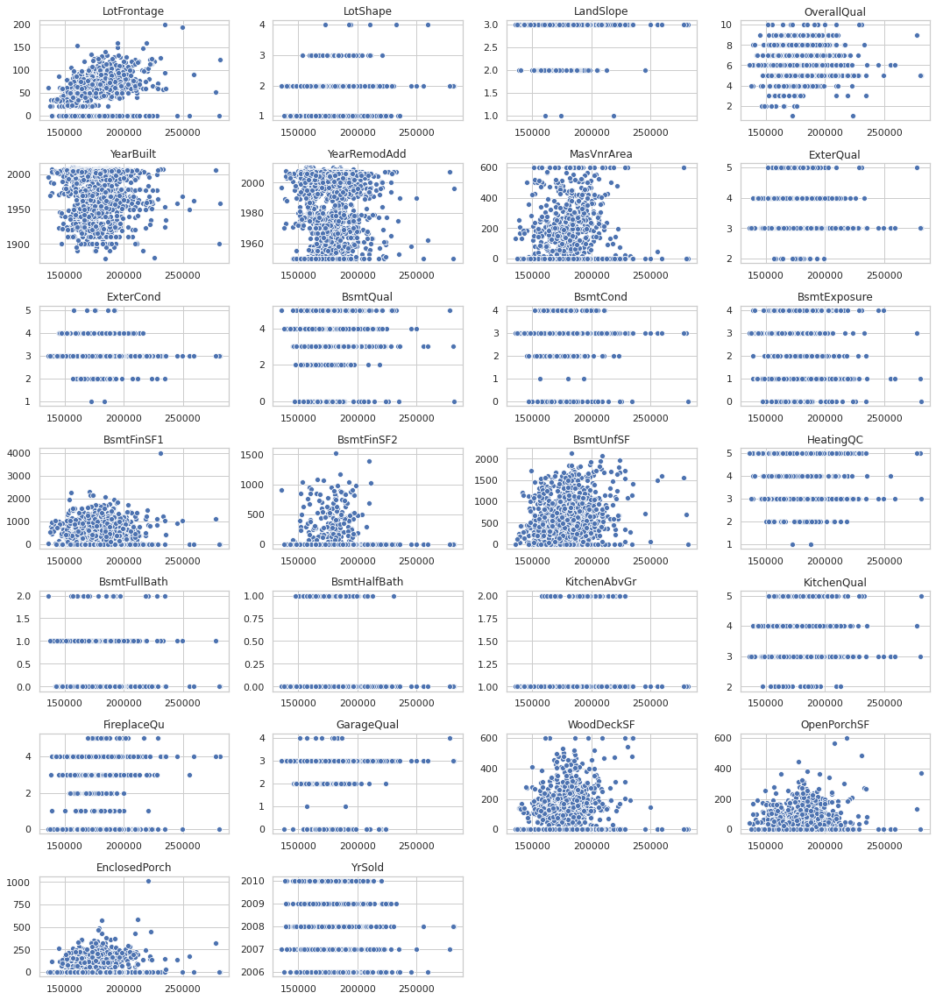

*Each small chart puts the sale price on the horizontal axis and one variable on the vertical axis.*

These variables have a very weak relationship with the sale price (the target: the value we want to predict), so they were deleted:

- YearBuilt, YearRemodAdd, MasVnrArea, BsmtQual, BsmtExposure, BsmtFinSF1, BsmtFinSF2, BsmtUnfSF, BsmtHalfBath, WoodDeckSF, OpenPorchSF, YrSold.

For these other variables the relationship does make some sense, so they were kept. Their correlation may look low partly because missing things were filled with 0 (for example, a house with no basement gets 0):

- LotFrontage, LotShape, LandSlope, OverallQual, ExterQual, ExterCond, BsmtCond, HeatingQC, BsmtFullBath, KitchenAbvGr, KitchenQual, FireplaceQu, GarageQual.

### 3.4 Relations with the sale price - categorical variables

> **In this section** we compare the average sale price of each category of the remaining 24 categorical variables, together with the number of houses in each category, because an average built on very few houses is not reliable. The neighbourhoods are also grouped into four socioeconomic levels according to their average price.

**Output (summary of the categorical variables that reach this point):**

| Variable      |   count |   unique | top      |   freq |
|:--------------|--------:|---------:|:---------|-------:|
| MSZoning      |    1459 |        4 | RL       |   1114 |
| Alley         |    1459 |        3 | No       |   1352 |
| LandContour   |    1459 |        4 | Lvl      |   1311 |
| LotConfig     |    1459 |        4 | Inside   |   1081 |
| Neighborhood  |    1459 |       17 | NAmes    |    218 |
| Condition1    |    1459 |        5 | Norm     |   1251 |
| BldgType      |    1459 |        5 | 1Fam     |   1205 |
| HouseStyle    |    1459 |        5 | 1Story   |    750 |
| RoofStyle     |    1459 |        3 | Gable    |   1169 |
| Exterior1st   |    1459 |        8 | VinylSd  |    510 |
| Exterior2nd   |    1459 |        8 | VinylSd  |    510 |
| MasVnrType    |    1459 |        3 | None     |    894 |
| Foundation    |    1459 |        4 | PConc    |    661 |
| BsmtFinType1  |    1459 |        7 | GLQ      |    431 |
| BsmtFinType2  |    1459 |        5 | Unf      |   1238 |
| CentralAir    |    1459 |        2 | Y        |   1358 |
| Electrical    |    1459 |        2 | SBrkr    |   1337 |
| GarageType    |    1459 |        5 | Attchd   |    853 |
| GarageFinish  |    1459 |        4 | Unf      |    625 |
| PavedDrive    |    1459 |        3 | Y        |   1301 |
| Fence         |    1459 |        4 | No       |   1169 |
| MiscFeature   |    1459 |        2 | No       |   1413 |
| SaleType      |    1459 |        4 | Warranty |   1271 |
| SaleCondition |    1459 |        4 | Normal   |   1204 |

**Output (average sale price in USD by zoning classification):**

| MSZoning |     mean |   count |
|:---------|---------:|--------:|
| RL       | 181911.0 |    1114 |
| Other    | 177579.0 |      29 |
| RM       | 170408.0 |     242 |
| FV       | 167461.0 |      74 |

Floating Village Residential and Residential Medium Density houses have lower prices than Residential Low Density houses.

Houses with a paved alley cost on average 13,000 USD less than houses with no alley or a gravel alley. (The table of average price by alley type was saved in a variable but never printed, so it is not shown here.)

**Output (average sale price in USD by land contour):**

| LandContour |     mean |   count |
|:------------|---------:|--------:|
| Low         | 187350.0 |      24 |
| Bnk         | 181791.0 |      54 |
| Lvl         | 179043.0 |    1311 |
| HLS         | 177008.0 |      70 |

Houses on low ground (a depression) are worth more than those on other land contours, but there are only 24 of them, so this result is not very reliable.

**Output (average sale price in USD by lot configuration):**

| LotConfig |     mean |   count |
|:----------|---------:|--------:|
| CulDSac   | 187930.0 |      82 |
| Corner    | 180226.0 |     248 |
| FR23      | 180150.0 |      48 |
| Inside    | 178239.0 |    1081 |

Houses on a cul-de-sac (a dead-end street) are worth about 8,000 USD more.

Neighbourhoods were grouped into 4 socioeconomic levels, based on their house prices:

- Rich
- Medium-rich
- Medium-poor
- Poor

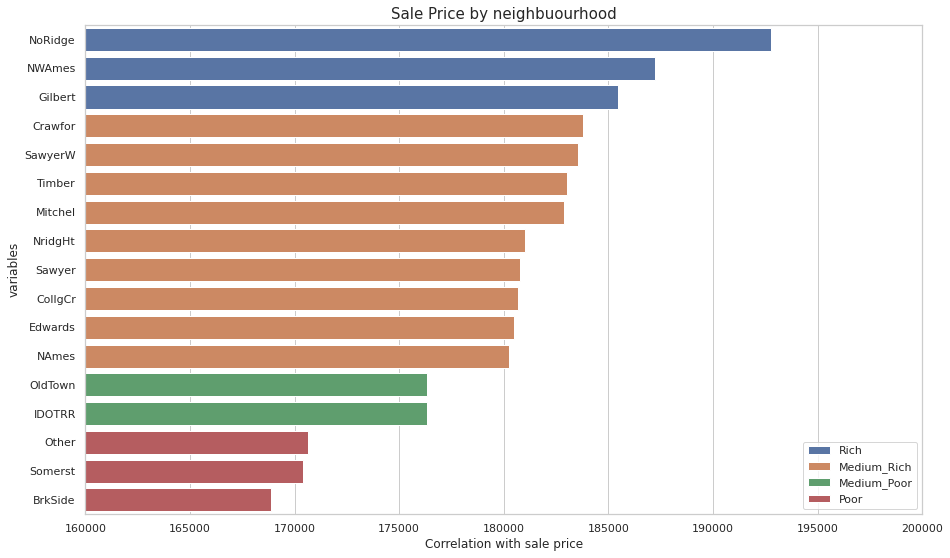

*The bars are the average sale price in USD of each neighbourhood, coloured by socioeconomic level. The horizontal axis label on the chart is wrong: it shows the average price, not a correlation.*

**Output (average sale price in USD by proximity to main road or railroad):**

| Condition1 |     mean |   count |
|:-----------|---------:|--------:|
| Pos        | 188281.0 |      32 |
| RRN        | 183024.0 |      49 |
| Feedr      | 181305.0 |      83 |
| Artery     | 180984.0 |      44 |
| Norm       | 178597.0 |    1251 |

Houses near something positive (like a park) are worth more. Surprisingly, houses close to the railroad are also worth more than normal ones.

**Output (average sale price in USD by type of dwelling):**

| BldgType |     mean |   count |
|:---------|---------:|--------:|
| Duplex   | 193805.0 |      57 |
| 2fmCon   | 184665.0 |      31 |
| 1Fam     | 181252.0 |    1205 |
| Twnhs    | 158204.0 |      53 |
| TwnhsE   | 158097.0 |     113 |

Duplexes sold for more than other houses, and townhouses for less.

**Output (average sale price in USD by house style):**

| HouseStyle |     mean |   count |
|:-----------|---------:|--------:|
| 2Story     | 184583.0 |     440 |
| SLvl       | 181484.0 |      63 |
| 1.5Fin     | 179307.0 |     160 |
| 1Story     | 176418.0 |     750 |
| SFoyer     | 169055.0 |      46 |

Houses with two or more stories are worth more, and split foyer houses are worth less.

**Output (average sale price in USD by roof style):**

| RoofStyle |     mean |   count |
|:----------|---------:|--------:|
| Hip       | 182878.0 |     265 |
| Other     | 181411.0 |      25 |
| Gable     | 178299.0 |    1169 |

Houses with a hip roof are worth more than those with a gable roof.

**Output (average sale price in USD by exterior covering):**

| Exterior1st |     mean |   count |
|:------------|---------:|--------:|
| Brick       | 184922.0 |      41 |
| Plywood     | 183028.0 |     113 |
| HdBoard     | 180746.0 |     220 |
| VinylSd     | 180435.0 |     510 |
| Wood        | 179441.0 |     235 |
| Other       | 174890.0 |      45 |
| MetalSd     | 174584.0 |     230 |
| CemntBd     | 172096.0 |      65 |

Houses covered with brick or plywood are worth more, and those covered with cement board or metal siding are worth less.

**Output (average sale price in USD by masonry veneer type):**

| MasVnrType |     mean |   count |
|:-----------|---------:|--------:|
| Brick      | 182038.0 |     444 |
| Stone      | 178447.0 |     121 |
| None       | 177866.0 |     894 |

Houses with a brick masonry veneer (a decorative brick layer on the walls) are worth more.

**Output (average sale price in USD by central air conditioning):**

| CentralAir |     mean |   count |
|:-----------|---------:|--------:|
| Y          | 179506.0 |    1358 |
| N          | 174849.0 |     101 |

Houses with central air conditioning are worth more than those without it.

**Output (average sale price in USD by electrical system):**

| Electrical |     mean |   count |
|:-----------|---------:|--------:|
| SBrkr      | 179448.0 |    1337 |
| Fuse       | 176286.0 |     122 |

Houses with an old fuse-based electrical system are worth less than those with standard circuit breakers (Romex).

**Output (average sale price in USD by garage type):**

| GarageType |     mean |   count |
|:-----------|---------:|--------:|
| BuiltIn    | 189212.0 |      98 |
| Other      | 182824.0 |      40 |
| Attchd     | 179679.0 |     853 |
| No         | 177893.0 |      76 |
| Detchd     | 175478.0 |     392 |

Houses with a built-in garage (part of the house, usually with a room above it) are worth more, and houses with a detached garage are worth less.

**Output (average sale price in USD by paved driveway):**

| PavedDrive |     mean |   count |
|:-----------|---------:|--------:|
| Y          | 179476.0 |    1301 |
| P          | 179251.0 |      32 |
| N          | 176147.0 |     126 |

Houses without a paved driveway are worth less.

**Output (average sale price in USD by miscellaneous feature):**

| MiscFeature |     mean |   count |
|:------------|---------:|--------:|
| Shed        | 185340.0 |      46 |
| No          | 178984.0 |    1413 |

Houses with a shed are worth more.

**Output (average sale price in USD by type of sale):**

| SaleType |     mean |   count |
|:---------|---------:|--------:|
| New      | 181332.0 |     117 |
| Warranty | 179143.0 |    1271 |
| COD      | 177989.0 |      44 |
| Contract | 173727.0 |      27 |

New houses sold for more, and houses sold by contract sold for less.

## 4. Regression analysis

### 4.1 Basic preprocessing

> **In this section** we prepare the data for the model: every remaining text variable becomes a set of 0/1 columns (one per category, dropping the first one so there is no redundancy), the data is split into training and test sets (80% / 20%), the seven most expensive houses of the training set are removed, and all the columns are standardized (each value minus the average, divided by the standard deviation) so that variables measured in different units weigh the same.

The data was split into two separate groups (no house is in both):

- **Train**: the houses the model learns from.
- **Test**: houses kept aside to check how well the model works on houses it has never seen.

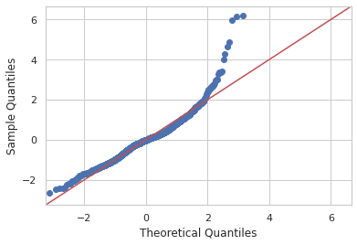

Atypical houses (sale price above 245,000 USD) were removed from the training set.

**Output (ten most expensive houses of the training set):**

| Id   |   SalePrice |
|:-----|------------:|
| 2189 |  281643.98 |
| 2251 |  280618.13 |
| 2264 |  277936.13 |
| 2797 |  259423.86 |
| 1948 |  255629.49 |
| 2265 |  249768.28 |
| 2901 |  245283.20 |
| 2823 |  235419.37 |
| 2600 |  234707.21 |
| 2754 |  234492.25 |

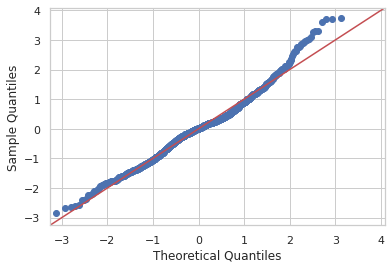

The sale price now looks much closer to a **normal distribution** than before.

### 4.2 Baseline

> **In this section** we build the baseline, the simplest possible prediction: giving every house of the test set the average price of the training set. Any model has to beat this. The errors are the Mean Absolute Error (the average size of the mistake, in USD), the Mean Squared Error (the average of the squared mistakes, which punishes the big ones) and its square root.

To know if a model is good, we compare it with a baseline: a very simple prediction that any useful model must beat. Here the baseline gives every house the average price of the training set.

**Output (baseline):**

```text
Base: 178777.25
Mean Absolute Error: 12817.26
Mean Squared Error: 280169188.19
Root Mean Squared Error: 16738.26
```

### 4.3 Linear regression techniques

1. **Simple Linear Regression**: finds the formula that makes the RSS (Residual Sum of Squares: the sum of the squared mistakes) as small as possible.
2. **Ridge Regression**: the same, plus a penalty for big weights (the sum of the squared coefficients). This keeps the coefficients small.
3. **Lasso Regression**: the same idea, but the penalty is the sum of the absolute values of the coefficients. This can push some coefficients to exactly zero, which removes those variables.

Ridge and lasso punish a model that leans on too many variables. That helps avoid overfitting (great results on the training data, poor results on new data), so these two are the ones used here.

#### 4.3.1 Ridge regression

> **In this section** we search the best penalty strength (alpha) for the ridge regression with a grid search and 5 fold cross validation (the training data is split in five parts, the model is trained five times and each part is used once to check it), and then we measure the errors in the test set and in the training set.

**Output (ridge regression, test set):**

```text
Mean Absolute Error: 1210.08
Mean Squared Error: 4075012.77
Root Mean Squared Error: 2018.67
```

**Output (ridge regression, training set):**

```text
Mean Absolute Error: 956.54
Mean Squared Error: 1659589.63
Root Mean Squared Error: 1288.25
```

**Output (best parameters):**

```text
{'alpha': 1.83, 'fit_intercept': True}
```

#### 4.3.2 Lasso regression

> **In this section** we repeat the same search for the lasso regression, with 3 fold cross validation, and we also compute the ratio between the test error and the training error, which shows how much the model gets worse on data it has never seen.

**Output (lasso regression, test set):**

```text
Mean Absolute Error: 1157.62
Mean Squared Error: 3870212.04
Root Mean Squared Error: 1967.29
```

**Output (lasso regression, training set):**

```text
Mean Absolute Error: 988.48
Mean Squared Error: 1857951.53
Root Mean Squared Error: 1363.07
```

**Output (best parameters):**

```text
{'alpha': 60.804020100502505, 'fit_intercept': True}
```

Lasso has the smallest error on the test set (houses the model never saw), and the smallest gap between its training and test errors. A small gap means less overfitting: the model learned general patterns instead of memorizing the training houses. So lasso was chosen for this data.

| Result in test set | Ridge | Lasso |
|--|--|--|
| Mean Absolute Error | 1210 | **1157** |
| Root Mean Squared Error | 2018 | **1967** |

Another plus of lasso: when a variable barely helps, lasso sets its coefficient (its weight in the formula) to zero, which removes it from the model and keeps the model simple.

**Output (ratio between test and training results):**

```text
Mean Absolute Error: 1.17
Root Mean Squared Error: 1.44
```

On the test set, the Mean Absolute Error (MAE) is 17% worse than on the training set. The Root Mean Squared Error (RMSE) is 44% worse, but the RMSE is more sensitive to a few big mistakes (outliers).

**Output (variables kept by the lasso, with their coefficients):**

| Columns              |   coefficients |
|:---------------------|---------------:|
| LotFrontage          |      28.472497 |
| LotArea              |    7981.662150 |
| ExterQual            |     -31.131587 |
| ExterCond            |     -11.313681 |
| BsmtCond             |     -30.046489 |
| BsmtFullBath         |     -32.388232 |
| BedroomAbvGr         |   10619.207556 |
| TotRmsAbvGrd         |      95.363553 |
| FireplaceQu          |     -19.813525 |
| MoSold               |    3071.143628 |
| Neighborhood_Mitchel |      14.519903 |
| BldgType_Twnhs       |       6.451782 |
| Exterior2nd_VinylSd  |      -6.231214 |
| MasVnrType_Stone     |     -12.136795 |
| Foundation_CBlock    |      10.754260 |
| BsmtFinType1_GLQ     |     -17.273508 |
| GarageType_Other     |      81.688189 |
| GarageFinish_RFn     |      33.069807 |
| SaleType_Contract    |     -60.013675 |
| SaleType_New         |     130.817815 |

Some variables were deleted because their effect in the model was not the expected one (it made no sense):

- BsmtCond
- ExterQual
- ExterCond
- FireplaceQu
- BsmtFinType1_GLQ
- GarageFinish_RFn

#### 4.3.3 Lasso regression - version 2

> **In this section** we train the lasso again with only the variables that behave as expected. *TotRmsAbvGrd* is also dropped because it is highly correlated with *BedroomAbvGr*, and the VIF (variance inflation factor, a number that says how much a variable can be explained by the others: above 10 means trouble) confirms that the remaining 13 variables are not redundant. The whole preparation is repeated with this reduced set (split, removal of the seven most expensive houses, standardization) and the errors are measured again.

**Output (first rows of the reduced set of variables):**

|   Id |   LotFrontage |   LotArea |   BsmtFullBath |   BedroomAbvGr |   TotRmsAbvGrd |   MoSold |   Neighborhood_Mitchel |   BldgType_Twnhs |   Exterior2nd_VinylSd |   MasVnrType_Stone |   Foundation_CBlock |   GarageType_Other |   SaleType_Contract |   SaleType_New |
|-----:|--------------:|----------:|---------------:|---------------:|---------------:|---------:|-----------------------:|-----------------:|----------------------:|-------------------:|--------------------:|-------------------:|--------------------:|---------------:|
| 1461 |            80 |     11622 |              0 |              2 |              5 |        6 |                      0 |                0 |                     1 |                  0 |                   1 |                  0 |                   0 |              0 |
| 1462 |            81 |     14267 |              0 |              3 |              6 |        6 |                      0 |                0 |                     0 |                  0 |                   1 |                  0 |                   0 |              0 |
| 1463 |            74 |     13830 |              0 |              3 |              6 |        3 |                      0 |                0 |                     1 |                  0 |                   0 |                  0 |                   0 |              0 |
| 1464 |            78 |      9978 |              0 |              3 |              7 |        6 |                      0 |                0 |                     1 |                  0 |                   0 |                  0 |                   0 |              0 |
| 1465 |            43 |      5005 |              0 |              2 |              5 |        1 |                      0 |                0 |                     0 |                  0 |                   0 |                  0 |                   0 |              0 |

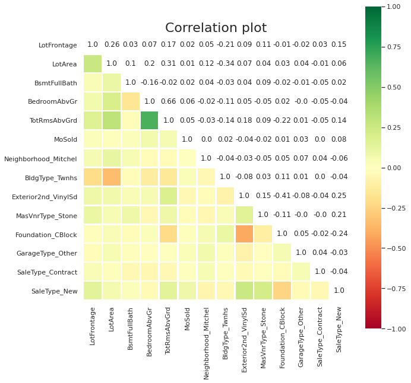

*BedroomAbvGr* and *TotRmsAbvGrd* are highly correlated, and *Exterior2nd_VinylSd* and *Foundation_CBlock* moderately so; the rest have low correlations. So *TotRmsAbvGrd* was deleted, and there is little or no **multicollinearity** left (variables repeating each other's information).

The VIF values confirm it: they are all below 10 (above 10 would signal a problem).

**Output (VIF of the 13 variables of the model):**

```text
LotFrontage           4.48    MasVnrType_Stone     1.18
LotArea               7.21    Foundation_CBlock    2.08
BsmtFullBath          1.69    GarageType_Other     1.04
BedroomAbvGr          8.86    SaleType_Contract    1.03
MoSold                5.22    SaleType_New         1.27
Neighborhood_Mitchel  1.08
BldgType_Twnhs        1.16
Exterior2nd_VinylSd   1.92
```

**Output (lasso version 2, test set):**

```text
Mean Absolute Error: 1162.47
Mean Squared Error: 3901580.90
Root Mean Squared Error: 1975.24
```

**Output (best parameters):**

```text
{'alpha': 34.67336683417085, 'fit_intercept': True}
```

> **In this section** we also check the two assumptions of the linear regression: that the residuals (the difference between the predicted price and the real price) have mean zero, and that they do not grow with the price of the house (heteroscedasticity).

The residuals (real price minus predicted price) have a mean of zero.

There is no heteroscedasticity: the size of the mistakes does not grow with the price of the house.

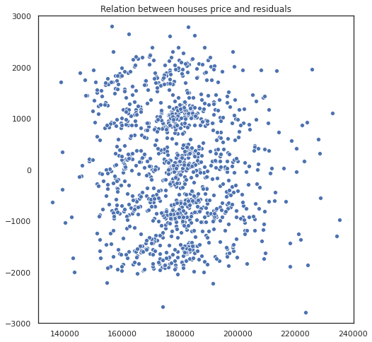

*The horizontal axis is the real sale price in USD of the training houses and the vertical axis is the residual in USD.*

**Output (coefficients of the final model, on standardized data):**

| Columns              |   coefficients |
|:---------------------|---------------:|
| LotFrontage          |      74.062884 |
| LotArea              |    8034.763189 |
| BsmtFullBath         |     -78.691169 |
| BedroomAbvGr         |   10709.981605 |
| MoSold               |    3095.407213 |
| Neighborhood_Mitchel |      49.795227 |
| BldgType_Twnhs       |      65.610204 |
| Exterior2nd_VinylSd  |     -55.512537 |
| MasVnrType_Stone     |     -54.946391 |
| Foundation_CBlock    |      17.273763 |
| GarageType_Other     |     119.616335 |
| SaleType_Contract    |     -98.123995 |
| SaleType_New         |     182.917556 |

Now every coefficient goes in a direction that makes sense, and the model meets the assumptions of linear regression, so we can draw conclusions from it.

First, the model beats the baseline (giving every house the average price) by far. Its Mean Absolute Error (MAE) is 1,162 USD: on average it misses a house's price by 1,162 USD, against 12,817 USD for the baseline. With an average price of 178,777 USD, that is a very good estimate.

Second, the factors that influence the sale price of a house are:

- **LotFrontage**: Linear feet of street connected to property
- **LotArea**: Lot size in square feet
- **BsmtFullBath**: Basement full bathrooms
- **BedroomAbvGr**: Number of bedrooms above basement level
- **MoSold**: Month Sold
- **Neighborhood**: Physical locations
- **BldgType**: Type of dwelling
- **Exterior2nd**: Exterior covering on house (if more than one material)
- **MasVnrType**: Masonry veneer type
- **Foundation**: Type of foundation
- **GarageType**: Garage location
- **SaleType**: Type of sale

The data was standardized (each column divided by its standard deviation), so the coefficients are measured in "standard deviations". To read them in real units (USD per square foot, per bedroom...), each coefficient is divided by its variable's standard deviation.

**Output (coefficients brought back to their real unit):**

| Columns              |   coefficients |   standard_deviation |   coefficients_unit |
|:---------------------|---------------:|---------------------:|--------------------:|
| LotFrontage          |      74.062884 |            32.266054 |            2.295381 |
| LotArea              |    8034.763189 |          4285.465336 |            1.874887 |
| BsmtFullBath         |     -78.691169 |             0.527849 |         -149.078979 |
| BedroomAbvGr         |   10709.981605 |             0.829788 |        12906.883352 |
| MoSold               |    3095.407213 |             2.722432 |         1137.000786 |
| Neighborhood_Mitchel |      49.795227 |             0.206387 |          241.271518 |
| BldgType_Twnhs       |      65.610204 |             0.187165 |          350.547764 |
| Exterior2nd_VinylSd  |     -55.512537 |             0.476993 |         -116.380251 |
| MasVnrType_Stone     |     -54.946391 |             0.275876 |         -199.170419 |
| Foundation_CBlock    |      17.273763 |             0.492351 |           35.084273 |
| GarageType_Other     |     119.616335 |             0.163348 |          732.277529 |
| SaleType_Contract    |     -98.123995 |             0.134818 |         -727.827126 |
| SaleType_New         |     182.917556 |             0.271683 |          673.275188 |

How to read each coefficient ($\beta_{k}$): it is how much the price changes when that variable goes up by one unit, **while all the other variables stay the same**:

- **LotFrontage**: each extra foot of street touching the property adds 2.29 USD to the price.
- **LotArea**: each extra square foot of land adds 1.87 USD.
- **BsmtFullBath**: each full bathroom in the basement lowers the price by 149.08 USD. A possible reason: a house with more bathrooms in the basement has fewer in the rest of the house, and a basement bathroom is less comfortable.
- **BedroomAbvGr**: each extra bedroom above the basement adds 12,906.88 USD.
- **Neighborhood**: a house in Mitchel is worth 241.27 USD more than in the other neighbourhoods.
- **BldgType**: a townhouse is worth 350.55 USD more than other types of dwelling.
- **Exterior2nd**: if the second exterior covering (when there is more than one material) is vinyl siding, the price drops by 116.38 USD compared with other coverings.
- **MasVnrType**: a stone masonry veneer (a decorative stone layer on the walls) lowers the price by 199.17 USD compared with other types.
- **Foundation**: a cinder block foundation adds 35.08 USD compared with other foundations.
- **GarageType**: a garage in the basement, a car port, or more than one type of garage adds 732.28 USD.
- **SaleType**: a sale by contract lowers the price by 727.83 USD, and a brand-new house adds 673.28 USD (both compared with warranty, court and other sales).
- **MoSold**: for each month later in the year (January = 1 to December = 12), the price goes up by 1,137 USD on average. Prices follow supply and demand, so months with more buyers bring higher prices.

The model meets the main assumptions of linear regression.

### 4.4 Other regression techniques

#### 4.4.1 Random forest regressor

> **In this section** we try a random forest (many decision trees whose predictions are averaged) on the same 13 variables, searching 500 random combinations of its settings.

**Output (random forest, test set):**

```text
Mean Absolute Error: 1788.23
Mean Squared Error: 9477577.89
Root Mean Squared Error: 3078.57
```

**Output (best parameters):**

```text
{'max_depth': 9, 'max_leaf_nodes': 59, 'n_estimators': 350}
```

#### 4.4.2 XGBoost

> **In this section** we try a gradient boosting model (trees built one after another, each one correcting the mistakes of the previous ones), also with 500 random combinations of its settings.

**Output (XGBoost, test set):**

```text
Mean Absolute Error: 1417.46
Mean Squared Error: 6512115.98
Root Mean Squared Error: 2551.88
```

Other models (Random Forest and XGBoost) were also tested, but they did worse than lasso.

## Appendix: Python code

The code below is the same as in [`analysis.py`](analysis.py), grouped by the sections of this report. The only difference: here the file paths still point to the original Google Drive folder, while `analysis.py` reads from `data/`. The two lines that only work in Google Colab are commented out.

### A.1 Introduction

```python
"""House price regression analysis.

What this script does, step by step:
1. Reads an Excel file with two sheets: the price each house was sold for,
   and the characteristics of each house (size, rooms, quality, year...).
2. Cleans the data: fills the empty cells, joins the categories that have
   very few houses, fixes impossible years and cuts the extreme values.
3. Looks at the data: how the price is distributed and which characteristics
   move together with the price.
4. Fits several regression models and keeps the best one (Lasso), which tells
   us which characteristics really influence the sale price.

A regression is just a formula that predicts a number (here, the price of a
house) out of other numbers (its characteristics).

Run it from the folder that contains the Data folder.
"""

# %% Libraries
import warnings
warnings.filterwarnings("ignore")
from statsmodels.stats.outliers_influence import variance_inflation_factor
from xgboost import XGBRegressor
import pandas as pd
import numpy as np
import seaborn as sns
from matplotlib.colors import ListedColormap
import matplotlib.pyplot as plt
import statsmodels.api as sm
import pylab as py
from sklearn import linear_model
import os
import pickle

from sklearn.linear_model import LinearRegression
from sklearn.ensemble import RandomForestRegressor
from sklearn.model_selection import cross_val_score, train_test_split
from sklearn.metrics import mean_squared_error as MSE
from sklearn import preprocessing, metrics
from sklearn.preprocessing import StandardScaler
from sklearn.model_selection import GridSearchCV, RandomizedSearchCV

# The two lines below only work inside Google Colab, where the data lived in a
# Google Drive folder. They are commented out so the script runs anywhere.
# from google.colab import drive
# drive.mount('/content/gdrive')
```

### A.2 Data management

```python
# %% Read the two sheets of the Excel file
# y = what we want to predict (the sale price of each house).
# X = the characteristics of each house. Both are joined by the house Id.
path = r'gdrive/My Drive/gamblingCompany/Data/'  # path
#path = 'Data/' # path
y = pd.read_excel(path+'Dataset_regression analysis.xlsx',
                  index_col='Id',
                  sheet_name='SalePrice (Y var)')

X = pd.read_excel(path+'Dataset_regression analysis.xlsx',
                  index_col='Id',
                  sheet_name='Dataset house caracteristics')

# %%
print(X.head())
# shape = (number of houses, number of variables)
print(X.shape)

# %% Summary of the text (categorical) variables
# count = how many houses have a value, unique = how many different values,
# top = the most repeated value, freq = how many times the top value appears.
# The difference between count and the total number of houses is the number of
# empty cells (missing values) we have to deal with.
descriptive_table = X.describe(include='all').round(decimals=3)
description_object = descriptive_table.loc[['count', 'unique', 'top', 'freq']]
description_object.dropna(axis=1, thresh=None, inplace=True)
print(description_object)

# %% Delete columns that cannot help
# A variable where almost every house has the same value says nothing about the
# price, and a variable that is almost always empty cannot be used either.
X.drop(columns=['Utilities', 'Street', 'Condition2', 'RoofMatl', 'Heating', 'PoolQC'], inplace=True)

# %% Replace the missing values of the text variables
# In most of them an empty cell means "the house does not have it" (no alley,
# no basement, no fireplace, no garage, no fence), so we fill it with a "No"
# category. When the value is simply unknown we use the most typical value or
# an "Other" category.
X['Alley'] = X['Alley'].fillna('No')  # NA = no alley access
print(X['Alley'].value_counts())

# %%
# MSZoning: Identifies the general zoning classification of the sale.
X['MSZoning'] = X['MSZoning'].fillna('Other')
print(X['MSZoning'].value_counts())

# %%
X['Exterior1st'] = X['Exterior1st'].fillna('Other')
print(X['Exterior1st'].value_counts())

# %%
X['Exterior2nd'] = X['Exterior2nd'].fillna('Other')
print(X['Exterior2nd'].value_counts())

# %%
X['MasVnrType'] = X['MasVnrType'].fillna('None')
print(X['MasVnrType'].value_counts())

# %%
X['BsmtQual'] = X['BsmtQual'].fillna('No')  # No basement
print(X['BsmtQual'].value_counts())

# %%
X['BsmtCond'] = X['BsmtCond'].fillna('No')  # NA = No basement
print(X['BsmtCond'].value_counts())

# %%
X['BsmtExposure'] = X['BsmtExposure'].fillna('Nb')  # No basement
print(X['BsmtExposure'].value_counts())

# %%
X['BsmtFinType1'] = X['BsmtFinType1'].fillna('Nb')  # No basement
print(X['BsmtFinType1'].value_counts())

# %%
X['BsmtFinType2'] = X['BsmtFinType2'].fillna('Nb')  # No basement
print(X['BsmtFinType2'].value_counts())

# %%
# there is one house without kitchen quality data: it does have a kitchen,
# so the value is unknown, not absent.
print(X[X.KitchenQual.isna()].KitchenAbvGr)

# %%
X['KitchenQual'] = X['KitchenQual'].fillna('TA')  # average value
print(X['KitchenQual'].value_counts())

# %%
# Functional: Home functionality (Assume typical unless deductions are warranted)
X['Functional'] = X['Functional'].fillna('Typ')  # average value
print(X['Functional'].value_counts())

# %%
X['FireplaceQu'] = X['FireplaceQu'].fillna('No')  # no fireplace
print(X['FireplaceQu'].value_counts())

# %%
X['GarageType'] = X['GarageType'].fillna('No')  # no garage
print(X['GarageType'].value_counts())

# %%
X['GarageFinish'] = X['GarageFinish'].fillna('No')  # no garage
print(X['GarageFinish'].value_counts())

# %%
X['GarageQual'] = X['GarageQual'].fillna('No')  # no garage
print(X['GarageQual'].value_counts())

# %%
X['GarageCond'] = X['GarageCond'].fillna('No')  # no garage
print(X['GarageCond'].value_counts().sort_index())

# %%
X['Fence'] = X['Fence'].fillna('No')  # no fence
print(X['Fence'].value_counts())

# %%
# it only describe if it have a Shed (over 100 SF) or not
X['MiscFeature'] = X['MiscFeature'].fillna('No')  # no misc features
print(X['MiscFeature'].value_counts())

# %%
X['SaleType'] = X['SaleType'].fillna('Oth')  # oth
print(X['SaleType'].value_counts())

# %% Turn quality labels into numbers (an ordinal scale)
# Instead of one column per label, each label gets a score: the worse the
# quality, the lower the number. That way the model needs fewer parameters.
scoring = {'No': 0, 'Po': 1, 'Fa': 2, 'TA': 3, 'Gd': 4, 'Ex': 5}

X.GarageCond = X.GarageCond.map(scoring)
X.GarageQual = X.GarageQual.map(scoring)
X.FireplaceQu = X.FireplaceQu.map(scoring)
X.KitchenQual = X.KitchenQual.map(scoring)
X.BsmtCond = X.BsmtCond.map(scoring)
X.BsmtQual = X.BsmtQual.map(scoring)
X.ExterQual = X.ExterQual.map(scoring)
X.ExterCond = X.ExterCond.map(scoring)
X.HeatingQC = X.HeatingQC.map(scoring)

# LandSlope
Slope = {'Sev': 1, 'Mod': 2, 'Gtl': 3}
X.LandSlope = X.LandSlope.map(Slope)

# LotShape
Shape = {'IR3': 4, 'IR2': 3, 'IR1': 2, 'Reg': 1}
X.LotShape = X.LotShape.map(Shape)

# Functional
Functional = {'Sev': 1, 'Maj2': 2, 'Maj1': 2, 'Mod': 3, 'Min1': 4, 'Min2': 4, 'Typ': 5}
X.Functional = X.Functional.map(Functional)

# BsmtExposure: Refers to walkout or garden level walls
Exposure = {'Gd': 4, 'Av': 3, 'Mn': 2, 'No': 1, 'Nb': 0}
X.BsmtExposure = X.BsmtExposure.map(Exposure)

# %% Count the values of the text variables that are left
# The goal is to find the categories with very few houses.
print(X.LotConfig.value_counts())
print(X.LandContour.value_counts())
print(X.Condition1.value_counts())
print(X.HouseStyle.value_counts())
print(X.RoofStyle.value_counts())
print(X.Foundation.value_counts())
print(X.Electrical.value_counts())
print(X.SaleCondition.value_counts())
print(X.Neighborhood.value_counts())

# %% Group the small categories
# A category with fewer than 30 houses cannot support any conclusion, so it is
# merged with a similar one or into an "Other" bucket. This also fixes the
# exterior covering entries written with a space or with a typo (Wd Sdng,
# Wd Shng, Brk Cmn), which all end up in the same category.
X.MSZoning = np.where(X.MSZoning.isin(['RH', 'C (all)']), 'Other', X.MSZoning)

X.Exterior1st = np.where(X.Exterior1st.isin(['BrkComm', 'BrkFace']), 'Brick', X.Exterior1st)
X.Exterior1st = np.where(X.Exterior1st.isin(['Wd Sdng', 'WdShing']), 'Wood', X.Exterior1st)
X.Exterior1st = np.where(X.Exterior1st.isin(['AsphShn', 'AsbShng', 'CBlock', 'Stucco']), 'Other', X.Exterior1st)

X.Exterior2nd = np.where(X.Exterior2nd.isin(['BrkComm', 'BrkFace', 'Brk Cmn']), 'Brick', X.Exterior2nd)
X.Exterior2nd = np.where(X.Exterior2nd.isin(['Wd Sdng', 'WdShing', 'Wd Shng']), 'Wood', X.Exterior2nd)
X.Exterior2nd = np.where(X.Exterior2nd.isin(['AsphShn', 'AsbShng', 'CBlock', 'Stucco', 'Stone', 'ImStucc']), 'Other', X.Exterior2nd)

X.MasVnrType = np.where(X.MasVnrType.isin(['BrkCmn', 'BrkFace']), 'Brick', X.MasVnrType)

# Living Quarters
X.BsmtFinType2 = np.where(X.BsmtFinType2.isin(['GLQ', 'ALQ', 'BLQ']), 'LQ', X.BsmtFinType2)

X.GarageType = np.where(X.GarageType.isin(['2Types', 'Basment', 'CarPort']), 'Other', X.GarageType)

# MnWw	Minimum Wood/Wire ; MnPrv	Minimum Privacy
X.Fence = np.where(X.Fence == 'MnWw', 'MnPrv', X.Fence)

X.MiscFeature = np.where(X.MiscFeature.isin(['Gar2', 'Othr']), 'No', X.MiscFeature)

# other was grouped in warranty because is the major class
X.SaleType = np.where(X.SaleType.isin(['WD', 'CWD', 'VWD', 'Oth']), 'Warranty', X.SaleType)
X.SaleType = np.where(X.SaleType.isin(['Con', 'ConLw', 'ConLI', 'ConLD']), 'Contract', X.SaleType)

X.LotConfig = np.where(X.LotConfig.isin(['FR3', 'FR2']), 'FR23', X.LotConfig)

# Railroad Near; positive
X.Condition1 = np.where(X.Condition1.isin(['RRNn', 'RRNe', 'RRAn', 'RRAe']), 'RRN', X.Condition1)
X.Condition1 = np.where(X.Condition1.isin(['PosA', 'PosN']), 'Pos', X.Condition1)

X.HouseStyle = np.where(X.HouseStyle == '1.5Unf', '1Story', X.HouseStyle)
X.HouseStyle = np.where(X.HouseStyle == '2.5Unf', '2Story', X.HouseStyle)

X.RoofStyle = np.where(X.RoofStyle.isin(['Gambrel', 'Flat', 'Mansard', 'Shed']), 'Other', X.RoofStyle)

X.Foundation = np.where(X.Foundation.isin(['Slab', 'Stone', 'Wood']), 'Other', X.Foundation)

X.Electrical = np.where(X.Electrical.isin(['FuseA', 'FuseF', 'FuseP']), 'Fuse', X.Electrical)

X.SaleCondition = np.where(X.SaleCondition.isin(['Family', 'Alloca', 'AdjLand']), 'Other', X.SaleCondition)

X.Neighborhood = np.where(X.Neighborhood.isin(['StoneBr', 'SWISU', 'MeadowV', 'ClearCr',
                                               'NPkVill', 'BrDale', 'Veenker', 'Blmngtn', 'Blueste']), 'Other', X.Neighborhood)

# %%
descriptive_table = X.describe(include='all').round(decimals=3)
description_object = descriptive_table.loc[['count', 'unique', 'top', 'freq']]
description_object.dropna(axis=1, thresh=None, inplace=True)
print(description_object)

# %% Summary of the numeric variables
# mean = average, std = standard deviation (how spread out the values are),
# min / max = smallest and largest value, 25% / 50% / 75% = the quartiles
# (the values that leave a quarter, a half and three quarters of the houses
# below them).
descriptive_table = X.describe(include='all').round(decimals=3)
description_numeric = descriptive_table.loc[['count', 'mean', 'std', 'min', '25%', '50%', '75%', 'max']]
description_numeric.dropna(axis=1, thresh=None, inplace=True)
print(description_numeric)

# %% Fix the years that are not coherent
# this value needs to be edited
X.GarageYrBlt = np.where(X.GarageYrBlt == 2207, 2007, X.GarageYrBlt)

# it is noticed that the garage must to be built after the original construction date (YearBuilt). if that is not happening we have to change
# the garage built date to the original construction date
X.GarageYrBlt = np.where(X.GarageYrBlt < X.YearBuilt, X.YearBuilt, X.GarageYrBlt)

# %%
# the same happened (compared with the garage built variable) with the Remodel date:
X.YearRemodAdd = np.where(X.YearRemodAdd < X.YearBuilt, X.YearBuilt, X.YearRemodAdd)

X.YearRemodAdd = np.where(X.YearRemodAdd > X.YrSold, X.YrSold, X.YearRemodAdd)

# the same happened (compared with the garage built variable) with the YrSold:
X.YrSold = np.where(X.YrSold < X.YearBuilt, X.YearBuilt, X.YrSold)

# %% Replace the missing values of the numeric variables
# Here an empty cell always means that the house does not have that element,
# so zero is the right value.
X['LotFrontage'] = X['LotFrontage'].fillna(0)
X['MasVnrArea'] = X['MasVnrArea'].fillna(0)
X['BsmtFullBath'] = X['BsmtFullBath'].fillna(0)
X['GarageCars'] = X['GarageCars'].fillna(0)
X['GarageArea'] = X['GarageArea'].fillna(0)
X['BsmtFinSF1'] = X['BsmtFinSF1'].fillna(0)
X['BsmtUnfSF'] = X['BsmtUnfSF'].fillna(0)
X['BsmtFinSF2'] = X['BsmtFinSF2'].fillna(0)
X['TotalBsmtSF'] = X['TotalBsmtSF'].fillna(0)
X['BsmtHalfBath'] = X['BsmtHalfBath'].fillna(0)

# %% Rename the variables that start with a number
# A name that starts with a digit cannot be used directly in a formula.
X.rename(columns={'1stFlrSF': 'FstFlrSF',
                  '2ndFlrSF': 'SndFlrSF',
                  '3SsnPorch': 'ThrSsnPorch'}, inplace=True)

# %% Create variables
# hasgarage is only an auxiliary flag (1 = the house has a garage) used for the
# checks below; it is not a column of the table and does not enter the model.
hasgarage = np.where(X.GarageYrBlt.isna(), 0, 1)

# %%
# Enclosed porch, Three season porch and Screen porch are more or less the same
# thing, so they are added together into a single variable.
X.EnclosedPorch = X.EnclosedPorch + X.ThrSsnPorch + X.ScreenPorch
X.drop(columns=['ThrSsnPorch', 'ScreenPorch'], inplace=True)

# %% Checks before dropping some variables
# Only a handful of houses have miscellaneous worth more than 1,000 USD...
print(X[X.MiscVal > 1000].MiscVal.value_counts())

# %%
# ...and only 14 houses have low quality finished area above zero.
print(X[X.LowQualFinSF > 0].LowQualFinSF.value_counts())

# %%
# The year the garage was built follows the year the house was built very
# closely (correlation 0.86), so one of the two is enough.
print(X[hasgarage == 1][['YearBuilt', 'GarageYrBlt']].corr())

# %%
# The three basement areas add up exactly to the total basement area in every
# house, so the total carries no new information.
print('Equal: '+str(np.sum(X.BsmtFinSF1+X.BsmtFinSF2+X.BsmtUnfSF == X.TotalBsmtSF)))
print('Different: '+str(np.sum(X.BsmtFinSF1+X.BsmtFinSF2+X.BsmtUnfSF != X.TotalBsmtSF)))

# %%
X.drop(columns=['PoolArea', 'TotalBsmtSF', 'MSSubClass', 'GarageYrBlt', 'MiscVal', 'LowQualFinSF'], inplace=True)

# %% Replace unusual values
# A value that appears in one or two houses cannot be learned by the model, so
# it is brought back to the nearest normal value.
print(X.BsmtHalfBath.value_counts())

# %%
X.BsmtHalfBath = np.where(X.BsmtHalfBath >= 2, 1, X.BsmtHalfBath)

# %%
print(X.BsmtFullBath.value_counts())

# %%
X.BsmtFullBath = np.where(X.BsmtFullBath >= 3, 2, X.BsmtFullBath)

# %%
print(X.KitchenAbvGr.value_counts())

# %%
X.KitchenAbvGr = np.where(X.KitchenAbvGr == 0, 1, X.KitchenAbvGr)

# %% Find the outliers
# An outlier is a value far away from the rest, which can drag the model
# towards it. The usual rule is used: everything below the first quartile minus
# 1.5 interquartile ranges, or above the third quartile plus 1.5 interquartile
# ranges, is an outlier (the interquartile range, IQR, is the distance between
# the first and the third quartile).
count_outliers = pd.DataFrame(columns=['Outliers', 'inferior', 'superior', 'Maximum'])
# outlier detections:
for col in X.columns:
    # 'str' is in the list because in recent pandas versions the text columns
    # are called 'str' instead of 'object'; without it the loop would try to
    # compute quartiles on text and fail.
    if X[col].dtypes.name in ('datetime64[ns]', 'datetime32[ns]', 'bool', 'object', 'str'):
        pass
    else:
        Q1 = X[col].quantile(0.25)
        Q3 = X[col].quantile(0.75)
        IQR = Q3 - Q1
        count_outliers.loc[col] = [((X[col] < (Q1 - 1.5 * IQR)) | (X[col] > (Q3 + 1.5 * IQR))).sum(axis=0),
                                   Q1 - 1.5 * IQR,
                                   Q3 + 1.5 * IQR,
                                   X[col].max()]

# %%
print(count_outliers[(count_outliers.Outliers > 0) & (count_outliers.Maximum > count_outliers.superior+1) & (count_outliers.Maximum > 10)])

# %% Look at the distribution of the variables with outliers
# The cut-off point for each variable is read from these charts.
ax = sns.histplot(X.LotArea, bins=20, kde=True)
ax.set_xlim(0)
ax.set_title('Lot area distribution')
plt.show()

# %%
ax = sns.histplot(X.MasVnrArea, bins=20, kde=True)
ax.set_xlim(0)
ax.set_title('Masonry veneer area in square feet distribution')
plt.show()

# %%
ax = sns.histplot(X.FstFlrSF, bins=20, kde=True)
ax.set_xlim(0)
ax.set_title('First Floor square feet distribution')
plt.show()

# %%
ax = sns.histplot(X.GrLivArea, bins=20, kde=True)
ax.set_xlim(0)
ax.set_title('Above grade (ground) living area square feet distribution')
plt.show()

# %%
ax = sns.histplot(X.WoodDeckSF, bins=20, kde=True)
ax.set_xlim(0)
ax.set_title('Wood deck area in square feet distribution')
plt.show()

# %%
ax = sns.histplot(X.OpenPorchSF, bins=20, kde=True)
ax.set_xlim(0)
ax.set_title('Open porch area in square feet distribution')
plt.show()

# %% Truncate the extreme values
# Everything above the cut-off point is replaced by the cut-off point itself,
# so the house keeps its "very big" character without pulling the model.
X.LotArea = np.where(X.LotArea > 30000, 30000, X.LotArea)
X.MasVnrArea = np.where(X.MasVnrArea > 600, 600, X.MasVnrArea)
X.FstFlrSF = np.where(X.FstFlrSF > 3000, 3000, X.FstFlrSF)
X.GrLivArea = np.where(X.GrLivArea > 3000, 3000, X.GrLivArea)
X.WoodDeckSF = np.where(X.WoodDeckSF > 600, 600, X.WoodDeckSF)
X.OpenPorchSF = np.where(X.OpenPorchSF > 300, 300, X.OpenPorchSF)

# %% Coherence checks
# Does any house say it has no basement but reports basement square feet (or
# the other way around)? The same question for the fireplaces.
print(X[X.BsmtFinType1 == 'Nb'].BsmtFinSF1.value_counts())
print(X[X.BsmtFinType2 == 'Nb'].BsmtFinSF2.value_counts())
print(X[X.BsmtFinType1 == 'Nb'].BsmtUnfSF.value_counts())
print(X[X.Fireplaces == 0].FireplaceQu.value_counts())

# %%
print(X[X.BsmtFinSF1 == 0].BsmtFinType1.value_counts())
print(X[X.BsmtFinSF2 == 0].BsmtFinType2.value_counts())
print(X[X.BsmtUnfSF == 0].BsmtFinType1.value_counts())
print(X[X.FireplaceQu == 0].Fireplaces.value_counts())

# %%
# One house says it has living quarters in the basement with zero square feet:
# it is set to unfinished.
X.loc[(X.BsmtFinSF2 == 0) & (X.BsmtFinType2 == 'LQ'), 'BsmtFinType2'] = 'Unf'
```

### A.3 Descriptive analysis

```python
# %% How the sale price is distributed
ax = sns.histplot(y, bins=20, kde=True)
ax.set_title('House price distribution')
plt.show()

# %%
# A QQ plot compares the real data against a perfect normal distribution: the
# closer the points are to the 45 degree line, the more normal the data is.
# The values are standardized first (each value minus the average, divided by
# the standard deviation).
data_points = ((y-y.mean())/np.sqrt(y.var())).SalePrice.values

sm.qqplot(data_points, line='45')
py.show()

# %% Correlation between the explanatory variables
# Correlation measures how much two variables move together: 1 = they move
# exactly together, 0 = no linear relation, -1 = one goes up when the other
# goes down. Two variables that are almost the same thing (correlation above
# 0.8) would confuse the model, so one of them has to go.
correlation = X.corr(numeric_only=True)
high_correlation = pd.DataFrame(columns=['Row', 'Column', 'Calue'])
# outlier detections:
for col in correlation.columns:
    marginal = correlation.loc[col]
    if len(marginal[(marginal > 0.8) | (marginal < -0.8)]) == 1:
        pass
    else:
        print(col)
        print(marginal[((marginal > 0.8) | (marginal < -0.8)) & (marginal < 1)])

# %%
# A crosstab counts how many houses fall in each combination of two variables.
print(round(pd.crosstab(X.FireplaceQu,
                        X.Fireplaces, normalize=False,
                        margins=False), 2))

# %%
print(round(pd.crosstab(X.GarageQual,
                        X.GarageCond, normalize=False,
                        margins=False), 2))

# %%
X.drop(columns=['GarageCond', 'GarageCars', 'Fireplaces'], inplace=True)

# %% Correlation heat map
# Green = the two variables go up together, red = one goes up when the other
# goes down, pale yellow = no linear relation.
sns.set(style="white")
fig, ax = plt.subplots(1, figsize=(20, 20))
corr = X.corr(numeric_only=True)
labels = corr.where(np.triu(np.ones(corr.shape)).astype(bool))
labels = labels.round(2)
labels = labels.replace(np.nan, ' ', regex=True)

mask = np.triu(np.ones(corr.shape)).astype(bool)
ax = sns.heatmap(
    corr,
    mask=mask,
    vmin=-1,
    vmax=1,
    center=0,
    cmap='RdYlGn',
    fmt='',
    square=True,
    linewidths=1.5).set_title("Correlation plot", fontsize=22)
mask = np.ones(corr.shape) - mask
ax = sns.heatmap(
    corr,
    mask=mask,
    vmin=-1,
    vmax=1,
    center=0,
    cmap=ListedColormap(['white']),
    annot=labels,
    cbar=False,
    fmt='',
    linewidths=1.5)
plt.show()

# %% Correlation of each variable with the sale price
# The variables are sorted and coloured in four bands so it is easy to see
# which ones have a strong relation with the price.
Xy = pd.merge(X, y, how='inner', left_index=True, right_index=True)
corry = Xy.corr(numeric_only=True).SalePrice

corrColors = corry[(corry != 1)].sort_values(ascending=False).values
corrColors = np.where((corrColors >= 0.7), 1, corrColors)
corrColors = np.where((corrColors >= 0.4) & (corrColors < 0.7), 2, corrColors)
corrColors = np.where((corrColors >= 0.2) & (corrColors < 0.4), 3, corrColors)
corrColors = np.where(corrColors < 0.2, 4, corrColors)

mapping = {1: 'High', 2: 'Moderate', 3: 'Low', 4: 'Very Low'}

colors = []
for i in list(corrColors):
    colors.append(mapping[i])

# %%
sns.set(style="whitegrid")
fig = plt.figure(figsize=(15, 9))
ax = sns.barplot(y=list(corry[(corry != 1)].sort_values(ascending=False).index),
                 x=list(corry[(corry != 1)].sort_values(ascending=False).values), orient='h',
                 hue=colors, dodge=False)
ax.set_xlim(-0.2, 0.8)
ax.set_title('Correlation variables - Sale Price', fontsize=15)
plt.legend(loc='lower right')
ax.set(ylabel="variables", xlabel='Correlation with sale price')
plt.show()

# %% Average sale price by month of sale
print('Sale Price in dollars:')
mosold = round(Xy.groupby(['MoSold'])['SalePrice'].mean(), 0).sort_index(ascending=True)

sns.set(style="whitegrid")
fig = plt.figure(figsize=(15, 9))
ax = sns.barplot(x=list(mosold.index),
                 y=list(mosold.values), dodge=False, color='lightblue')

ax.set_ylim(160000, 200000)
ax.set_title('Sale Price by month sold', fontsize=15)
plt.legend(loc='lower right')
ax.set(ylabel="month", xlabel='sale price')
plt.show()

# %%
# A negative correlation with the price makes no sense for these two, so they
# are dropped.
X.drop(columns=['Functional', 'OverallCond'], inplace=True)

# %% Look one by one at the variables with a very low correlation
Xy = pd.merge(X, y, how='inner', left_index=True, right_index=True)
corry = Xy.corr(numeric_only=True).SalePrice
low_corr = list(corry[corry < 0.2].index)
fig = plt.figure(figsize=(15, 18))
for i in low_corr:
    fig.add_subplot(8, 4, 1+low_corr.index(i))
    sns.scatterplot(x=Xy['SalePrice'], y=Xy[i])
    plt.xlabel('')
    plt.ylabel('')
    plt.title(i)

plt.tight_layout()
plt.show()

# %%
X.drop(columns=['YearBuilt', 'YearRemodAdd', 'MasVnrArea', 'BsmtQual', 'BsmtExposure',
                'BsmtFinSF1', 'BsmtFinSF2', 'BsmtUnfSF', 'BsmtHalfBath', 'WoodDeckSF', 'OpenPorchSF', 'YrSold'], inplace=True)

# %% Relation between the text variables and the sale price
descriptive_table = X.describe(include='all').round(decimals=3)
description_object = descriptive_table.loc[['count', 'unique', 'top', 'freq']]
description_object.dropna(axis=1, thresh=None, inplace=True)
print(description_object)

# %%
# mean = average price of the category, count = how many houses it has. A big
# difference built on very few houses is not trustworthy.
print('Sale Price in dollars:')
print(round(Xy.groupby(['MSZoning'])['SalePrice'].agg(['mean', 'count']), 0).sort_values(by='mean', ascending=False))

# %%
print('Sale Price in dollars:')
price = round(Xy.groupby(['Alley'])['SalePrice'].agg(['mean', 'count']), 0).sort_values(by='mean', ascending=False)
print(price)

# %%
print('Sale Price in dollars:')
print(round(Xy.groupby(['LandContour'])['SalePrice'].agg(['mean', 'count']), 0).sort_values(by='mean', ascending=False))

# %%
print('Sale Price in dollars:')
print(round(Xy.groupby(['LotConfig'])['SalePrice'].agg(['mean', 'count']), 0).sort_values(by='mean', ascending=False))

# %% Group the neighbourhoods by socioeconomic level
neighbuourhood = round(Xy.groupby(['Neighborhood'])['SalePrice'].mean(), 0).sort_values(ascending=False)

# %%
colors_map = np.array(list(neighbuourhood.values))
colors_map = np.where(colors_map >= 185000, 1, colors_map)
colors_map = np.where(colors_map >= 180000, 2, colors_map)
colors_map = np.where(colors_map >= 175000, 3, colors_map)
colors_map = np.where(colors_map >= 16500, 4, colors_map)

mapping = {1: 'Rich', 2: 'Medium_Rich', 3: 'Medium_Poor', 4: 'Poor'}

colors = []
for i in list(colors_map):
    colors.append(mapping[i])

# %%
sns.set(style="whitegrid")
fig = plt.figure(figsize=(15, 9))
ax = sns.barplot(y=list(neighbuourhood.index),
                 x=list(neighbuourhood.values), orient='h',
                 dodge=False, hue=colors)

ax.set_xlim(160000, 200000)
ax.set_title('Sale Price by neighbuourhood', fontsize=15)
plt.legend(loc='lower right')
ax.set(ylabel="variables", xlabel='Correlation with sale price')
plt.show()

# %%
mapping = {'NoRidge': 'Rich', 'NWAmes': 'Rich', 'Gilbert': 'Rich',
           'Crawfor': 'Medium_Rich', 'SawyerW': 'Medium_Rich',
           'Timber': 'Medium_Rich', 'Mitchel': 'Medium_Rich',
           'NridgHt': 'Medium_Rich', 'Sawyer': 'Medium_Rich',
           'CollgCr': 'Medium_Rich', 'Edwards': 'Medium_Rich', 'NAmes': 'Medium_Rich',
           'OldTown': 'Medium_Poor', 'IDOTRR': 'Medium_Poor',
           'Other': 'Poor', 'Somerst': 'Poor', 'BrkSide': 'Poor'}

X['socioconomical_level'] = X.Neighborhood.map(mapping)

# %%
print('Sale Price in dollars:')
print(round(Xy.groupby(['Condition1'])['SalePrice'].agg(['mean', 'count']), 0).sort_values(by='mean', ascending=False))

# %%
print('Sale Price in dollars:')
print(round(Xy.groupby(['BldgType'])['SalePrice'].agg(['mean', 'count']), 0).sort_values(by='mean', ascending=False))

# %%
print('Sale Price in dollars:')
print(round(Xy.groupby(['HouseStyle'])['SalePrice'].agg(['mean', 'count']), 0).sort_values(by='mean', ascending=False))

# %%
print('Sale Price in dollars:')
print(round(Xy.groupby(['RoofStyle'])['SalePrice'].agg(['mean', 'count']), 0).sort_values(by='mean', ascending=False))

# %%
print('Sale Price in dollars:')
print(round(Xy.groupby(['Exterior1st'])['SalePrice'].agg(['mean', 'count']), 0).sort_values(by='mean', ascending=False))

# %%
print('Sale Price in dollars:')
print(round(Xy.groupby(['MasVnrType'])['SalePrice'].agg(['mean', 'count']), 0).sort_values(by='mean', ascending=False))

# %%
print('Sale Price in dollars:')
print(round(Xy.groupby(['CentralAir'])['SalePrice'].agg(['mean', 'count']), 0).sort_values(by='mean', ascending=False))

# %%
print('Sale Price in dollars:')
print(round(Xy.groupby(['Electrical'])['SalePrice'].agg(['mean', 'count']), 0).sort_values(by='mean', ascending=False))

# %%
print('Sale Price in dollars:')
print(round(Xy.groupby(['GarageType'])['SalePrice'].agg(['mean', 'count']), 0).sort_values(by='mean', ascending=False))

# %%
print('Sale Price in dollars:')
print(round(Xy.groupby(['PavedDrive'])['SalePrice'].agg(['mean', 'count']), 0).sort_values(by='mean', ascending=False))

# %%
print('Sale Price in dollars:')
print(round(Xy.groupby(['MiscFeature'])['SalePrice'].agg(['mean', 'count']), 0).sort_values(by='mean', ascending=False))

# %%
print('Sale Price in dollars:')
print(round(Xy.groupby(['SaleType'])['SalePrice'].agg(['mean', 'count']), 0).sort_values(by='mean', ascending=False))
```

### A.4 Regression analysis

```python
# %% Turn the text variables into 0/1 columns
# A model only understands numbers, so each category becomes its own column
# with 1 (the house belongs to it) or 0. The first category of each variable is
# dropped because it can be deduced from the others.
X_dummies = pd.get_dummies(X, drop_first=True, dtype=int)

# %%
# it's the same than GarageType_No
X_dummies.drop(columns=['BsmtFinType1_Nb', 'BsmtFinType2_Nb'], inplace=True)

# %% Split the data in two
# Train = the part the model learns from. Test = the part kept aside to check
# that the model also works on houses it has never seen (20% here).
Xtrain, Xtest, ytrain, ytest = train_test_split(X_dummies, y, random_state=0, test_size=0.2)

# %%
data_points = ((ytrain-ytrain.mean())/np.sqrt(ytrain.var())).SalePrice.values

sm.qqplot(data_points, line='45')
py.show()

# %%
print(ytrain.sort_values(by='SalePrice', ascending=False).head(10))

# %%
# The seven most expensive houses of the training set are removed because they
# are far above the rest and would distort the model.
non_atypical_index = set(list(ytrain.index)) - set(list(ytrain.sort_values(by='SalePrice', ascending=False).head(7).index))

ytrain = ytrain[ytrain.index.isin(non_atypical_index)]
Xtrain = Xtrain[Xtrain.index.isin(non_atypical_index)]

# %%
data_points = ((ytrain-ytrain.mean())/np.sqrt(ytrain.var())).SalePrice.values

sm.qqplot(data_points, line='45')
py.show()

# %% Standardize the data
# Each value is replaced by (value - average) / standard deviation, so that
# variables measured in different units (square feet, rooms, months) weigh the
# same. The scaler learns the averages on the train set only, and the same
# numbers are applied to the test set.
scaler = StandardScaler()
Xtrain = scaler.fit_transform(Xtrain)
Xtest = scaler.transform(Xtest)

# %% Baseline
# The simplest possible prediction: give every house the average price of the
# training set. Any useful model has to beat this error.
# MAE = average size of the mistake in USD. MSE = average of the squared
# mistakes (it punishes the big ones). RMSE = square root of the MSE, back in
# USD.
base = ytrain.mean()
print('Base:', round(base.iloc[0], 2))
print('Mean Absolute Error:', round(metrics.mean_absolute_error(ytest, np.full(len(ytest), base.iloc[0])), 2))
print('Mean Squared Error:', round(metrics.mean_squared_error(ytest, np.full(len(ytest), base.iloc[0])), 2))
print('Root Mean Squared Error:', round(np.sqrt(metrics.mean_squared_error(ytest, np.full(len(ytest), base.iloc[0]))), 2))

# %% Ridge regression
# Ridge is a linear regression with a penalty that keeps the coefficients
# small, which avoids overfitting (learning the training data by heart and
# failing on new data). alpha is how strong that penalty is; GridSearchCV tries
# many values and keeps the best one using cross validation (the train set is
# split in 5 parts, the model is fitted 5 times and each part is used once to
# check it).
alpha_grid = list(range(1, 500, 1))
alpha_grid = [x / 100 for x in alpha_grid]

ridge_params = {'alpha': alpha_grid, 'fit_intercept': [True, False]}

reg_ridge_best_model = GridSearchCV(linear_model.Ridge(), param_grid=ridge_params,
                                    scoring='neg_mean_absolute_error',
                                    n_jobs=14, cv=5, verbose=2)

reg_ridge_best_model.fit(Xtrain, ytrain)

ypred = reg_ridge_best_model.predict(Xtest)

print('Result in test set:')
print('Mean Absolute Error:', metrics.mean_absolute_error(ytest, ypred))
print('Mean Squared Error:', metrics.mean_squared_error(ytest, ypred))
print('Root Mean Squared Error:', np.sqrt(metrics.mean_squared_error(ytest, ypred)))

# %%
print('Result in training set:')
ypred_train = reg_ridge_best_model.predict(Xtrain)
print('Mean Absolute Error:', metrics.mean_absolute_error(ytrain, ypred_train))
print('Mean Squared Error:', metrics.mean_squared_error(ytrain, ypred_train))
print('Root Mean Squared Error:', np.sqrt(metrics.mean_squared_error(ytrain, ypred_train)))

# %%
print(reg_ridge_best_model.best_params_)

# %%
with open(os.path.join(r'gdrive/My Drive/gamblingCompany/Models', 'reg_ridge_best_model.pkl'), 'wb') as f:
    pickle.dump(reg_ridge_best_model, f)

# %% Lasso regression
# Lasso works like ridge, but its penalty can set a coefficient exactly to
# zero, which means the variable is thrown out of the formula. So it also
# selects the variables for us.
lasso_params = {'alpha': list(np.linspace(0, 100, 200)),
                'fit_intercept': [True, False]}

reg_lasso_best_model = GridSearchCV(linear_model.Lasso(), param_grid=lasso_params,
                                    scoring='neg_mean_absolute_error',
                                    n_jobs=12, cv=3, verbose=2)
reg_lasso_best_model.fit(Xtrain, ytrain)

ypred = reg_lasso_best_model.predict(Xtest)

print('Result in test set:')
print('Mean Absolute Error:', metrics.mean_absolute_error(ytest, ypred))
print('Mean Squared Error:', metrics.mean_squared_error(ytest, ypred))
print('Root Mean Squared Error:', np.sqrt(metrics.mean_squared_error(ytest, ypred)))

# %%
print('Result in training set:')
ypred_train = reg_lasso_best_model.predict(Xtrain)
print('Mean Absolute Error:', metrics.mean_absolute_error(ytrain, ypred_train))
print('Mean Squared Error:', metrics.mean_squared_error(ytrain, ypred_train))
print('Root Mean Squared Error:', np.sqrt(metrics.mean_squared_error(ytrain, ypred_train)))

# %%
print(reg_lasso_best_model.best_params_)

# %%
# How much worse the model is on unseen data: test error divided by train
# error. The closer to 1, the less overfitting.
print('Coefficient between training and test set results:')
ypred_train = reg_lasso_best_model.predict(Xtrain)
print('Mean Absolute Error:',
      round(metrics.mean_absolute_error(ytest, ypred)/metrics.mean_absolute_error(ytrain, ypred_train), 2))
print('Root Mean Squared Error:',
      round(np.sqrt(metrics.mean_squared_error(ytest, ypred))/np.sqrt(metrics.mean_squared_error(ytrain, ypred_train)), 2))

# %%
print(reg_lasso_best_model.best_params_)

# %%
with open(os.path.join(r'gdrive/My Drive/gamblingCompany/Models', 'reg_lasso_best_model.pkl'), 'wb') as f:
    pickle.dump(reg_lasso_best_model, f)

# %%
reg_lasso = linear_model.Lasso(alpha=58.29, fit_intercept=True)
reg_lasso.fit(Xtrain, ytrain)
ypred = reg_lasso.predict(Xtest)

# %%
# These are the variables the lasso kept (the ones whose coefficient is not
# zero).
print(reg_lasso.coef_[reg_lasso.coef_ != 0])

# %%
model_columns = pd.DataFrame(X_dummies.columns, columns=['Columns'])
model_columns['coefficients'] = list(reg_lasso.coef_)
model_columns = model_columns[list(reg_lasso.coef_ != 0)]

# %%
print(model_columns)

# %% Lasso regression - version 2
# Only the variables whose effect points in the expected direction are kept.
X_dummies_red = X_dummies[['LotFrontage', 'LotArea', 'BsmtFullBath', 'BedroomAbvGr',
                           'TotRmsAbvGrd', 'MoSold', 'Neighborhood_Mitchel', 'BldgType_Twnhs',
                           'Exterior2nd_VinylSd', 'MasVnrType_Stone',
                           'Foundation_CBlock',
                           'GarageType_Other', 'SaleType_Contract', 'SaleType_New']]

# %%
print(X_dummies_red.head())

# %%
sns.set(style="white")
fig, ax = plt.subplots(1, figsize=(10, 10))
corr = X_dummies_red.corr()
labels = corr.where(np.triu(np.ones(corr.shape)).astype(bool))
labels = labels.round(2)
labels = labels.replace(np.nan, ' ', regex=True)

mask = np.triu(np.ones(corr.shape)).astype(bool)
ax = sns.heatmap(
    corr,
    mask=mask,
    vmin=-1,
    vmax=1,
    center=0,
    cmap='RdYlGn',
    fmt='',
    square=True,
    linewidths=1.5).set_title("Correlation plot", fontsize=22)
mask = np.ones(corr.shape) - mask
ax = sns.heatmap(
    corr,
    mask=mask,
    vmin=-1,
    vmax=1,
    center=0,
    cmap=ListedColormap(['white']),
    annot=labels,
    cbar=False,
    fmt='',
    linewidths=1.5)
plt.show()

# %%
# TotRmsAbvGrd is dropped because it says almost the same as BedroomAbvGr.
X_dummies_red = X_dummies[['LotFrontage', 'LotArea', 'BsmtFullBath', 'BedroomAbvGr',
                           'MoSold', 'Neighborhood_Mitchel', 'BldgType_Twnhs',
                           'Exterior2nd_VinylSd', 'MasVnrType_Stone',
                           'Foundation_CBlock',
                           'GarageType_Other', 'SaleType_Contract', 'SaleType_New']]

# %%
# VIF (variance inflation factor) says how much a variable can be explained by
# the others. Above 10 means the variables overlap too much (multicollinearity)
# and the coefficients cannot be trusted.
vif = [variance_inflation_factor(X_dummies_red.values, i) for i in range(X_dummies_red.shape[1])]
print(vif)

# %% The whole preparation is repeated with the reduced set of variables
Xtrain, Xtest, ytrain, ytest = train_test_split(X_dummies_red, y, random_state=0, test_size=0.2)

# %%
non_atypical_index = set(list(ytrain.index)) - set(list(ytrain.sort_values(by='SalePrice', ascending=False).head(7).index))

ytrain = ytrain[ytrain.index.isin(non_atypical_index)]
Xtrain = Xtrain[Xtrain.index.isin(non_atypical_index)]

# %%
# data standarization
scaler = StandardScaler()
Xtrain = scaler.fit_transform(Xtrain)
Xtest = scaler.transform(Xtest)

# %%
lasso_params = {'alpha': list(np.linspace(0, 100, 200)),
                'fit_intercept': [True, False]}

reg_lasso_best_model = GridSearchCV(linear_model.Lasso(), param_grid=lasso_params,
                                    scoring='neg_mean_absolute_error',
                                    n_jobs=12, cv=3, verbose=2)
reg_lasso_best_model.fit(Xtrain, ytrain)

ypred = reg_lasso_best_model.predict(Xtest)

print('Result in test set:')
print('Mean Absolute Error:', metrics.mean_absolute_error(ytest, ypred))
print('Mean Squared Error:', metrics.mean_squared_error(ytest, ypred))
print('Root Mean Squared Error:', np.sqrt(metrics.mean_squared_error(ytest, ypred)))

# %%
print(reg_lasso_best_model.best_params_)

# %%
reg_lasso = linear_model.Lasso(alpha=20.60, fit_intercept=True)
reg_lasso.fit(Xtrain, ytrain)
ypred = reg_lasso.predict(Xtest)

# %%
model_columns = pd.DataFrame(X_dummies_red.columns, columns=['Columns'])
model_columns['coefficients'] = list(reg_lasso.coef_)
model_columns = model_columns[list(reg_lasso.coef_ != 0)]

# %%
with open(os.path.join(r'gdrive/My Drive/gamblingCompany/Models', 'reg_lasso_best_model_V2.pkl'), 'wb') as f:
    pickle.dump(reg_lasso_best_model, f)

# %% Check the assumptions of the linear regression
# A residual is the difference between the price the model predicts and the
# real price. They should average zero and should not grow with the price of
# the house (that growth is called heteroscedasticity).
ypredTrain = pd.DataFrame(reg_lasso.predict(Xtrain), columns=['residuals'])
yredTrain = ypredTrain-ytrain.values

# %%
# residuals mean:
print(round(yredTrain.mean(), 0))

# %%
fig, ax = plt.subplots(1, figsize=(8, 8))
sns.scatterplot(x=ytrain.SalePrice.values, y=yredTrain.residuals.values)
plt.xlabel('')
plt.ylim(-3000, 3000)
plt.ylabel('')
plt.title('Relation between houses price and residuals')
plt.show()

# %%
print(model_columns)

# %% Bring the coefficients back to their real unit
# The data was standardized, so each coefficient is divided by the standard
# deviation of its variable to read it in USD per square foot, per bedroom, etc.
model_columns['standard_deviation'] = np.sqrt(X_dummies_red.var()).values
model_columns['coefficients_unit'] = model_columns.coefficients/model_columns.standard_deviation

# %%
print(model_columns)

# %% Random forest regressor
# A random forest builds many decision trees on random pieces of the data and
# averages their predictions. RandomizedSearchCV tries 500 random combinations
# of its settings instead of all of them, which is much faster.
max_depth = list(range(3, 12))
max_depth.append(None)

parameters = {
    'n_estimators': list(range(10, 501, 10)),
    'max_leaf_nodes': list(range(6, 60, 1)),
    'max_depth': max_depth
}

reg_rf_best_model = RandomizedSearchCV(estimator=RandomForestRegressor(),
                                       param_distributions=parameters, n_iter=500,
                                       scoring='neg_mean_absolute_error',
                                       n_jobs=16, cv=3, verbose=2)

reg_rf_best_model.fit(Xtrain, ytrain)

ypred = reg_rf_best_model.predict(Xtest)

print('Mean Absolute Error:', metrics.mean_absolute_error(ytest, ypred))
print('Mean Squared Error:', metrics.mean_squared_error(ytest, ypred))
print('Root Mean Squared Error:', np.sqrt(metrics.mean_squared_error(ytest, ypred)))

# %%
print(reg_rf_best_model.best_params_)

# %% XGBoost
# Gradient boosting: trees built one after another, each one correcting the
# mistakes of the previous ones. learning_rate is how big each correction is.
max_depth = list(range(3, 12))
max_depth.append(None)

parameters = {
    'n_estimators': list(range(10, 501, 10)),
    'learning_rate': [x / 100 for x in range(5, 10, 1)],
    'max_depth': max_depth
}

reg_xg_best_model = RandomizedSearchCV(estimator=XGBRegressor(objective='reg:squarederror'),
                                       param_distributions=parameters, n_iter=500,
                                       scoring='neg_mean_absolute_error',
                                       n_jobs=12, cv=3, verbose=2)

reg_xg_best_model.fit(Xtrain, ytrain)

ypred = reg_xg_best_model.predict(Xtest)

print('Mean Absolute Error:', metrics.mean_absolute_error(ytest, ypred))
print('Mean Squared Error:', metrics.mean_squared_error(ytest, ypred))
print('Root Mean Squared Error:', np.sqrt(metrics.mean_squared_error(ytest, ypred)))
```
