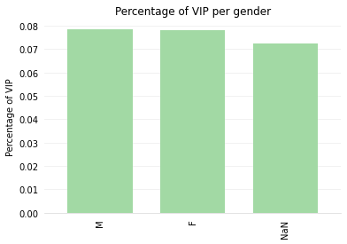
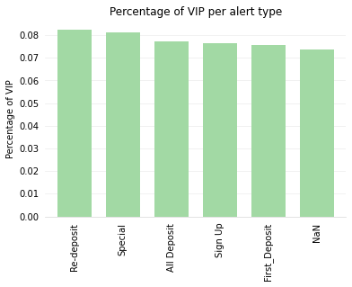
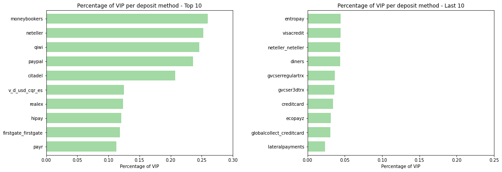
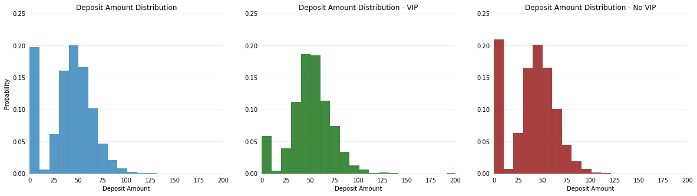
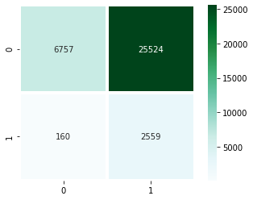
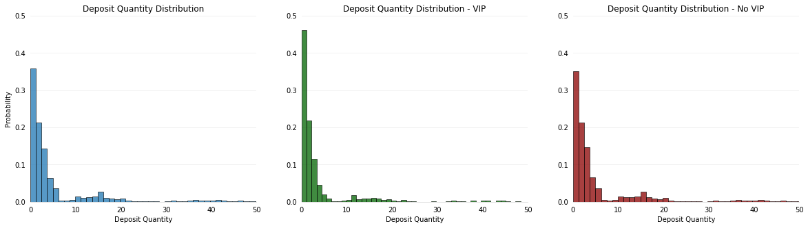
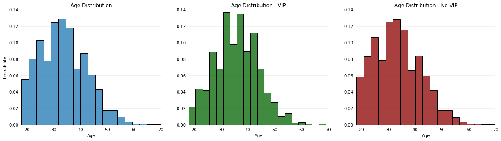
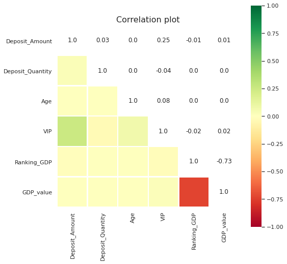

## 1. Problem Description

From a data set of fictitious sports betting customers there is a business need to understand which customers are more likely to be *VIPs*, so
that these customers will be target in priority with a new specific offer next month.
Please use the data made available in the VIP Train.csv spreadsheet to train a predictive model to provide your best answer to this business problem.

The training set (Train.csv) contains 8 features and one binary target variable named VIP, this set is going to be used to train a predictive model. Then the model predicted is going to be apply in the *Test.csv* spreadsheet to insert the predicted probability that a customer will become a VIP in the column VIP.

The primary evaluation metric will be the Log Loss.

Please explain the modelling approach you have taken and give a brief
overview of your code during the interview. The total time for the presentation should be about 20 minutes.

Log Loss definition:

$L(y, p) = −(ylog(p) + (1 − y)log(1 − p))$

Please send back within seven days the following:
- Test set predictions
- Code used
- Presentation

## 2. Descriptive analysis

### 2.1 Set up environment

> **In this section** we installed and imported the libraries, defined the helper functions, read the training and test tables (the first rows of each are shown below) and removed the player id column from the training table. We also checked that both tables have the same structure (the column types are shown below), that the test table has no new categories and that no player appears in both tables.


**Output:**

|  | Player_Id | Deposit_Amount | Deposit_Quantity | Deposit_Method | Age | Country | Gender | Dim_Alert_Type_Desc | VIP |
|---|---|---|---|---|---|---|---|---|---|
| 0 | 613972 | 30.173168 | 5 | v3_ebs | 31.0 | RO | NaN | All Deposit | 0 |
| 1 | 1001159 | 4871.409870 | 1 | instadebitviasc | 30.0 | VG | F | All Deposit | 0 |
| 2 | 2405146 | 37.812566 | 3 | ifund-smooth-usd | 21.0 | LB | M | Special | 0 |
| 3 | 3694261 | 52.722560 | 15 | diners | 33.0 | NZ | M | Sign Up | 0 |
| 4 | 7004960 | 42.776558 | 3 | lateralpayments | 55.0 | IR | M | All Deposit | 0 |

**Output:**

|  | Player_Id | Deposit_Amount | Deposit_Quantity | Deposit_Method | Age | Country | Gender | Dim_Alert_Type_Desc | VIP |
|---|---|---|---|---|---|---|---|---|---|
| 0 | 5890355 | 44.313120 | 20 | debitcard | 31.0 | GP | M | First_Deposit | 0.0 |
| 1 | 940061 | 56.223226 | 1 | servipag | 52.0 | KM | NaN | Special | 0.0 |
| 2 | 8549083 | 28.329851 | 13 | visadebit | 42.0 | LK | F | NaN | 0.0 |
| 3 | 7447056 | 0.000000 | 0 | lateralpayments | 33.0 | IR | M | Special | 0.0 |
| 4 | 7047755 | 0.000000 | 0 | payr | 29.0 | MY | M | Special | 0.0 |

**Output:**

```text
Table Model - Structure:
Player_Id                int64
Deposit_Amount         float64
Deposit_Quantity         int64
Deposit_Method          object
Age                    float64
Country                 object
Gender                  object
Dim_Alert_Type_Desc     object
VIP                      int64
dtype: object
 
Table Deliverable - Structure:
Player_Id                int64
Deposit_Amount         float64
Deposit_Quantity         int64
Deposit_Method          object
Age                    float64
Country                 object
Gender                  object
Dim_Alert_Type_Desc     object
VIP                    float64
dtype: object
```

### 2.2 Categorical's variables descriptive analysis

> **In this section** we looked at the text columns (gender, alert type, country and deposit method): how many values are missing and what share of players are VIP in each category. We checked a hypothesis about missing country and gender, and filled the missing values with the category 'NaN'.

The only dataset used in the next step is the Model dataset, which is the dataset used for the data analysis.

With the *count* field in the descriptive table and the amount of rows, we can figure out the number of missing data. Missing data is not a big issue in the Deposit method and country. We have some issues with gender and Alert type.

**Hipothesis**: if a person doesn't have any data about country or gender, this is because the person is not registered in a proper way, and this is needed for a deposit. So, if a person is not properly registered and the hipothesis is true, it could be assumed that this person is not VIP.

**Output:**

|  | Deposit_Method | Country | Gender | Dim_Alert_Type_Desc |
|---|---|---|---|---|
| count | 34669 | 34647 | 31173 | 28909 |
| unique | 154 | 195 | 2 | 5 |
| top | servipag | MT | F | Sign Up |
| freq | 271 | 218 | 15666 | 5860 |

**Output:**

```text
Amount of rows: 35000
```

**Gender:**

**Output:**

```text
F      15666
M      15507
NaN     3827
Name: Gender, dtype: int64
```

The % of VIP customer is similar over different gender



**Alert Type:**

**Output:**

```text
NaN              6091
Sign Up          5860
Special          5835
First_Deposit    5795
Re-deposit       5726
All Deposit      5693
Name: Dim_Alert_Type_Desc, dtype: int64
```

The % of VIP customer is similar over different alert types. in the next steps alert types is going to be group in “sign ups / first deposit” and “rest”.



**Country:** the difference in percentage of VIP clients is noticeable across the countries (the chart that showed it is not available in the saved notebook).

**Output:**

```text
NaN    353
MT     218
HN     212
DJ     207
EG     206
      ... 
EU     151
GA     148
AZ     146
BG     146
UA     141
Name: Country, Length: 196, dtype: int64
```

**Deposit Method:** as it can be seen in the next tables, the difference in percentage of VIP clients is high accross the different deposit methods.

**Output:**

```text
NaN                 331
servipag            271
ebs-3d-smooth       263
maestro             262
macaucashdesk       255
                   ... 
sc-gvccashier       200
gvcser3dtrx         194
pgclubcashier       194
gvcserregulartrx    192
cqr_banktransfer    181
Name: Deposit_Method, Length: 155, dtype: int64
```



**Rejected Hipothesis**: The hipothesis (just with descriptive data, without a statistical test)  "*If a person doesn't have data about country or gender is because the person is not register in properly, and this is needed for a deposit"* is not true, so we can't set up as non VIP people without a country assigned.

In this session it can be observed that the dataset doesn't have small categories (categories with less than 30 clients tends to overfit the final model), so use the "other" category is not needed.

**Replace Missing values**:
Some classification techniques don't work with missing data.

### 2.3 Data Enrichment

> **In this section** we downloaded two external tables (GDP per capita and country codes), cleaned the country names, joined both tables to the players table, filled the missing GDP values with the median and saved the two tables for the prediction step.


**Gross Domestic Product (GDP) Table:**

Gross Domestic Product (GDP) per capita shows a country's GDP divided by its total population. The table below lists countries in the world ranked by GDP at Purchasing Power Parity (PPP) per capita, along with the Nominal GDP per capita. PPP takes into account the relative cost of living, rather than using only exchange rates, therefore providing a more accurate picture of the real differences in income.

Info from: https://www.worldometers.info/gdp/gdp-per-capita/

**Country codes Table:**
This is used to merge the initial data set and the GDP dataset. Also for future interpretations.

Delete all the "()" in the country name field, for example "Bolivia (Plurinational State of)" was change by "Bolivia"

Save dataset in a pickle file: This step is made because this data is going to be used in the model deploy. in a pickle file the user can save python objects in different format and read then without problems

Median is used as a metric to fill the na data derived from the merge between tables, this is a centrality measure like the average but it is robust to outliers.

### 2.4 Numeric's variables descriptive analysis

> **In this section** we summarized the number columns (deposit amount, deposit quantity, age and GDP), compared their distributions between VIP and non-VIP players and looked at the correlation between the variables.

From the descriptive table, it can be concluded that Deposit_amount, Deposit_quantity and VIP don't have missing data. Age have less than 400 missings (1% more or less) and the min and max values looks coherent.

**Output:**

|  | Deposit_Amount | Deposit_Quantity | Age | VIP | Ranking_GDP | GDP_value |
|---|---|---|---|---|---|---|
| count | 35000.000 | 35000.000 | 34641.000 | 35000.000 | 35000.000 | 35000.000 |
| mean | 170.429 | 5.358 | 33.451 | 0.078 | 91.455 | 12980.925 |
| std | 931.817 | 9.022 | 8.726 | 0.268 | 46.661 | 17902.844 |
| min | 0.000 | 0.000 | 18.000 | 0.000 | 1.000 | 293.000 |
| 25% | 28.711 | 1.000 | 27.000 | 0.000 | 56.000 | 3762.000 |
| 50% | 43.944 | 2.000 | 33.000 | 0.000 | 96.000 | 5765.000 |
| 75% | 57.365 | 4.000 | 39.000 | 0.000 | 117.000 | 14364.000 |
| max | 10085.205 | 62.000 | 73.000 | 1.000 | 190.000 | 105280.000 |



In the range shown (0 to 200), the deposit amount between VIP and Non VIP is more or less the same. However, the percentage of Non VIP players with a small deposit is higher, and the summary below shows higher deposits for VIP (mean 974 vs 103, median 56 vs 43).

**Output:**

```text
Deposit Amount  - No VIP:
count    32281.000000
mean       102.743958
std        644.497216
min          0.000000
25%         27.243787
50%         43.040945
75%         56.262610
max      10074.849927
Name: Deposit_Amount, dtype: float64
 
Deposit Amount - VIP:
count     2719.000000
mean       974.014703
std       2355.227900
min          0.000000
25%         42.218131
50%         55.688917
75%         76.734491
max      10085.205071
Name: Deposit_Amount, dtype: float64
```

From 6,917 customer who don't deposit money, only 160 are VIP (2.31%). Moreover, from the customer who deposit money 9.1% are VIP, been the deposit status a good predictor.



*Rows: VIP (0 = no, 1 = yes). Columns: deposit made (0 = no, 1 = yes).*



VIP clients are a bit older than Non VIP.



**Output:**

```text
Age - No VIP:
count    31950.000000
mean        33.258091
std          8.749293
min         18.000000
25%         27.000000
50%         33.000000
75%         39.000000
max         73.000000
Name: Age, dtype: float64
 
Age - VIP:
count    2691.000000
mean       35.746191
std         8.098548
min        18.000000
25%        30.000000
50%        36.000000
75%        41.000000
max        69.000000
Name: Age, dtype: float64
```



There is a high correlation between Ranking_GDP and GDP_value, so Ranking_GDP was deleted because the relation with the VIP players is inverse (when the ranking increase the % of vip players decrease, this is worse for the interpretation).

There is a medium correlation between been VIP and the deposit amount, also, there is a small correlation between the VIP and age. Finally, there is a very small correlation between GDP and VIP.

## 3. Data pre-processing
Train, test, standarization and get dummies variables.

### 3.1 Train - test split

> **In this section** we used 80% of the data for training and 20% for testing.

Modelling data set was split in two disjoint subset: training data set (to identify the best model) and testing data set (to check if the model is expanding the result properly). The sample was getting considering the Deposit_Method.

### 3.2 Encoding categorical variables

> **In this section** we turned the text columns into numbers: deposit method and country with target encoding, and alert type with one-hot encoding, grouped into two bigger groups. We dropped the columns not used by the models, repeated the same steps on the test set and saved the encodings. The first rows of the resulting training and test inputs are shown below.

**Target Encoding**
Country code and deposit method have more or less 200 categories.

**Output:**

|  | Deposit_Amount | Deposit_Quantity | Age | GDP_value | Deposit_Method_encoded | Country_code_encoded | Alert_Type_redeposit_special_all | Alert_Type_first_signup |
|---|---|---|---|---|---|---|---|---|
| 7550 | 9052.603657 | 5 | 35.0 | 1554.0 | 0.039326 | 0.067568 | 1 | 0 |
| 30486 | 48.114610 | 1 | 34.0 | 5765.0 | 0.048780 | 0.079137 | 0 | 0 |
| 7845 | 0.000000 | 0 | 19.0 | 1535.0 | 0.064516 | 0.084507 | 1 | 0 |
| 20851 | 43.358977 | 2 | 25.0 | 5765.0 | 0.107843 | 0.069231 | 0 | 0 |
| 6203 | 41.703943 | 3 | 36.0 | 7894.0 | 0.078313 | 0.078947 | 0 | 1 |

**Output:**

|  | Deposit_Amount | Deposit_Quantity | Age | GDP_value | Deposit_Method_encoded | Country_code_encoded | Alert_Type_redeposit_special_all | Alert_Type_first_signup |
|---|---|---|---|---|---|---|---|---|
| 5560 | 55.700181 | 1 | 34.0 | 5765.0 | 0.125000 | 0.181159 | 0 | 1 |
| 9098 | 31.418342 | 1 | 25.0 | 5765.0 | 0.093750 | 0.144928 | 1 | 0 |
| 19033 | 64.442176 | 2 | 37.0 | 15166.0 | 0.052941 | 0.071895 | 0 | 1 |
| 23016 | 47.228790 | 1 | 39.0 | 32038.0 | 0.049180 | 0.100000 | 0 | 0 |
| 7953 | 43.442327 | 1 | 23.0 | 5765.0 | 0.049180 | 0.104895 | 1 | 0 |

### 3.3 Fill numerical na values

> **In this section** we filled the missing ages with the average age of the training set, did the same on the test set and saved that average.


### 3.4 Outlier detection

> **In this section** we looked for outliers (very large or very small values; the columns that have them and their limits are shown below) and capped the extreme high values of deposit amount, deposit quantity and GDP at the upper limit found in the training set. The same limits were applied to the test set and saved.


**Output:**

|  | Outliers | inferior | superior | Maximum |
|---|---|---|---|---|
| Deposit_Amount | 807.0 | -14.296519 | 100.276392 | 10085.205071 |
| Deposit_Quantity | 4894.0 | -3.500000 | 8.500000 | 61.000000 |
| Age | 148.0 | 9.000000 | 57.000000 | 72.000000 |
| GDP_value | 3705.0 | -12141.000000 | 30267.000000 | 105280.000000 |

### 3.5 Create and transform numeric variables

> **In this section** we created three new variables: whether the player made a deposit, and the square root of the deposit amount and of the deposit quantity (the two original columns were removed).


### 3.6 Data standarization

> **In this section** we standardized all the variables (average 0 and spread 1) using the training set, applied the same scaling to the test set and saved the scaler.


## 4. Model selection - Classification Analysis

### 4.1 Baseline

> **In this section** we calculated the baseline scores (accuracy, F1, AUC and log loss) over 1,000 random simulations; they are the reference the models have to beat.

A fundamental aspect of a model assessment is to compare with a baseline. In this case VIP players were simulated according to the probability of being a VIP in the training data.

**Baseline AUC and log loss**

**Output (AUC):**

```text
0.5
```

**Output (log loss):**

```text
0.2770491893604383
```

**Output:**

|  | Accuracy | F1 |
|---|---|---|
| count | 1000.000000 | 1000.000000 |
| mean | 0.855724 | 0.078108 |
| std | 0.003203 | 0.011472 |
| min | 0.845000 | 0.044000 |
| 25% | 0.854000 | 0.070000 |
| 50% | 0.856000 | 0.078000 |
| 75% | 0.858000 | 0.085000 |
| max | 0.867000 | 0.118000 |

### 4.2 Classification Techniques

The charts and detailed metrics of the sections 4.2.1 to 4.2.4 are not included in the saved notebook (except the best parameters of the Logistic Regression). The test scores of each model are summarized in the table of section 4.3.

#### 4.2.1 Logistic Regression

> **In this section** we trained a logistic regression, choosing its best settings with a grid search (it tries many combinations; the best ones are shown below), and measured it on the training and test sets with scores, a ROC curve and a confusion matrix.


**Output:**

```text
{'C': 1, 'class_weight': {0: 0.5, 1: 0.5}, 'penalty': 'l1', 'solver': 'saga'}
```

#### 4.2.2 Decision tree classifier

> **In this section** we did the same with a decision tree classifier.


#### 4.2.3 Random Forest

> **In this section** we did the same with a random forest (settings chosen with a random search). We also looked at which variables matter most and compared the training and test results.


#### 4.2.4 XgBoost

> **In this section** we did the same with XGBoost.


### 4.3 Final Model Selection and conclusions

> **In this section** we picked the Random Forest as the final model and saved the four trained models.

For compare performance metric in each model, the following table was built:

| **Metric** | **Baseline** |  **Logistic** | **Tree** | **Random Forest** | **XgBoost** |
|--|:-:|:-:|:-:|:-:|:-:|
| **Log Loss**|  0.277 | 0.245 | 0.254 | **0.240** | 0.250 |
| **Accuracy** | 0.856 |  0.700 | **0.875** | 0.703 | 0.763 |
| **F1 Score** |  0.078 | 0.256 | **0.297** | 0.285 | 0.282  |
| **AUC** |  0.500 | 0.750 | 0.693 | **0.765** | 0.745  |

Comparing the results among different techniques, Random Forest gives the best results based on log loss. On the other hand, decission tree classifier ends up with the best F1 score and accuracy.

All the models perform better than the baseline in terms of F1 score, AUC and Log Loss. However, the accuracy in the baseline is only surpassed by the classification regression tree, this is because 92% of our customers are NoN VIP, so the baseline tends to predict most of the customers as NoN VIP (majority class).

In order to improve the model's output we should consider the cost of classify a VIP as NoN VIP (lost the opportunity of send the specific offer) and the cost of classify a NoN VIP customer as VIP (lost money sending the offer to someone with low CLV). This could be achived estimating the expected earning per VIP customer and the expected earning/lost per NoN VIP customer

## 5. Deploy the model

> **In this section** we applied the same preparation steps to the file to predict, used the Random Forest to get the probability of being VIP for each player and saved the file with those probabilities in the VIP column.


## Appendix: Python code

### A.1 Set up environment (section 2.1)

```python
# Colab-only line: it installed a plotting helper (scikit-plot).
# It is not needed any more because the ROC charts now use plot_roc_curve (defined below).
# !pip install scikit-plot

# Load the tools (libraries) the script needs:
# pandas = tables, numpy = math, seaborn / matplotlib = charts,
# scikit-learn (sklearn) = models and scores, xgboost = one more type of model.
# warnings.filterwarnings("ignore") hides the yellow warning messages to keep the output clean.
# The Google Colab lines are commented out: they only work inside Google Colab.
import warnings
warnings.filterwarnings("ignore")

import re
import os
import pickle
from io import StringIO
import pandas as pd
import numpy as np
from mlxtend.preprocessing import TransactionEncoder

import seaborn as sns
from matplotlib.colors import ListedColormap
import matplotlib.pyplot as plt
from sklearn import metrics
from sklearn.model_selection import train_test_split
from sklearn.preprocessing import StandardScaler
from sklearn.metrics import roc_curve, auc
import scipy.stats as st

from sklearn.model_selection import GridSearchCV, RandomizedSearchCV
from sklearn.tree import DecisionTreeClassifier
from sklearn.linear_model import LogisticRegression
from sklearn.ensemble import RandomForestClassifier
import xgboost as xgb

# import scikitplot as skplt
import itertools
import requests
# from google.colab import drive
# mount google drive information in a google colaboratory directory
# drive.mount('/content/gdrive')
# Print every column of a table (otherwise pandas hides the middle ones with '...')
pd.set_option('display.max_columns', None)
pd.set_option('display.width', 200)

# Helper functions we will reuse later:
# - plot_confusion_matrix: draws a small 2x2 table (a "confusion matrix") of right and wrong
#   guesses as a colored picture. Rows = what was real, columns = what the model said.
# - Find_Optimal_Cutoff: a model gives a probability (0 to 1). The cutoff is the line above
#   which we say "VIP". This function picks the line where the share of real VIPs we catch
#   is the same as the share of non-VIPs we correctly leave alone.
# - plot_roc_curve (new): draws the ROC curve, a chart of how many real VIPs we catch (y)
#   versus how many non-VIPs we wrongly flag (x), for every possible cutoff.
#functions
def plot_confusion_matrix(cm, classes,
                          normalize=False,
                          title='Confusion matrix',
                          cmap=plt.cm.Greens):
    """
    This function prints and plots the confusion matrix.
    Normalization can be applied by setting `normalize=True`.
    """

    plt.imshow(cm, interpolation='nearest', cmap=cmap)
    plt.title(title, fontsize=16)

    tick_marks = np.arange(len(classes))
    plt.xticks(tick_marks, classes, rotation=45)
    plt.yticks(tick_marks, classes)

    fmt = '.2f' if normalize else 'd'
    thresh = cm.max() / 2.
    for i, j in itertools.product(range(cm.shape[0]), range(cm.shape[1])):
        plt.text(j, i, format(cm[i, j], fmt),
                 horizontalalignment="center",
                 color="white" if cm[i, j] > thresh else "black")

    plt.ylabel('Actual')
    plt.xlabel('Predicted')
    plt.tight_layout()


def Find_Optimal_Cutoff(target, predicted):
    """ Find the optimal probability cutoff point for a classification model related to event rate
    Parameters
    ----------
    target : Matrix with dependent or target data, where rows are observations

    predicted : Matrix with predicted data, where rows are observations

    Returns
    -------
    list type, with optimal cutoff value

    """
    fpr, tpr, threshold = roc_curve(target, predicted)
    i = np.arange(len(tpr))
    roc = pd.DataFrame({'tf' : pd.Series(tpr-(1-fpr), index=i), 'threshold' : pd.Series(threshold, index=i)})
    roc_t = roc.iloc[(roc.tf-0).abs().argsort()[:1]]

    return list(roc_t['threshold'])

def plot_roc_curve(y_true, y_proba, title='ROC Curve'):
    # Draws the ROC curve. It replaces the old scikit-plot call (that library is not
    # kept up to date and breaks with recent scipy / matplotlib versions).
    # y_true = the real answers (0/1), y_proba = the probability of being VIP.
    fpr, tpr, _ = roc_curve(y_true, y_proba)
    plt.figure()
    plt.plot(fpr, tpr, lw=2, label='ROC curve of class 1 (area = {:.2f})'.format(auc(fpr, tpr)))
    plt.plot([0, 1], [0, 1], 'k--', lw=2)  # dashed diagonal = a pure guess
    plt.xlim([0.0, 1.0])
    plt.ylim([0.0, 1.05])
    plt.xlabel('False Positive Rate')
    plt.ylabel('True Positive Rate')
    plt.title(title, fontsize=16)
    plt.legend(loc='lower right')

# Read the two CSV files (tables).
# na_values='?' means: a '?' in the file is a missing value.
# df_model = players we already know about (we know if they are VIP), used to train the model.
# df_deploy = players we must predict.
# Change 'path' to the folder where your files are.
path = r'gdrive/My Drive/Entain - Data Scientist/Data/' # path

df_model = pd.read_csv(path+'VIP_Train.csv', na_values='?')
df_deploy = pd.read_csv(path+'VIP_Test.csv', na_values='?')

# Show the first 5 rows of the training table, just to have a look.
print(df_model.head())

# Show the first 5 rows of the table we must predict.
print(df_deploy.head())

# Print the type of each column (number, text...) in both tables to check they match.
print('Table Model - Structure:')
print(df_model.dtypes)
print(' ')
print('Table Deliverable - Structure:')
print(df_deploy.dtypes)

# Check that every country in the table to predict also appears in the training table.
# True = no new countries, so no surprises.
# List1
List1 = list(df_model.Country.unique())

# List2
List2 = list(df_deploy.Country.unique())

check_countries =  all(item in List1 for item in List2)
print(check_countries)

# Same check for the deposit method.
# List1
List1 = list(df_model.Deposit_Method.unique())

# List2
List2 = list(df_deploy.Deposit_Method.unique())

check_Deposit_Method =  all(item in List1 for item in List2)
print(check_Deposit_Method)

# Same check for the alert type.
# List1
List1 = list(df_model.Dim_Alert_Type_Desc.unique())

# List2
List2 = list(df_deploy.Dim_Alert_Type_Desc.unique())

check_Dim_Alert_Type_Desc =  all(item in List1 for item in List2)
print(check_Dim_Alert_Type_Desc)

# Same check for the gender.
# List1
List1 = list(df_model.Gender.unique())

# List2
List2 = list(df_deploy.Gender.unique())

check_Gender =  all(item in List1 for item in List2)
print(check_Gender)

# Check if any player appears in both tables.
# False = no player is in both, which is what we want (no leaking of answers).
# List1
List1 = list(df_model.Player_Id.unique())

# List2
List2 = list(df_deploy.Player_Id.unique())

check_players =  any(item in List1 for item in List2)
print(check_players)

# Count the different players in the training table.
# If it equals the number of rows, nobody is repeated.
print(df_model.Player_Id.nunique())

# Save the player ids in their own variable and remove that column.
# An id is just a label, it says nothing about being VIP, so the model should not learn from it.
player_id = df_model.Player_Id
df_model.drop(columns=['Player_Id'],inplace=True)
```

### A.2 Categorical variables descriptive analysis (section 2.2)

```python
# Summary of the text columns: count = how many values are filled, unique = how many
# different values, top = the most common one, freq = how many times it appears.
# Comparing count with the number of rows tells us how many values are missing.
descriptive_table = df_model.describe(include='all').round(decimals=3)
description_object=descriptive_table.loc[['count','unique','top','freq']]
description_object.dropna(axis=1, inplace=True)
print(description_object)

# Print how many rows the training table has.
print('Amount of rows: '+str(df_model.shape[0]))

# Count players per gender. dropna=False keeps the missing values in the count
# (otherwise they would be left out).
print(df_model.Gender.value_counts(dropna=False))

# Bar chart: of the players in each gender, what share are VIP?
# VIP is 0 or 1, so its average is the share of VIPs.
# fillna('NaN') writes the text 'NaN' in empty cells so they get their own bar.
# 'colors' is a list of colors picked from a color scale; the charts use colors[5] (green).
# The lines about spines, ticks and grid are only make-up: hide borders, light horizontal lines.
cmap = plt.get_cmap('Spectral')
colors = [cmap(i) for i in np.linspace(0, 1, 8)]
fig, ax = plt.subplots()

df_model.fillna('NaN').groupby(['Gender'])['VIP'].mean().sort_values(ascending=False).plot(kind="bar", color=colors[5], width=.7)
plt.title("Percentage of VIP per gender")
plt.xlabel("")
plt.ylabel("Percentage of VIP")

ax.spines['top'].set_visible(False)
ax.spines['right'].set_visible(False)
ax.spines['left'].set_visible(False)
ax.spines['bottom'].set_color('#DDDDDD')

# Second, remove the ticks as well.
ax.tick_params(bottom=False, left=False)

# Third, add a horizontal grid (but keep the vertical grid hidden).
# Color the lines a light gray as well.
ax.set_axisbelow(True)
ax.yaxis.grid(True, color='#EEEEEE')
ax.xaxis.grid(False);
plt.show()

# Count players per alert type (missing values included).
print(df_model.Dim_Alert_Type_Desc.value_counts(dropna=False))

# Same bar chart, now per alert type.
fig, ax = plt.subplots()
df_model.fillna('NaN').groupby(['Dim_Alert_Type_Desc'])['VIP'].mean().sort_values(ascending=False).plot(kind="bar", color=colors[5], width=.7)
plt.title("Percentage of VIP per alert type")
plt.xlabel("")
plt.ylabel("Percentage of VIP")

ax.spines['top'].set_visible(False)
ax.spines['right'].set_visible(False)
ax.spines['left'].set_visible(False)
ax.spines['bottom'].set_color('#DDDDDD')

# Second, remove the ticks as well.
ax.tick_params(bottom=False, left=False)

# Third, add a horizontal grid (but keep the vertical grid hidden).
# Color the lines a light gray as well.
ax.set_axisbelow(True)
ax.yaxis.grid(True, color='#EEEEEE')
ax.xaxis.grid(False);
plt.show()

# Count players per country code (missing values included).
print(df_model.Country.value_counts(dropna=False))

# Two bar charts side by side: the 10 countries with the highest share of VIPs and
# the 10 with the lowest. xlim sets how much of the x axis we see.
fig, ax = plt.subplots(figsize=(18, 6))

plt.subplot(1,2, 1)
df_model.fillna('NaN').groupby(['Country'])['VIP'].mean().sort_values()[-10:].plot(kind="barh", color=colors[5], width=.7)
plt.xlim(0,0.25)
plt.title("Percentage of VIP per country code - Top 10")
plt.ylabel("")
plt.xlabel("Percentage of VIP")

ax.spines['top'].set_visible(False)
ax.spines['right'].set_visible(False)
ax.spines['left'].set_visible(False)
ax.spines['bottom'].set_color('#DDDDDD')

# Second, remove the ticks as well.
ax.tick_params(bottom=False, left=False)

# Third, add a horizontal grid (but keep the vertical grid hidden).
# Color the lines a light gray as well.
ax.set_axisbelow(True)
ax.xaxis.grid(True, color='#EEEEEE')
ax.yaxis.grid(False);


plt.subplot(1,2, 2)
df_model.fillna('NaN').groupby(['Country'])['VIP'].mean().sort_values()[0:10].plot(kind="barh", color=colors[5], width=.7)
plt.xlim(0,0.25)
plt.title("Percentage of VIP per country code - Last 10")
plt.ylabel("")
plt.xlabel("Percentage of VIP")

ax.spines['top'].set_visible(False)
ax.spines['right'].set_visible(False)
ax.spines['left'].set_visible(False)
ax.spines['bottom'].set_color('#DDDDDD')

# Second, remove the ticks as well.
ax.tick_params(bottom=False, left=False)

# Third, add a horizontal grid (but keep the vertical grid hidden).
# Color the lines a light gray as well.
ax.set_axisbelow(True)
ax.xaxis.grid(True, color='#EEEEEE')
ax.yaxis.grid(False);
plt.show()

# Count players per deposit method (missing values included).
print(df_model.Deposit_Method.value_counts(dropna=False))

# Same two charts, now for the deposit method.
# subplots_adjust(wspace=0.4) just leaves some space between the two charts.
f,ax=plt.subplots(figsize=(18,6))

plt.subplot(1,2, 1)
plt.subplots_adjust(left=None, bottom=None, right=None, top=None, wspace=0.4, hspace=None)
df_model.fillna('NaN').groupby(['Deposit_Method'])['VIP'].mean().sort_values()[-10:].plot(kind="barh", color=colors[5], width=.7)
plt.xlim(0,0.3)
plt.title("Percentage of VIP per deposit method - Top 10")
plt.ylabel("")
plt.xlabel("Percentage of VIP")

ax.spines['top'].set_visible(False)
ax.spines['right'].set_visible(False)
ax.spines['left'].set_visible(False)
ax.spines['bottom'].set_color('#DDDDDD')

# Second, remove the ticks as well.
ax.tick_params(bottom=False, left=False)

# Third, add a horizontal grid (but keep the vertical grid hidden).
# Color the lines a light gray as well.
ax.set_axisbelow(True)
ax.xaxis.grid(True, color='#EEEEEE')
ax.yaxis.grid(False)


plt.subplot(1,2, 2)
plt.subplots_adjust(left=None, bottom=None, right=None, top=None, wspace=0.4, hspace=None)
df_model.fillna('NaN').groupby(['Deposit_Method'])['VIP'].mean().sort_values()[0:10].plot(kind="barh", color=colors[5], width=.7)
plt.xlim(0,0.25)
plt.title("Percentage of VIP per deposit method - Last 10")
plt.ylabel("")
plt.xlabel("Percentage of VIP")

ax.spines['top'].set_visible(False)
ax.spines['right'].set_visible(False)
ax.spines['left'].set_visible(False)
ax.spines['bottom'].set_color('#DDDDDD')

# Second, remove the ticks as well.
ax.tick_params(bottom=False, left=False)

# Third, add a horizontal grid (but keep the vertical grid hidden).
# Color the lines a light gray as well.
ax.set_axisbelow(True)
ax.xaxis.grid(True, color='#EEEEEE')
ax.yaxis.grid(False);
plt.show()

# Fill the empty cells of the four text columns with the text 'NaN'.
# Many models cannot work with empty values, so "missing" becomes a category of its own.
df_model['Gender'] = df_model['Gender'].fillna('NaN')
df_model['Dim_Alert_Type_Desc'] = df_model['Dim_Alert_Type_Desc'].fillna('NaN')
df_model['Country'] = df_model['Country'].fillna('NaN')
df_model['Deposit_Method'] = df_model['Deposit_Method'].fillna('NaN')
```

### A.3 Data Enrichment (section 2.3)

```python
# Download a table of GDP per person (how rich each country is, per inhabitant) from a website
# and keep the last table on the page. Ranking_GDP = position of the country (1 = richest).
# It needs internet, and the web page may have changed its layout since this was written.
url = 'https://www.worldometers.info/gdp/gdp-per-capita/'
html = requests.get(url).text
GDP_list = pd.read_html(StringIO(html))
GDP = GDP_list[-1]
GDP.rename(columns={'#':'Ranking_GDP'}, inplace=True)
print(GDP.head())

# Keep only 3 columns and give them simpler names.
# Then turn the money text (like '$12,345') into a real number: remove the '$' and the ','.
GDP=GDP[['Ranking_GDP','Country','GDP (nominal) per capita (2017)']]
GDP.rename(columns={'GDP (nominal) per capita (2017)':'GDP_value','Country':'Country_name'}, inplace=True)

GDP['GDP_value'] =GDP['GDP_value'].apply(lambda x: float(x.replace(',', '').replace('$', '')))

# Show the first rows of the GDP table.
print(GDP.head())

# Download a table that links each 2-letter country code (like 'MT') with the country name.
# Players only have the code, so we need it to connect them with the GDP table.
# Two columns we do not need are dropped.
url = 'https://www.iban.com/country-codes'
html = requests.get(url).text
Country_codes = pd.read_html(StringIO(html))
Country_codes = Country_codes[-1]
Country_codes.rename(columns={'Alpha-2 code':'Code','Country':'Country_name'}, inplace=True)
Country_codes.drop(columns=['Alpha-3 code',	'Numeric'],inplace=True)
print('Country code table shape: '+ str(Country_codes.shape))
print(Country_codes.head())

# Clean the country names: remove anything inside parentheses
# (for example 'Bolivia (Plurinational State of)' becomes 'Bolivia') and a space at the end,
# so the names match the ones in the GDP table.
Country_codes['Country_name']=Country_codes.Country_name.apply(lambda x: re.sub(r"[\(\[].*?[\)\]]", "", x))
Country_codes['Country_name']=Country_codes.Country_name.apply(lambda x: x[:-1] if x[-1]==' ' else x)

# Save both tables in 'pickle' files (a way to save Python objects exactly as they are),
# so the final prediction step can reuse them without downloading again.
with open(r'gdrive/My Drive/Entain - Data Scientist/Outputs/Country_codes.pkl', 'wb') as f:
    pickle.dump(Country_codes, f)

with open(r'gdrive/My Drive/Entain - Data Scientist/Outputs/GDP.pkl', 'wb') as f:
    pickle.dump(GDP, f)

# Join (merge) the country names into the players table using the 2-letter code.
# how='left' keeps every player, even if the code is not found.
# Then rename and drop helper columns.
df_model = pd.merge(df_model,Country_codes,  how='left', left_on=['Country'], right_on = ['Code'])
df_model.rename(columns={'Country':'Country_code'}, inplace=True)
df_model.drop(columns=['Code'],inplace=True)

# Show the first rows of the players table after the join.
print(df_model.head())

# Join the GDP table too, matching by country name.
df_model = pd.merge(df_model, GDP,  how='left', left_on=['Country_name'], right_on = ['Country_name'])

# Some players have no GDP data after the joins (country unknown or not matched).
# Fill those gaps with the median of the GDP table. The median is the middle value when
# everything is sorted; it is like the average but extreme values do not pull it away.
df_model['GDP_value'] = df_model['GDP_value'].fillna(GDP.GDP_value.median())
df_model['Ranking_GDP'] = df_model['Ranking_GDP'].fillna(round(GDP.Ranking_GDP.median(),0))
```

### A.4 Numeric variables descriptive analysis (section 2.4)

```python
# Summary of the number columns: count, mean (the average), std (how spread out the values are),
# min, 25% / 50% / 75% (the value below which 25% / 50% / 75% of players fall; 50% is the median)
# and max.
descriptive_table = df_model[['Deposit_Amount','Deposit_Quantity','Age','VIP','Ranking_GDP',	'GDP_value']].describe(include='all').round(decimals=3)
description_numeric = descriptive_table.loc[['count','mean','std','min','25%','50%','75%','max']]
description_numeric.dropna(axis=1, inplace=True)
print(description_numeric)

# Print how many rows the table has.
print('Amount of rows: '+str(df_model.shape[0]))

# Three histograms (bar charts that show how often each value happens) of Deposit_Amount:
# all players, VIP players and non-VIP players.
# stat='probability' shows shares instead of raw counts; xlim / ylim zoom into the area
# where most of the data is.
f,ax=plt.subplots(figsize=(20,5))

plt.subplot(1,3, 1)
ax=sns.histplot(df_model.Deposit_Amount, bins=1000,stat="probability")
ax.set_xlim(0,200)
ax.set_ylim(0,0.25)
ax.set_title('Deposit Amount Distribution')
ax.set_xlabel('Deposit Amount')
ax.spines['top'].set_visible(False)
ax.spines['right'].set_visible(False)
ax.spines['left'].set_visible(False)
ax.spines['bottom'].set_color('#DDDDDD')
ax.tick_params(bottom=False, left=False)
ax.set_axisbelow(True)
ax.yaxis.grid(True, color='#EEEEEE')
ax.xaxis.grid(False);


plt.subplot(1,3, 2)
ax=sns.histplot(df_model[df_model.VIP==1].Deposit_Amount, bins=1000,color='darkgreen',stat="probability")
ax.set_xlim(0,200)
ax.set_ylim(0,0.25)
ax.set_ylabel(' ')
ax.set_xlabel('Deposit Amount')
ax.set_title('Deposit Amount Distribution - VIP')
ax.spines['top'].set_visible(False)
ax.spines['right'].set_visible(False)
ax.spines['left'].set_visible(False)
ax.spines['bottom'].set_color('#DDDDDD')
ax.tick_params(bottom=False, left=False)
ax.set_axisbelow(True)
ax.yaxis.grid(True, color='#EEEEEE')
ax.xaxis.grid(False);

plt.subplot(1,3,3)
ax=sns.histplot(df_model[df_model.VIP==0].Deposit_Amount, bins=1000,color='darkred',stat="probability")
ax.set_xlim(0,200)
ax.set_ylim(0,0.25)
ax.set_ylabel(' ')
ax.set_xlabel('Deposit Amount')
ax.set_title('Deposit Amount Distribution - No VIP')
ax.spines['top'].set_visible(False)
ax.spines['right'].set_visible(False)
ax.spines['left'].set_visible(False)
ax.spines['bottom'].set_color('#DDDDDD')
ax.tick_params(bottom=False, left=False)
ax.set_axisbelow(True)
ax.yaxis.grid(True, color='#EEEEEE')
ax.xaxis.grid(False);
plt.show()

# Print the summary numbers of Deposit_Amount, first for non-VIP and then for VIP players.
print('Deposit Amount  - No VIP:')
print(df_model[df_model.VIP==0].Deposit_Amount.describe())
print(' ')
print('Deposit Amount - VIP:')
print(df_model[df_model.VIP==1].Deposit_Amount.describe())

# Heatmap of a 2x2 table: VIP or not (rows) against 'made a deposit or not' (columns).
# It shows how VIP relates to having deposited money.
sns.heatmap(metrics.confusion_matrix(df_model.VIP,df_model.Deposit_Amount>0) , square=True, annot=True, fmt='d', cmap = 'BuGn', linewidths=3);
plt.show()

# Same three histograms, now for Deposit_Quantity (how many deposits a player made).
f,ax=plt.subplots(figsize=(20,5))

plt.subplot(1,3, 1)
ax=sns.histplot(df_model.Deposit_Quantity, bins=50,stat="probability")
ax.set_xlim(0,50)
ax.set_ylim(0,0.5)
ax.set_title('Deposit Quantity Distribution')
ax.set_xlabel('Deposit Quantity')
ax.spines['top'].set_visible(False)
ax.spines['right'].set_visible(False)
ax.spines['left'].set_visible(False)
ax.spines['bottom'].set_color('#DDDDDD')
ax.tick_params(bottom=False, left=False)
ax.set_axisbelow(True)
ax.yaxis.grid(True, color='#EEEEEE')
ax.xaxis.grid(False);

plt.subplot(1,3, 2)
ax=sns.histplot(df_model[df_model.VIP==1].Deposit_Quantity, bins=50,color='darkgreen',stat="probability")
ax.set_xlim(0,50)
ax.set_ylim(0,0.5)
ax.set_ylabel(' ')
ax.set_xlabel('Deposit Quantity')
ax.set_title('Deposit Quantity Distribution - VIP')
ax.spines['top'].set_visible(False)
ax.spines['right'].set_visible(False)
ax.spines['left'].set_visible(False)
ax.spines['bottom'].set_color('#DDDDDD')
ax.tick_params(bottom=False, left=False)
ax.set_axisbelow(True)
ax.yaxis.grid(True, color='#EEEEEE')
ax.xaxis.grid(False);

plt.subplot(1,3,3)
ax=sns.histplot(df_model[df_model.VIP==0].Deposit_Quantity, bins=50,color='darkred',stat="probability")
ax.set_xlim(0,50)
ax.set_ylim(0,0.5)
ax.set_ylabel(' ')
ax.set_xlabel('Deposit Quantity')
ax.set_title('Deposit Quantity Distribution - No VIP')
ax.spines['top'].set_visible(False)
ax.spines['right'].set_visible(False)
ax.spines['left'].set_visible(False)
ax.spines['bottom'].set_color('#DDDDDD')
ax.tick_params(bottom=False, left=False)
ax.set_axisbelow(True)
ax.yaxis.grid(True, color='#EEEEEE')
ax.xaxis.grid(False);
plt.show()

# Same three histograms, now for Age.
f,ax=plt.subplots(figsize=(20,5))

plt.subplot(1,3, 1)
ax=sns.histplot(df_model.Age, bins=20,stat="probability")
ax.set_xlim(18,70)
ax.set_ylim(0,0.14)
ax.set_title('Age Distribution')
ax.set_xlabel('Age')
ax.spines['top'].set_visible(False)
ax.spines['right'].set_visible(False)
ax.spines['left'].set_visible(False)
ax.spines['bottom'].set_color('#DDDDDD')
ax.tick_params(bottom=False, left=False)
ax.set_axisbelow(True)
ax.yaxis.grid(True, color='#EEEEEE')
ax.xaxis.grid(False);

plt.subplot(1,3, 2)
ax=sns.histplot(df_model[df_model.VIP==1].Age, bins=20,color='darkgreen',stat="probability")
ax.set_xlim(18,70)
ax.set_ylim(0,0.14)
ax.set_ylabel(' ')
ax.set_xlabel('Age')
ax.set_title('Age Distribution - VIP')
ax.spines['top'].set_visible(False)
ax.spines['right'].set_visible(False)
ax.spines['left'].set_visible(False)
ax.spines['bottom'].set_color('#DDDDDD')
ax.tick_params(bottom=False, left=False)
ax.set_axisbelow(True)
ax.yaxis.grid(True, color='#EEEEEE')
ax.xaxis.grid(False);

plt.subplot(1,3,3)
ax=sns.histplot(df_model[df_model.VIP==0].Age, bins=20,color='darkred',stat="probability")
ax.set_xlim(18,70)
ax.set_ylim(0,0.14)
ax.set_ylabel(' ')
ax.set_xlabel('Age')
ax.set_title('Age Distribution - No VIP')
ax.spines['top'].set_visible(False)
ax.spines['right'].set_visible(False)
ax.spines['left'].set_visible(False)
ax.spines['bottom'].set_color('#DDDDDD')
ax.tick_params(bottom=False, left=False)
ax.set_axisbelow(True)
ax.yaxis.grid(True, color='#EEEEEE')
ax.xaxis.grid(False);
plt.show()

# Print the summary numbers of Age, first for non-VIP and then for VIP players.
print('Age - No VIP:')
print(df_model[df_model.VIP==0].Age.describe())
print(' ')
print('Age - VIP:')
print(df_model[df_model.VIP==1].Age.describe())

# Correlation plot. Correlation is a number from -1 to 1 that says if two columns move together:
# 1 = they go up together, -1 = one goes up while the other goes down, 0 = no link.
# The colored half shows the colors, the other half shows the numbers.
# (np.bool was changed to bool, and numeric_only=True makes pandas use only number columns.)
sns.set(style="white")
fig, ax = plt.subplots(1, figsize=(8, 8))
corr = df_model.corr(numeric_only=True)
labels = corr.where(np.triu(np.ones(corr.shape)).astype(bool))
labels = labels.round(2)
labels = labels.replace(np.nan, ' ', regex=True)

mask = np.triu(np.ones(corr.shape)).astype(bool)
ax = sns.heatmap(
    corr,
    mask=mask,
    vmin=-1,
    vmax=1,
    center=0,
    cmap='RdYlGn',
    fmt='',
    square=True,
    linewidths=1.5).set_title("Correlation plot", fontsize=16)
mask = np.ones(corr.shape) - mask
ax = sns.heatmap(
    corr,
    mask=mask,
    vmin=-1,
    vmax=1,
    center=0,
    cmap=ListedColormap(['white']),
    annot=labels,
    cbar=False,
    fmt='',
    linewidths=1.5)
plt.show()
```

### A.5 Train - test split (section 3.1)

```python
# X = the columns the model uses to learn (everything except VIP).
# y = the answer the model must learn to predict (VIP).
X=df_model.drop(columns=['VIP'])
y=df_model['VIP']

# Split the players in two groups: 80% to train the model and 20% to test it on players
# it has never seen. stratify keeps the mix of deposit methods similar in both groups.
# random_state=0 makes the split the same every time we run it.
Xtrain, Xtest, ytrain, ytest = train_test_split(X, y, random_state=0,test_size =0.2, stratify=X.Deposit_Method)
```

### A.6 Encoding categorical variables (section 3.2)

```python
# Target encoding: replace each category by the share of VIPs found in it
# (for example 'paypal' becomes 0.23). We use it for columns with about 200 categories,
# where one column per category would be too many.
# The shares are calculated only on the training group, so the test group stays unseen.
# (train and Xtrain are the same table here: we add VIP to it for a moment.)
train = Xtrain
train['VIP'] = y
Deposit_Method_dict = dict(train.groupby(["Deposit_Method"])["VIP"].mean())
Country_code_dict = dict(train.groupby(["Country_code"])["VIP"].mean())

# Use those shares to fill two new columns in the training group.
Xtrain["Deposit_Method_encoded"] = Xtrain.Deposit_Method.map(Deposit_Method_dict)
Xtrain["Country_code_encoded"] = Xtrain.Country_code.map(Country_code_dict)

# One-hot encoding: one new 0/1 column per alert type (1 = the player has that alert type).
Xtrain[['Alert_Type_All_Deposit','Alert_Type_First_Deposit','Alert_Type_Re_deposit','Alert_Type_Sign_Up','Alert_Type_Special']]=\
pd.get_dummies(Xtrain.Dim_Alert_Type_Desc, dtype=int)[['All Deposit','First_Deposit','Re-deposit','Sign Up','Special']]

# Make two bigger groups of alert types: 'redeposit / special / all deposit' and
# 'first deposit / sign up'. Fewer, bigger groups are easier to learn from.
Xtrain['Alert_Type_redeposit_special_all']=Xtrain['Alert_Type_All_Deposit']+Xtrain['Alert_Type_Re_deposit']+Xtrain['Alert_Type_Special']
Xtrain['Alert_Type_first_signup']=Xtrain['Alert_Type_Sign_Up']+Xtrain['Alert_Type_First_Deposit']

# Drop the columns we will not feed to the model: the original text columns (already turned
# into numbers), Ranking_GDP (GDP_value says almost the same), the single alert type columns,
# and VIP (it is the answer, it must never be one of the inputs).
Xtrain.drop(columns=['Deposit_Method','Country_code','Country_name','Gender','Dim_Alert_Type_Desc','Ranking_GDP','VIP','Gender',
                     'Alert_Type_All_Deposit','Alert_Type_First_Deposit','Alert_Type_Re_deposit','Alert_Type_Sign_Up',
                     'Alert_Type_Special'],inplace=True)

# Show the first rows of the training inputs.
print(Xtrain.head())

# Do the same steps for the test group. Important: we use the shares learned on the
# training group, we never learn anything from the test group.
Xtest["Deposit_Method_encoded"] = Xtest.Deposit_Method.map(Deposit_Method_dict)
Xtest["Country_code_encoded"] = Xtest.Country_code.map(Country_code_dict)

# One-hot encoding of the alert type for the test group.
Xtest[['Alert_Type_All_Deposit','Alert_Type_First_Deposit','Alert_Type_Re_deposit','Alert_Type_Sign_Up','Alert_Type_Special']]=\
pd.get_dummies(Xtest.Dim_Alert_Type_Desc, dtype=int)[['All Deposit','First_Deposit','Re-deposit','Sign Up','Special']]

# Make the same two bigger groups of alert types for the test group.
Xtest['Alert_Type_redeposit_special_all']=Xtest['Alert_Type_All_Deposit']+Xtest['Alert_Type_Re_deposit']+Xtest['Alert_Type_Special']
Xtest['Alert_Type_first_signup']=Xtest['Alert_Type_Sign_Up']+Xtest['Alert_Type_First_Deposit']

# Drop the same columns from the test group.
Xtest.drop(columns=['Deposit_Method','Country_code','Country_name','Gender','Dim_Alert_Type_Desc','Ranking_GDP','Gender',
                     'Alert_Type_All_Deposit','Alert_Type_First_Deposit','Alert_Type_Re_deposit','Alert_Type_Sign_Up',
                    'Alert_Type_Special'],inplace=True)

# Show the first rows of the test inputs.
print(Xtest.head())

# Save the two dictionaries (category -> share of VIPs) so we can reuse them to predict.
with open(r'gdrive/My Drive/Entain - Data Scientist/Outputs/Deposit_Method_dict.pkl', 'wb') as f:
    pickle.dump(Deposit_Method_dict, f)

with open(r'gdrive/My Drive/Entain - Data Scientist/Outputs/Country_code_dict.pkl', 'wb') as f:
    pickle.dump(Country_code_dict, f)
```

### A.7 Fill numerical na values (section 3.3)

```python
# Fill the missing ages with the average age of the training group.
mean_age=Xtrain.Age.mean()
Xtrain['Age']=Xtrain.Age.fillna(mean_age)

# Same for the test group, using the average of the training group.
Xtest['Age']=Xtest.Age.fillna(mean_age)

# Save the average age to reuse it at prediction time.
with open(r'gdrive/My Drive/Entain - Data Scientist/Outputs/mean_age.pkl', 'wb') as f:
    pickle.dump(mean_age, f)
```

### A.8 Outlier detection (section 3.4)

```python
# Find outliers: values far away from the rest.
# Rule used (IQR): Q1 and Q3 are the values below which 25% and 75% of the data fall,
# IQR = Q3 - Q1. A value above Q3 + 1.5 x IQR (or below Q1 - 1.5 x IQR) is an outlier.
# The table counts outliers per column and keeps the limits.
count_outliers=pd.DataFrame(columns=['Outliers','inferior','superior','Maximum'])
# outlier detections:
for col in Xtrain.columns:
    if Xtrain[col].dtypes.name in ('datetime64[ns]','datetime32[ns]','bool','object'):
        pass
    else:
        Q1 = Xtrain[col].quantile(0.25)
        Q3 = Xtrain[col].quantile(0.75)
        IQR = Q3 - Q1
        count_outliers.loc[col] = [((Xtrain[col] < (Q1 - 1.5 * IQR)) | (Xtrain[col] > (Q3 + 1.5 * IQR))).sum(axis=0),
                                   Q1 - 1.5 * IQR,
                                   Q3 + 1.5 * IQR,
                                   Xtrain[col].max()]

# Show only the columns that have outliers far above the upper limit.
print(count_outliers[(count_outliers.Outliers>0)&(count_outliers.Maximum>count_outliers.superior+1)&(count_outliers.Maximum>50)])

# Show the upper limit of Deposit_Amount.
print(count_outliers.loc['Deposit_Amount']['superior'])

# Cap the big values: anything above the upper limit becomes the limit.
# This way a few giant values do not distort the model.
Xtrain['GDP_value']=np.where(Xtrain['GDP_value']>
                             count_outliers.loc['GDP_value']['superior'],count_outliers.loc['GDP_value']['superior'],Xtrain['GDP_value'])
Xtrain['Deposit_Amount']=np.where(Xtrain['Deposit_Amount']>
                                  count_outliers.loc['Deposit_Amount']['superior'],count_outliers.loc['Deposit_Amount']['superior'],Xtrain['Deposit_Amount'])
Xtrain['Deposit_Quantity']=np.where(Xtrain['Deposit_Quantity']>
                                  count_outliers.loc['Deposit_Quantity']['superior'],count_outliers.loc['Deposit_Quantity']['superior'],Xtrain['Deposit_Quantity'])

# Same capping for the test group, using the limits found on the training group.
Xtest['GDP_value']=np.where(Xtest['GDP_value']>
                             count_outliers.loc['GDP_value']['superior'],count_outliers.loc['GDP_value']['superior'],Xtest['GDP_value'])
Xtest['Deposit_Amount']=np.where(Xtest['Deposit_Amount']>
                                  count_outliers.loc['Deposit_Amount']['superior'],count_outliers.loc['Deposit_Amount']['superior'],Xtest['Deposit_Amount'])
Xtest['Deposit_Quantity']=np.where(Xtest['Deposit_Quantity']>
                                  count_outliers.loc['Deposit_Quantity']['superior'],count_outliers.loc['Deposit_Quantity']['superior'],Xtest['Deposit_Quantity'])

# Save the limits to reuse them at prediction time.
with open(os.path.join(r'gdrive/My Drive/Entain - Data Scientist/Outputs', 'count_outliers.pkl'), 'wb') as f:
    pickle.dump(count_outliers, f)
```

### A.9 Create and transform numeric variables (section 3.5)

```python
# Create new columns: Deposit_dummy (1 if the player deposited anything, else 0) and the
# square root of the amount and of the quantity. The square root shrinks big numbers, so the
# data is less stretched to one side. Then the two original columns are dropped.
Xtrain['Deposit_dummy']=np.where(Xtrain['Deposit_Amount']>0,1,0)
Xtrain['Deposit_Amount_sqrt']=np.sqrt(Xtrain['Deposit_Amount'])
Xtrain['Deposit_Quantity_sqrt']=np.sqrt(Xtrain['Deposit_Quantity'])

Xtrain.drop(columns=['Deposit_Amount','Deposit_Quantity'],inplace=True)

# Same new columns for the test group.
Xtest['Deposit_dummy']=np.where(Xtest['Deposit_Amount']>0,1,0)
Xtest['Deposit_Amount_sqrt']=np.sqrt(Xtest['Deposit_Amount'])
Xtest['Deposit_Quantity_sqrt']=np.sqrt(Xtest['Deposit_Quantity'])

Xtest.drop(columns=['Deposit_Amount','Deposit_Quantity'],inplace=True)
```

### A.10 Data standarization (section 3.6)

```python
# Remember the column names (the scaling step below returns a table without names).
train_columns=list(Xtrain.columns)

# Standardize: rescale each column so its average is 0 and its spread (std) is 1.
# This makes columns with very different sizes (age vs. GDP) comparable.
# The scaler learns the average and spread on the training group only.
scaler = StandardScaler()
Xtrain=scaler.fit_transform(Xtrain)

# Apply the same scaling to the test group.
Xtest=scaler.transform(Xtest)

# Save the scaler and the column names to reuse them at prediction time.
with open(os.path.join(r'gdrive/My Drive/Entain - Data Scientist/Outputs', 'scaler_interest.pkl'), 'wb') as f:
    pickle.dump(scaler, f)

with open(os.path.join(r'gdrive/My Drive/Entain - Data Scientist/Outputs', 'train_columns.pkl'), 'wb') as f:
    pickle.dump(train_columns, f)
```

### A.11 Baseline (section 4.1)

```python
# Baseline = a very simple 'model' that our real models must beat.
# Here it guesses VIP at random, with the same share of VIPs as in the training group.
# We repeat it 1000 times and keep two scores each time:
# accuracy = share of right guesses; F1 = a score from 0 to 1 that mixes
# 'of the players we call VIP, how many really are' and 'of the real VIPs, how many we find'.
baseline_acc=[]
baseline_f1=[]
for i in range(1000):
  sim_baseline=np.random.binomial(size=len(ytest), n=1, p= ytrain.mean())
  baseline_acc.append(round(metrics.accuracy_score(ytest, sim_baseline),3))
  baseline_f1.append(round(metrics.f1_score(ytest, sim_baseline),3))

# AUC of the baseline. AUC is 0.5 for a coin flip and 1 for a perfect ranking.
# Everybody gets the same probability, so it is 0.5.
print(round(metrics.roc_auc_score(ytest,  [ytrain.mean()]*len(ytest)),3))

# Log loss of the baseline = the score our models must beat. Log loss punishes wrong
# guesses that are very confident; lower is better. Everybody gets the VIP share of the training
# group as their probability.
print(metrics.log_loss(y_true=ytest, y_pred=[ytrain.mean()]*len(ytest)))

# Put the 1000 baseline scores in a table.
baseline=pd.DataFrame(baseline_acc)
baseline.columns=['Accuracy']
baseline['F1']=baseline_f1

# Summary of the baseline scores (average, spread, min, max...).
print(baseline.describe())
```

### A.12 Logistic Regression (section 4.2.1)

```python
# Load the logistic regression that was already trained and saved (training takes a while).
# The text between triple quotes is the code that trained it: a grid search, which tries many
# combinations of settings (penalty, C, class_weight, solver) and keeps the best one.
# cv = 3 means 3-fold cross validation: train on 2/3 of the data, check on the other 1/3,
# three times. 'neg_log_loss' is log loss with the sign flipped (higher is better).
with open("gdrive/My Drive/Entain - Data Scientist/Outputs/logistic_regression.pkl", "rb") as fp:
   grid_lr = pickle.load(fp)
"""

penalty = ['l1', 'l2']
C = [0.0001, 0.001, 0.01, 0.1, 1, 10, 100, 1000]
class_weight = [ {1:0.70, 0:0.30}, {1:0.60, 0:0.40}
                , {1:0.50, 0:0.50}, {1:0.40, 0:0.60}]

solver = ['liblinear', 'saga'] # it can be used with l1 and l2

param_grid = dict(penalty=penalty,
                  C=C,
                  class_weight=class_weight,
                  solver=solver)

#https://scikit-learn.org/stable/modules/model_evaluation.html
grid_lr = GridSearchCV(estimator=LogisticRegression(),
                    param_grid=param_grid,
                    scoring='neg_log_loss',
                    cv = 3, verbose=2, n_jobs = -1)

#Fit the model
grid_lr = grid_lr.fit(Xtrain, ytrain)
"""

# Probability of being VIP for each test player, and the best settings found by the search.
#predict
#ypred = grid_lr.predict(Xtest)

yproba = grid_lr.predict_proba(Xtest)[:,1]

print(grid_lr.best_params_)

# Train a model again with those best settings (to be able to read its coefficients).
params=grid_lr.best_params_
best_lr=LogisticRegression(C=params['C'],class_weight=params['class_weight'],penalty=params['penalty'],solver=params['solver']).fit(Xtrain, ytrain)

# Table with the weight (coefficient) the model gives to each column.
coefficients=pd.DataFrame(train_columns,columns=['variables'])
coefficients['coeff']=list(best_lr.coef_[0])

# Scores on the training group. yest_train = 1 (VIP) when the probability is above the
# optimal cutoff. Accuracy = share of right guesses, F1 and AUC as explained above,
# Log Loss = the main score of this assignment.
yproba_train = grid_lr.predict_proba(Xtrain)[:,1]
yest_train = np.where(yproba_train>Find_Optimal_Cutoff(ytrain,yproba_train)[0],1,0)
print("Accuracy train set: ", round(metrics.accuracy_score(ytrain, yest_train),3))
print("F1 Score train set: ", round(metrics.f1_score(ytrain, yest_train),3))
print("AUC train set: ", round(metrics.roc_auc_score(ytrain, yproba_train),3))
print("Log Loss train set: ",round(metrics.log_loss(ytrain,yproba_train),3))

# ROC curve on the test group. The bigger the area under the curve (AUC), the better.
plot_roc_curve(ytest, grid_lr.predict_proba(Xtest)[:, 1], title='ROC Curve')
plt.show()

# Turn the test probabilities into 'VIP' / 'not VIP' using the cutoff found on the training group.
ypred=np.where(yproba>Find_Optimal_Cutoff(ytrain,yproba_train)[0],1,0)

# Confusion matrix of the test group (real vs. predicted) and the scores on the test group.
# The 'tn, fp, fn, tp' line just unpacks the four boxes of the matrix.
sns.set(style="white")
# confusion matrix
cnf_matrix = metrics.confusion_matrix(ytest, ypred)
np.set_printoptions(precision=2)

# chart
plt.figure(figsize=(5,5))
plot_confusion_matrix(cnf_matrix, classes=['No VIP','VIP'],
                      title='Confusion Matrix')

# measures :
tn, fp, fn, tp = cnf_matrix.ravel()
print("Accuracy test set: ", round(metrics.accuracy_score(ytest, ypred),3))
print("F1 Score test set: ", round(metrics.f1_score(ytest, ypred),3))
print("AUC test set: ", round(metrics.roc_auc_score(ytest, yproba),3))
print("Log Loss test set: ",round(metrics.log_loss(ytest,yproba),3))
plt.show()
```

### A.13 Decision tree classifier (section 4.2.2)

```python
# Load the trained decision tree (a model that asks a chain of yes/no questions, like
# 'is the deposit above 50?'). The text between triple quotes shows how it was trained: a grid
# search over criterion (how a question is judged), max_depth (how many questions in a row),
# min_samples_leaf (the fewest players allowed at the end of a branch) and class_weight
# (how much more a VIP counts than a non-VIP).
with open("gdrive/My Drive/Entain - Data Scientist/Outputs/tree_classification.pkl", "rb") as fp:
  tree_best_model = pickle.load(fp)
"""
#List hyperparameters that we want to tune.
criterion = ['gini','entropy']
max_depth = list(range(1,15))
min_samples_leaf=list(range(1,15))
class_weight = [ {1:0.70, 0:0.30}, {1:0.60, 0:0.40}
                , {1:0.50, 0:0.50}, {1:0.40, 0:0.60}, {1:0.30, 0:0.70}]

#Convert to dictionary
hyperparameters = dict(criterion=criterion, max_depth=max_depth, min_samples_leaf=min_samples_leaf,class_weight=class_weight)

#from sklearn.model_selection import GridSearchCV
#Create new KNN object
model_tree = DecisionTreeClassifier()
#Use GridSearch
clf = GridSearchCV(estimator=model_tree,
                         param_grid =hyperparameters,
                         scoring='neg_log_loss',
                         cv = 3, verbose=2,  n_jobs = -1)

#Fit the model
tree_best_model = clf.fit(Xtrain,ytrain)
"""

# Probability of being VIP for each test player, and the best settings found by the search.
#predict
#ypred = tree_best_model.predict(Xtest)
yproba = tree_best_model.predict_proba(Xtest)[:,1]
print(tree_best_model.best_params_)

# Scores on the training group.
# Note: here the AUC is calculated with the yes/no predictions (yest_train) and not with the
# probabilities (yproba_train) as in the other models. It was left as in the original notebook.
yproba_train = tree_best_model.predict_proba(Xtrain)[:,1]
yest_train = np.where(yproba_train>Find_Optimal_Cutoff(ytrain,yproba_train)[0],1,0)
print("Accuracy train set: ", round(metrics.accuracy_score(ytrain, yest_train),3))
print("F1 Score train set: ", round(metrics.f1_score(ytrain, yest_train),3))
print("AUC train set: ", round(metrics.roc_auc_score(ytrain, yest_train),3))
print("Log Loss train set: ",round(metrics.log_loss(ytrain,yproba_train),3))

# ROC curve on the test group.
plot_roc_curve(ytest, tree_best_model.predict_proba(Xtest)[:, 1], title='ROC Curve')
plt.show()

# Turn the test probabilities into 'VIP' / 'not VIP' with the cutoff of the training group.
ypred=np.where(yproba>Find_Optimal_Cutoff(ytrain,yproba_train)[0],1,0)

# Confusion matrix and scores on the test group.
sns.set(style="white")
# confusion matrix
cnf_matrix = metrics.confusion_matrix(ytest, ypred)
np.set_printoptions(precision=2)

# chart
plt.figure(figsize=(5,5))
plot_confusion_matrix(cnf_matrix, classes=['No VIP','VIP'],
                      title='Confusion Matrix')

# measures :
tn, fp, fn, tp = cnf_matrix.ravel()
print("Accuracy test set: ", round(metrics.accuracy_score(ytest, ypred),3))
print("F1 Score test set: ", round(metrics.f1_score(ytest, ypred),3))
print("AUC test set: ", round(metrics.roc_auc_score(ytest, yproba),3))
print("Log Loss test set: ",round(metrics.log_loss(ytest,yproba),3))
plt.show()
```

### A.14 Random Forest (section 4.2.3)

```python
# Settings to try for the Random Forest (many decision trees that vote together):
# number of trees, how many columns each split looks at, how deep the trees go,
# the fewest players needed to split / to keep in a leaf, bootstrap (each tree sees a random
# re-draw of the players) and class_weight.
# Note: the value 'auto' for max_features is not accepted by recent scikit-learn versions;
# remove it if you run the search again.
# Number of trees in random forest
n_estimators = [int(x) for x in np.linspace(start = 50, stop = 400, num = 10)]
# Number of features to consider at every split
max_features = ['auto', 'sqrt']
# Maximum number of levels in tree
max_depth = list(range(3,12))
max_depth.append(None)
# Minimum number of samples required to split a node
min_samples_split = [2, 5, 10, 20]
# Minimum number of samples required at each leaf node
min_samples_leaf=list(range(1,15))
# Method of selecting samples for training each tree
bootstrap = [True, False]

class_weight = [ {1:0.70, 0:0.30}, {1:0.60, 0:0.40}
                , {1:0.50, 0:0.50}, {1:0.40, 0:0.60}, {1:0.30, 0:0.70}]

# Create the random grid
hyperparameters = {'n_estimators': n_estimators,
               'max_features': max_features,
               'max_depth': max_depth,
               'min_samples_split': min_samples_split,
               'min_samples_leaf': min_samples_leaf,
               'bootstrap': bootstrap,
               'class_weight':class_weight}

# Load the trained Random Forest. The text between triple quotes is the random search that
# trained it: it tries 100 random combinations of the settings above, with 3-fold cross validation.
with open("gdrive/My Drive/Entain - Data Scientist/Outputs/rf_classification.pkl", "rb") as fp:
   rf_best_model = pickle.load(fp)

"""
# First create the base model to tune
rf = RandomForestClassifier()
# Random search of parameters, using 3 fold cross validation,
# search across 100 different combinations, and use all available cores
rf_best_model = RandomizedSearchCV(estimator = rf,
                               param_distributions = hyperparameters,
                               scoring='neg_log_loss',
                               n_iter = 100, cv = 3, verbose=4,
                               random_state=42, n_jobs = -1)

# Fit the random search model
rf_best_model.fit(Xtrain, ytrain)
"""

# Probability of being VIP for each test player, and the best settings found by the search.
#ypred = rf_best_model.predict(Xtest)
yproba = rf_best_model.predict_proba(Xtest)[:,1]
print(rf_best_model.best_params_)

# Optimal cutoff calculated on the test group (just to compare).
print(Find_Optimal_Cutoff(ytest,yproba)[0])

# Bar chart of feature importance: how much each column helped the forest decide.
# A longer bar = a more useful column.
fig, ax = plt.subplots(figsize=(10, 6))

feature_importance_chart=pd.DataFrame(train_columns,columns=['variables'])
feature_importance_chart['importance']=rf_best_model.best_estimator_.feature_importances_.tolist()
feature_importance_chart=feature_importance_chart.sort_values(by='importance',ascending=False)

sns.barplot(y=feature_importance_chart['variables'], x=feature_importance_chart['importance'],color=colors[5]);
plt.xlim(0,0.45)
plt.title("Feature Importance - Random Forest")
plt.ylabel("")
plt.xlabel("Importance")

ax.spines['top'].set_visible(False)
ax.spines['right'].set_visible(False)
ax.spines['left'].set_visible(False)
ax.spines['bottom'].set_color('#DDDDDD')

# Second, remove the ticks as well.
ax.tick_params(bottom=False, left=False)

# Third, add a horizontal grid (but keep the vertical grid hidden).
# Color the lines a light gray as well.
ax.set_axisbelow(True)
ax.xaxis.grid(True, color='#EEEEEE')
ax.yaxis.grid(False);
plt.show()

# Scores on the training group.
yproba_train = rf_best_model.predict_proba(Xtrain)[:,1]
yest_train = np.where(yproba_train>Find_Optimal_Cutoff(ytrain,yproba_train)[0],1,0)
print("Accuracy train set: ", round(metrics.accuracy_score(ytrain, yest_train),3))
print("F1 Score train set: ", round(metrics.f1_score(ytrain, yest_train),3))
print("AUC train set: ", round(metrics.roc_auc_score(ytrain, yproba_train),3))
print("Log Loss train set: ",round(metrics.log_loss(ytrain,yproba_train),3))

# ROC curve on the training group.
plot_roc_curve(ytrain, rf_best_model.predict_proba(Xtrain)[:, 1], title='ROC Curve')
plt.show()

# Save the optimal cutoff (calculated on the training group) to reuse it at prediction time.
with open(os.path.join(r'gdrive/My Drive/Entain - Data Scientist/Outputs', 'optimal_cutoff.pkl'), 'wb') as f:
    pickle.dump(Find_Optimal_Cutoff(ytrain,yproba_train)[0], f)

# ROC curve on the test group.
plot_roc_curve(ytest, rf_best_model.predict_proba(Xtest)[:, 1], title='ROC Curve')
plt.show()

# Turn the test probabilities into 'VIP' / 'not VIP' with the cutoff of the training group.
ypred=np.where(yproba>Find_Optimal_Cutoff(ytrain,yproba_train)[0],1,0)

# Confusion matrix and scores on the test group.
sns.set(style="white")
# confusion matrix
cnf_matrix = metrics.confusion_matrix(ytest, ypred)
np.set_printoptions(precision=2)

# chart
plt.figure(figsize=(5,5))
plot_confusion_matrix(cnf_matrix, classes=['No VIP','VIP'],
                      title='Confusion Matrix')


tn, fp, fn, tp = cnf_matrix.ravel()
# Measures :
print("Accuracy test set: ", round(metrics.accuracy_score(ytest, ypred),3))
print("F1 Score test set: ", round(metrics.f1_score(ytest, ypred),3))
print("AUC test set: ", round(metrics.roc_auc_score(ytest, yproba),3))
print("Log Loss test set: ",round(metrics.log_loss(ytest,yproba),3))
plt.show()

# Quick calculation with numbers typed by hand from the confusion matrix of an earlier run
# (it looks like the share of players the model flags as VIP).
# It only makes sense for that run.
print((1670+369)/len(ytest))

# Same kind of quick calculation, typed by hand (it looks like the share of real VIPs).
# It only makes sense for that run.
print((186+369)/len(ytest))

# Confusion matrix as shares: each row adds up to 1, so we see, for real VIPs and real
# non-VIPs, what share the model got right and wrong.
plt.figure(figsize=(5,5))

plot_confusion_matrix(metrics.confusion_matrix(ytest, ypred,normalize='true'), classes=['No VIP','VIP'],
                      title='Confusion Matrix - Normalized',
                      normalize=True)
plt.show()

# Radar chart: each corner is one score (Log Loss, Accuracy, AUC, F1) and each line is the
# training or the test group. If the two lines are close, the model behaves the same with new
# players; if not, it may have memorized the training players (overfitting).
# Libraries
import matplotlib.pyplot as plt
import pandas as pd
from math import pi

# Set data
df = pd.DataFrame({
'group': ['Train','Test'],
'Log Loss': [round(metrics.log_loss(ytrain,yproba_train),3), round(metrics.log_loss(ytest,yproba),3)],
'Accuracy': [round(metrics.accuracy_score(ytrain, yest_train),3), round(metrics.accuracy_score(ytest, ypred),3)],
'AUC': [round(metrics.roc_auc_score(ytrain, yproba_train),3), round(metrics.roc_auc_score(ytest, yproba),3)],
'F1 Score': [round(metrics.f1_score(ytrain, yest_train),3), round(metrics.f1_score(ytest, ypred),3)]
})

# ------- PART 1: Create background

# number of variable
categories=list(df)[1:]
N = len(categories)

# What will be the angle of each axis in the plot? (we divide the plot / number of variable)
angles = [n / float(N) * 2 * pi for n in range(N)]
angles += angles[:1]


plt.figure(figsize=(6,6))
# Initialise the spider plot
ax = plt.subplot(111, polar=True)

# If you want the first axis to be on top:
ax.set_theta_offset(pi / 2)
ax.set_theta_direction(-1)


# Draw one axe per variable + add labels
plt.xticks(angles[:-1], categories)

# Draw ylabels
ax.set_rlabel_position(0)
plt.yticks([0.2,0.4,0.6,0.8], ["0.2","0.4","0.6","0.8"], color="grey", size=12)
plt.ylim(0,0.9)


# ------- PART 2: Add plots

# Plot each individual = each line of the data
# I don't make a loop, because plotting more than 3 groups makes the chart unreadable

# Ind1
values=df.loc[0].drop('group').values.flatten().tolist()
values += values[:1]
ax.plot(angles, values, linewidth=3, linestyle='solid', label="Train",color=colors[2])
ax.fill(angles, values, 'b', alpha=0)

# Ind2
values=df.loc[1].drop('group').values.flatten().tolist()
values += values[:1]
ax.plot(angles, values, linewidth=3, linestyle='solid', label="Test", color=colors[5])
ax.fill(angles, values, 'r', alpha=0)

# Add legend
plt.legend(loc='upper right', bbox_to_anchor=(0.1, 0.1))
plt.title("Train vs Test metrics", fontsize=16, pad=20)
# Show the graph
plt.show()
```

### A.15 XgBoost (section 4.2.4)

```python
# Load the trained XGBoost model (many small trees built one after another, each one fixing
# the mistakes of the previous ones). The text between triple quotes is the random search that
# trained it: learning_rate = size of each correction step, subsample / colsample = share of players
# and columns each tree sees, gamma / reg_alpha / min_child_weight = ways to keep the model simple.
# Note: this search used 'balanced_accuracy' as score, not log loss.
with open("gdrive/My Drive/Entain - Data Scientist/Outputs/xgboost_classification.pkl", "rb") as fp:
   xgb_best_model = pickle.load(fp)

"""
model_xgb = xgb.XGBClassifier(n_jobs=-1)

one_to_left = st.beta(10, 1) #  this distribution give us values between 0 and 1, closely to 1

max_depth = list(range(3,12))
max_depth.append(None)

hyperparameters = {
    "n_estimators": st.randint(50,400), # Number of boosted trees to fit.
    "max_depth": max_depth,     # Maximum tree depth for base learners.
    "learning_rate": st.uniform(0.05, 0.4), # Boosting learning rate (xgb’s “eta”)
    "colsample_bytree": one_to_left, # Subsample ratio of columns when constructing each tree.
    "subsample": one_to_left,     # Subsample ratio of the training instance.
    "gamma": st.uniform(0, 10), # Minimum loss reduction required to make a further partition on a leaf node of the tree.
    'reg_alpha': st.uniform(0.05,10),   # L1 regularization term on weights
    "min_child_weight": st.uniform(1,20), # Minimum sum of instance weight(hessian) needed in a child.
    'class_weight':[ {1:0.70, 0:0.30}, {1:0.60, 0:0.40}
                   , {1:0.50, 0:0.50}, {1:0.40, 0:0.60}, {1:0.30, 0:0.70}]
}

xgb_best_model = RandomizedSearchCV(estimator = model_xgb,
                            param_distributions = hyperparameters,
                            scoring='balanced_accuracy',
                            n_iter = 100, cv = 3, verbose=4,
                            random_state=42, n_jobs = -1)
xgb_best_model.fit(Xtrain, ytrain)
"""

# Probability of being VIP for each test player, and the best settings found by the search.
#ypred = xgb_best_model.predict(Xtest)
yproba = xgb_best_model.predict_proba(Xtest)[:,1]
print(xgb_best_model.best_params_)

# Optimal cutoff from the training probabilities.
# (At this point yproba_train still holds the Random Forest values; they are recalculated for
# XGBoost in the next cell.)
print(Find_Optimal_Cutoff(ytrain,yproba_train))

# Scores on the training group.
yproba_train = xgb_best_model.predict_proba(Xtrain)[:,1]
yest_train = np.where(yproba_train>Find_Optimal_Cutoff(ytrain,yproba_train)[0],1,0)
print("Accuracy train set: ", round(metrics.accuracy_score(ytrain, yest_train),3))
print("F1 Score train set: ", round(metrics.f1_score(ytrain, yest_train),3))
print("AUC train set: ", round(metrics.roc_auc_score(ytrain, yproba_train),3))
print("Log Loss train set: ",round(metrics.log_loss(ytrain,yproba_train),3))

# Turn the test probabilities into 'VIP' / 'not VIP' with the cutoff of the training group.
ypred=np.where(yproba>Find_Optimal_Cutoff(ytrain,yproba_train)[0],1,0)

# ROC curve on the test group.
plot_roc_curve(ytest, xgb_best_model.predict_proba(Xtest)[:, 1], title='ROC Curve')
plt.show()

# Confusion matrix and scores on the test group.
sns.set(style="white")
# confusion matrix
cnf_matrix = metrics.confusion_matrix(ytest, ypred)
np.set_printoptions(precision=2)

# chart
plt.figure(figsize=(5,5))
plot_confusion_matrix(cnf_matrix, classes=['No VIP','VIP'],
                      title='Confusion Matrix')

# Measures :
tn, fp, fn, tp = cnf_matrix.ravel()

print("Accuracy test set: ", round(metrics.accuracy_score(ytest, ypred),3))
print("F1 Score test set: ", round(metrics.f1_score(ytest, ypred),3))
print("AUC test set: ", round(metrics.roc_auc_score(ytest, yproba),3))
print("Log Loss test set: ",round(metrics.log_loss(ytest,yproba),3))
plt.show()
```

### A.16 Final Model Selection and conclusions (save models) (section 4.3)

```python
# Save the four trained models in pickle files so they can be loaded later.
#Save models
with open(os.path.join(r'gdrive/My Drive/Entain - Data Scientist/Outputs', 'logistic_regression.pkl'), 'wb') as f:
    pickle.dump(grid_lr, f)
with open(os.path.join(r'gdrive/My Drive/Entain - Data Scientist/Outputs', 'tree_classification.pkl'), 'wb') as f:
    pickle.dump(tree_best_model, f)
with open(os.path.join(r'gdrive/My Drive/Entain - Data Scientist/Outputs', 'rf_classification.pkl'), 'wb') as f:
    pickle.dump(rf_best_model, f)
with open(os.path.join(r'gdrive/My Drive/Entain - Data Scientist/Outputs', 'xgboost_classification.pkl'), 'wb') as f:
    pickle.dump(xgb_best_model, f)
```

### A.17 Deploy the model (section 5)

```python
# Prediction step. We repeat every preparation step on the file to predict (VIP_Test.csv),
# using the pieces saved during training (country tables, VIP share per category, average age,
# outlier limits, scaler). Then we load the chosen model (Random Forest), predict the probability
# of being VIP for each player and save the file with the VIP column filled with those probabilities.
#read deploy data
path = r'gdrive/My Drive/Entain - Data Scientist/' # path
df_deploy = pd.read_csv(path+'Data/VIP_Test.csv', na_values='?')

player_id = pd.DataFrame(df_deploy.Player_Id)
df_deploy.drop(columns=['Player_Id'],inplace=True)

#Fill NAs
df_deploy['Gender'] = df_deploy['Gender'].fillna('NaN')
df_deploy['Dim_Alert_Type_Desc'] = df_deploy['Dim_Alert_Type_Desc'].fillna('NaN')
df_deploy['Country'] = df_deploy['Country'].fillna('NaN')
df_deploy['Deposit_Method'] = df_deploy['Deposit_Method'].fillna('NaN')

# read external files
with open(path+'Outputs/Country_codes.pkl', 'rb') as fp:
    Country_codes = pickle.load(fp)

with open(path+'Outputs/GDP.pkl', 'rb') as fp:
    GDP = pickle.load(fp)

#join external final to deploy model
df_deploy = pd.merge(df_deploy,Country_codes,  how='left', left_on=['Country'], right_on = ['Code'])
df_deploy.rename(columns={'Country':'Country_code'}, inplace=True)
df_deploy.drop(columns=['Code'],inplace=True)
df_deploy = pd.merge(df_deploy, GDP,  how='left', left_on=['Country_name'], right_on = ['Country_name'])

#fill NAs
df_deploy['GDP_value'] = df_deploy['GDP_value'].fillna(GDP.GDP_value.median())
df_deploy['Ranking_GDP'] = df_deploy['Ranking_GDP'].fillna(round(GDP.Ranking_GDP.median(),0))

# read target encoding files
with open(path+'Outputs/Deposit_Method_dict.pkl', "rb") as fp:
   Deposit_Method_dict = pickle.load(fp)

with open(path+"Outputs/Country_code_dict.pkl", "rb") as fp:
   Country_code_dict = pickle.load(fp)

#apply target encoder dictionaries
df_deploy["Deposit_Method_encoded"] = df_deploy.Deposit_Method.map(Deposit_Method_dict)
df_deploy["Country_code_encoded"] = df_deploy.Country_code.map(Country_code_dict)

#Get dummies
df_deploy[['Alert_Type_All_Deposit','Alert_Type_First_Deposit','Alert_Type_Re_deposit','Alert_Type_Sign_Up','Alert_Type_Special']]=\
pd.get_dummies(df_deploy.Dim_Alert_Type_Desc, dtype=int)[['All Deposit','First_Deposit','Re-deposit','Sign Up','Special']]

df_deploy['Alert_Type_redeposit_special_all']=df_deploy['Alert_Type_All_Deposit']+df_deploy['Alert_Type_Re_deposit']+df_deploy['Alert_Type_Special']
df_deploy['Alert_Type_first_signup']=df_deploy['Alert_Type_Sign_Up']+df_deploy['Alert_Type_First_Deposit']

#drop unuseful columns
df_deploy.drop(columns=['Deposit_Method','Country_code','Country_name','Gender','Dim_Alert_Type_Desc','Ranking_GDP','VIP',
                     'Gender','Alert_Type_All_Deposit','Alert_Type_First_Deposit','Alert_Type_Re_deposit',
                     'Alert_Type_Sign_Up','Alert_Type_Special'],inplace=True)

#fill NAs - Age
with open(path+'Outputs/mean_age.pkl', "rb") as fp:
   mean_age = pickle.load(fp)
df_deploy['Age']=df_deploy.Age.fillna(mean_age)

#read outlier's thresholds
with open(path+'Outputs/count_outliers.pkl', "rb") as fp:
   count_outliers = pickle.load(fp)

#apply outlier thresholds
df_deploy['GDP_value']=np.where(df_deploy['GDP_value']>
                             count_outliers.loc['GDP_value']['superior'],count_outliers.loc['GDP_value']['superior'],df_deploy['GDP_value'])
df_deploy['Deposit_Amount']=np.where(df_deploy['Deposit_Amount']>
                                  count_outliers.loc['Deposit_Amount']['superior'],count_outliers.loc['Deposit_Amount']['superior'],df_deploy['Deposit_Amount'])
df_deploy['Deposit_Quantity']=np.where(df_deploy['Deposit_Quantity']>
                                  count_outliers.loc['Deposit_Quantity']['superior'],count_outliers.loc['Deposit_Quantity']['superior'],df_deploy['Deposit_Quantity'])

#Transform numerical variables
df_deploy['Deposit_dummy']=np.where(df_deploy['Deposit_Amount']>0,1,0)
df_deploy['Deposit_Amount_sqrt']=np.sqrt(df_deploy['Deposit_Amount'])
df_deploy['Deposit_Quantity_sqrt']=np.sqrt(df_deploy['Deposit_Quantity'])

df_deploy.drop(columns=['Deposit_Amount','Deposit_Quantity'],inplace=True)

#Standarization
with open(path+'Outputs/scaler_interest.pkl', "rb") as fp:
   scaler = pickle.load(fp)

with open(path+'Outputs/train_columns.pkl', "rb") as fp:
   train_columns = pickle.load(fp)

df_deploy=scaler.transform(df_deploy)

#Read final model
with open(path+'Outputs/rf_classification.pkl', "rb") as fp:
   rf_best_model = pickle.load(fp)

#Apply model
yproba = rf_best_model.predict_proba(df_deploy)[:,1]

# read again the deploy dataset to paste the probabilities

final_output = pd.read_csv(path+'Data/VIP_Test.csv', na_values='?')

final_output['VIP']=yproba

#save the file
final_output.to_csv(path+'Data/test_with_probabilities.csv',index=False)

# Old code kept as comments: it would also save a 'VIP / not VIP' prediction using the optimal
# cutoff. It is not used.
#with open("gdrive/My Drive/Entain - Data Scientist/Outputs/optimal_cutoff.pkl", "rb") as fp:
#   optimal_cutoff = pickle.load(fp)


#player_id['model_probability']=yproba

#ypred = np.where(yproba>optimal_cutoff,1,0)
#player_id['model_prediction']=ypred
#player_id.to_csv(r'gdrive/My Drive/Entain - Data Scientist/Data/test.csv',index=False)
```
