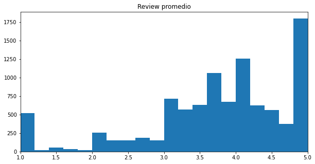
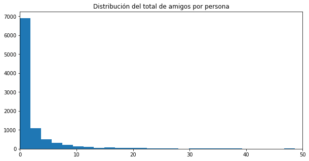
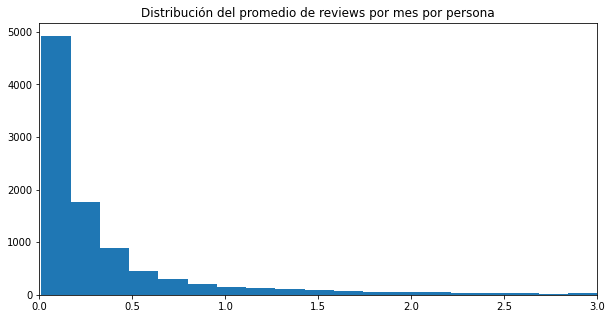
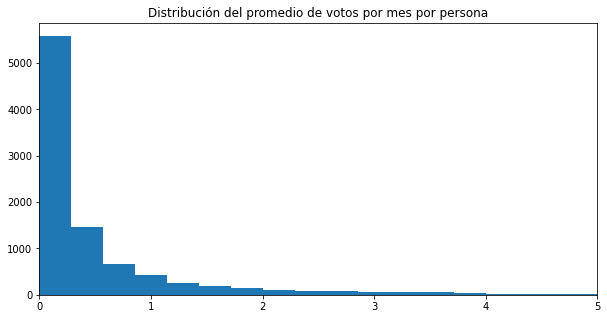
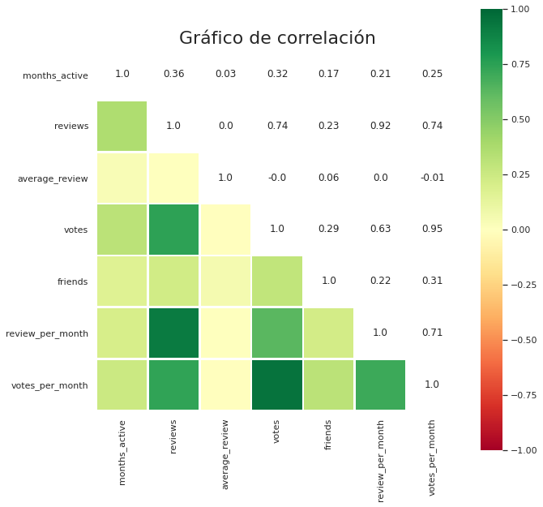
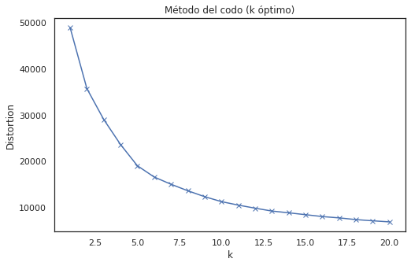

# User Segmentation for a Marketing Campaign

> **TL;DR**
>
> - **Role:** Data Science Analyst (Dec 2020)
> - **Question:** which users of a reviews website should a marketing campaign target?
> - **What I did:** there was no "right answer" column, so I let K-means put similar users into groups (clustering) and picked the number of groups with the elbow method.
> - **Result:** 5 user segments (Pessimists, Optimists, Friendly Ones, Reviewers, Uninterested), each with a recommendation. The raw data file (`Yelp.csv`) is not in the repo.

## Problem introduction

The main goal of this assignment is to analyze the data in the database and identify the cluster of users to target in a marketing campaign.

The deliverable of the assignment is a report with the following structure:
- Initial approach to the mission
- Which analytical model you decided to use for the task, with a brief explanation of it
- Why you used that model
- Final conclusions and recommendations

## Index
- Executive Summary.
- Exploratory data analysis and data cleaning.
- Data modeling.
- Cluster description.
- Assigning clusters to the dataset.
- Limitations.
- Appendix: Python code.

## Executive Summary

The data has no label (no column saying how users reacted to a past campaign), so we can't learn from history. All the variables are numbers, so I used clustering, an unsupervised method (one that finds patterns without a "right answer"): it puts users into groups, so that users in the same group are more alike than users in different groups.

I used K-means, the most common clustering method, which works well when all the variables are numbers. It works like this:

1. Pick *k*, the number of groups (here with the elbow method, see below), and drop k random points in the data: they are the first centers of the groups.
2. Put each user in the group whose center is closest.
3. Move each center to the average of the users in its group.
4. Repeat steps 2 and 3 until the centers barely move (or a set number of rounds is reached).

K-means found these user segments:

- **The Pessimists**: much newer than average, with the fewest friends and the fewest reviews, and their reviews tend to be negative. They are almost 20% of the users. Better not to include them: if the campaign goes wrong, a bad review can cost a lot.

- **The Optimists**: the newest users on average. They don't write many reviews either (about 1.7 times the Pessimists), but their reviews tend to be positive. They are 44% of the users and look like a good target, because they will probably react well.

- **The Friendly Ones**: a tiny segment (1.3% of the users), but a special one: they have lots of friends, so their reviews reach many people and can boost the brand, or hurt it. If they are included, the campaign must be top quality.

- **The Reviewers**: they write many reviews and votes per month, and are 3% of the users. They will probably review the product, so if they are included the campaign must be top quality, to earn good reviews. Still, they are a lower priority than the Friendly Ones.

- **The Uninterested**: active for a long time, but with low activity (still higher than the new users: the Pessimists and the Optimists). Their average score is close to the overall average. They could get a campaign, but not an expensive one.

The data exploration also showed that:
- 5% of users always give 1 star (maybe they rated only once), and 20% always give 5 stars. Overall, users tend to rate positively (above 3 stars).
- Almost 70% of the users on this platform have 1 friend or none.
- Users who write the most reviews also vote the most.
- Users who have been active for longer tend to be more active.

The full analysis follows below. For any questions, write to joaquinamiel@gmail.com.

## Exploratory data analysis and data cleaning

> **In this section** we read the data, removed repeated user IDs (keeping the first row of each) and renamed the columns. We then created the variables reviews per month and votes per month, removed the outliers, plotted the distributions and the correlations, and dropped the original reviews and votes columns. The first rows of the data and the summary tables are shown below.

Here the goal is to get to know the data: understand the problem, decide how to approach it, see what needs cleaning, and find first insights.

The data has no label that would let us learn from history. Normally, a campaign model learns from users who received a similar campaign before. For example, for a consumer loan offer, we would use past loan campaigns to estimate which new customers are likely to accept, and so make the campaign more profitable. Here we don't have that.

Also, all the variables are numbers. With no history and only numbers, the best option is clustering: an unsupervised method that finds groups of users who are alike, so each group can be described as a whole.

**Output:**

| ID | Months Active | Reviews | Average Review | Votes | Friends |
|---|---|---|---|---|---|
| HzLh-2WyMjf6TYATFwg6NA | 36 | 5 | 3.60 | 2 | 0 |
| gYV6bmTSgbZMGkvXHVCowg | 38 | 5 | 2.20 | 86 | 0 |
| 4duCDxDMiRJJbc2CmnziAg | 46 | 7 | 3.57 | 2 | 0 |
| 2EeuYhLuzvvrJ9v2pVrTjQ | 30 | 4 | 3.00 | 1 | 0 |
| 5AwX3A1D-PJkkrWuRpmpCA | 49 | 19 | 4.30 | 36 | 2 |

The summary table below shows that:

- There are no missing values (every column has the same count).
- *Months Active* and *Average Review* look fairly balanced, but the other variables are very skewed (a few users have huge values), which points to outliers. They must be handled, because K-means works with distances and a few extreme users can change the results a lot.
- We can create "reviews per month" and "votes per month". This way, a user who joined long ago doesn't look more active just because they had more time.

**Output:**

| | months_active | reviews | average_review | votes | friends |
|---|---|---|---|---|---|
| count | 9888.000 | 9888.000 | 9888.000 | 9888.000 | 9888.000 |
| mean | 40.569 | 33.779 | 3.744 | 152.833 | 4.277 |
| std | 20.379 | 112.485 | 1.028 | 1471.384 | 22.838 |
| min | 7.000 | 1.000 | 1.000 | 0.000 | 0.000 |
| 25% | 25.000 | 2.000 | 3.290 | 2.000 | 0.000 |
| 50% | 39.000 | 6.000 | 3.900 | 7.000 | 0.000 |
| 75% | 53.000 | 18.000 | 4.500 | 30.000 | 2.000 |
| max | 118.000 | 3166.000 | 5.000 | 67094.000 | 1066.000 |

### Outlier detection

To find outliers I used Isolation Forest, which looks at all the variables at once (a user can look normal in each column, but strange in the combination). I assumed that 1% of users are outliers: a much bigger share would not be "outliers" anymore, but a normal part of the data.
Removing these few users is fine here, because the goal is to pick users for a marketing campaign. It would be different if we were looking for fraud, where the strange users are exactly the ones we want.

**Output (1 = normal user, -1 = outlier):**

```text
 1    9789
-1      99
Name: outlier, dtype: int64
```

Without the outliers the data is much more regular (it still needs to be standardized before clustering, see Data modeling). The spread (standard deviation) drops a lot:
- *reviews*: from a standard deviation of 112 to 72.
- *votes*: from 1,471 to 268.
- *friends*: from 22 to 9.

**Output:**

| | months_active | reviews | average_review | votes | friends | review_per_month | votes_per_month |
|---|---|---|---|---|---|---|---|
| count | 9789.000000 | 9789.000000 | 9789.000000 | 9789.000000 | 9789.000000 | 9789.000000 | 9789.000000 |
| mean | 40.287363 | 26.939728 | 3.743980 | 66.913883 | 2.954234 | 0.545038 | 1.172412 |
| std | 20.182744 | 72.053297 | 1.032713 | 268.540590 | 9.177625 | 1.187845 | 3.886438 |
| min | 7.000000 | 1.000000 | 1.000000 | 0.000000 | 0.000000 | 0.011000 | 0.000000 |
| 25% | 24.000000 | 2.000000 | 3.290000 | 2.000000 | 0.000000 | 0.077000 | 0.056000 |
| 50% | 38.000000 | 5.000000 | 3.900000 | 7.000000 | 0.000000 | 0.167000 | 0.209000 |
| 75% | 53.000000 | 17.000000 | 4.500000 | 28.000000 | 2.000000 | 0.430000 | 0.673000 |
| max | 118.000000 | 1352.000000 | 5.000000 | 7892.000000 | 187.000000 | 15.745000 | 85.783000 |

The average review histogram shows that about 5% of users always give 1 star (maybe they rated only once), and about 20% always give 5 stars. Most users rate positively (most of the chart is to the right of 3).



Almost 70% of the users on this platform have 1 friend or none.



Both reviews per month and votes per month drop fast: many users do very little, and only a few do a lot.





### Correlation analysis

*Votes per month* is almost perfectly correlated with *votes*, and *reviews per month* with *reviews*. So *votes* and *reviews* were dropped: they say the same thing, but are distorted by how long each user has been active.

Reviews per month and votes per month are also highly correlated: users who write more reviews also vote more.

Finally, time active and reviews per month have a low positive correlation: users who have been active for longer tend to be a bit more active (the same holds for votes).



## Data modeling

> **In this section** we standardized the five remaining variables, tried 1 to 14 groups to build the elbow chart, trained the final k-means model with 5 groups and saved each user's group number (0 to 4) in a new column. The inertia of the final model is shown below.

With no labels there is nothing to test against, so the data is not split into train and test. But it does need standardizing (subtract the average and divide by the standard deviation), so that every variable counts the same in the distances, whatever its unit.

I used K-means, the most common clustering method, which works well when all the variables are numbers. Others, like DBSCAN, would also work here, but they are harder to explain.

First we need the number of groups. For that we use inertia: the sum of the squared distances from each user to the center of their group (how far users are from their group's "typical user"). Lower is better, but inertia always goes down when we add more groups, so the lowest value is not the answer.

The elbow method plots inertia against the number of groups and picks the point where adding more groups stops helping much (the "elbow" of the curve). Here that point is 5 groups.



**Output (inertia of the final 5 groups):**

```text
18975.8422932686
```

## Cluster description

> **In this section** we also calculated the share and the number of users in each segment, and the average of all users to compare each segment against.

The table below shows the average of each variable in each group, which lets us describe each segment:

**Output:**

| kmeans | months_active | average_review | friends | review_per_month | votes_per_month | Percentage | Total |
|---|---|---|---|---|---|---|---|
| 0 | 29.66 | 2.14 | 0.67 | 0.18 | 0.27 | 19.76 | 1934 |
| 1 | 28.08 | 4.39 | 1.44 | 0.30 | 0.34 | 43.66 | 4274 |
| 2 | 51.89 | 3.99 | 62.68 | 1.19 | 4.56 | 1.34 | 131 |
| 3 | 60.13 | 3.72 | 11.77 | 5.79 | 17.22 | 3.06 | 300 |
| 4 | 61.01 | 3.84 | 3.08 | 0.58 | 1.19 | 32.18 | 3150 |

**Output (average of all users):**

```text
months_active       40.287363
average_review       3.743980
friends              2.954234
review_per_month     0.545038
votes_per_month      1.172412
dtype: float64
```

- **The Pessimists (Segment 0)**: much newer than average, with the fewest friends and the fewest reviews, and their reviews tend to be negative. They are almost 20% of the users. Better not to include them: if the campaign goes wrong, a bad review can cost a lot.

- **The Optimists (Segment 1)**: the newest users on average. They don't write many reviews either (about 1.7 times the Pessimists), but their reviews tend to be positive. They are 44% of the users and look like a good target, because they will probably react well.

- **The Friendly Ones (Segment 2)**: a tiny segment (1.3% of the users), but a special one: they have lots of friends, so their reviews reach many people and can boost the brand, or hurt it. If they are included, the campaign must be top quality.

- **The Reviewers (Segment 3)**: they write many reviews and votes per month, and are 3% of the users. They will probably review the product, so if they are included the campaign must be top quality, to earn good reviews. Still, they are a lower priority than the Friendly Ones.

- **The Uninterested (Segment 4)**: active for a long time, but with low activity (still higher than the new users: the Pessimists and the Optimists). Their average score is close to the overall average. They could get a campaign, but not an expensive one.

## Assigning clusters to the dataset

> **In this section** we gave each user the name of their segment (instead of the group number); the first rows of the resulting table are shown below.

**Output:**

| ID | months_active | average_review | friends | review_per_month | votes_per_month | Cluster |
|---|---|---|---|---|---|---|
| HzLh-2WyMjf6TYATFwg6NA | 36 | 3.60 | 0 | 0.139 | 0.056 | The Optimists |
| gYV6bmTSgbZMGkvXHVCowg | 38 | 2.20 | 0 | 0.132 | 2.263 | The Pessimists |
| 4duCDxDMiRJJbc2CmnziAg | 46 | 3.57 | 0 | 0.152 | 0.043 | The Uninterested |
| 2EeuYhLuzvvrJ9v2pVrTjQ | 30 | 3.00 | 0 | 0.133 | 0.033 | The Pessimists |
| 5AwX3A1D-PJkkrWuRpmpCA | 49 | 4.30 | 2 | 0.388 | 0.735 | The Uninterested |

## Limitations

> **In this section** we list what I would do differently today.

- **The number of groups (5) was picked by eye** from the elbow chart. A second check, like the silhouette score (how well each user fits its own group compared with the closest other group), would back up the choice.
- **K-means works best with round groups of similar size**, and some variables are still very skewed after removing the outliers. A log transformation before clustering would probably give cleaner groups.
- **The groups were not tested for stability**: running K-means again with another random start, or on a sample of the users, should give similar groups.
- **The raw data (`Yelp.csv`) is not in this repository**, so the analysis can't be re-run from here.

## Appendix: Python code

Full code of the analysis, in the order it was run. It is the same code as in [`analysis.py`](analysis.py).

### A.1 Exploratory data analysis and data cleaning

```python
# Load the tools (libraries) we need, like taking tools out of a toolbox.
import warnings
warnings.filterwarnings("ignore")  # hide the warning messages so the output stays clean

# Colab only (not needed locally): the original notebook installed 'kneed' here,
# but it was never used afterwards.
# !pip install kneed
# from kneed import KneeLocator

import pandas as pd                                  # tables of data (a table is called a DataFrame)
import numpy as np                                   # math on lists of numbers
import seaborn as sns                                # nicer-looking charts
from matplotlib.colors import ListedColormap         # lets us pick our own chart colors
import matplotlib.pyplot as plt                      # draws the charts
from sklearn.ensemble import IsolationForest         # finds "weird" rows (outliers)
from sklearn.cluster import KMeans                   # puts similar rows into groups (clusters)
from sklearn.preprocessing import StandardScaler     # puts all columns on the same size scale

# Colab only: the original notebook mounted Google Drive here to read the file.
# from google.colab import drive
# drive.mount('/content/gdrive')

# Read the data. A CSV file is just a table saved as plain text.
# `df` is our table, and we will keep using that name.
# path = r'gdrive/My Drive/startupCompany/'  # original Colab path
path = 'data/'  # folder where Yelp.csv lives; change it to your own folder
df = pd.read_csv(path + 'Yelp.csv')  # , sep=';'

# Some user IDs show up more than once. We can't trust them (we don't know which
# row is the right one), so we keep only the first row of each ID.
df.drop_duplicates(inplace=True, subset='ID')

# Use the ID as the row label (called the "index"), so each row is named after its user.
# Then print the first 5 rows to see what the data looks like.
df.set_index('ID', inplace=True)
print(df.head())

# The column names have extra spaces and capital letters, which makes them
# annoying to type. Print them to see.
print(df.columns)

# Give the columns short names: lowercase, no spaces, underscores between words.
df.rename(columns={' Months Active': 'months_active',
                   ' Reviews': 'reviews',
                   ' Average Review': 'average_review',
                   ' Votes': 'votes',
                   ' Friends ': 'friends'}, inplace=True)

# Quick summary of every column:
#   count = how many rows have a value (if it differs between columns, some are empty)
#   mean  = the average
#   std   = how spread out the numbers are (big = very different from each other)
#   min / max = smallest / biggest value
#   25%, 50%, 75% = the value that 25%, half and 75% of the rows are below
#                   (50% is the "middle" user, also called the median)
descriptive_table = df.describe(include='all').round(decimals=3)
description_numeric = descriptive_table.loc[['count', 'mean', 'std', 'min', '25%', '50%', '75%', 'max']]
description_numeric.dropna(axis=1, thresh=None, inplace=True)
print(description_numeric)

# Someone active for 100 months will naturally have more reviews and votes than
# someone active for 10. Dividing by the months makes the two fair to compare.
df['review_per_month'] = round(df.reviews / df.months_active, 3)
df['votes_per_month'] = round(df.votes / df.months_active, 3)

# An "outlier" is a row that is very different from almost all the others
# (for example, one user with 67,000 votes). It can confuse the grouping later.
# IsolationForest finds them by asking random questions to separate each row from
# the rest: weird rows get separated very fast, normal rows take longer.
n_estimators = 5000      # how many random "question trees" to build (more = steadier result)
anomalies_ratio = 0.01   # we guess that 1% of the rows are outliers
random_state = 42        # fixes the randomness, so we get the same answer on every run

clf = IsolationForest(n_estimators=n_estimators, contamination=anomalies_ratio, random_state=random_state)
clf.fit(df[['average_review', 'friends', 'review_per_month', 'votes_per_month']])
df['outlier'] = clf.predict(df[['average_review', 'friends', 'review_per_month', 'votes_per_month']])

# Count the rows: 1 = normal row, -1 = outlier.
print(df.outlier.value_counts())

# Keep only the normal rows, then remove the helper column we no longer need.
df = df[df.outlier == 1]
df.drop(columns=['outlier'], inplace=True)

# Look at the summary again, now without the outliers (numbers should look calmer).
print(df.describe())

# A histogram is a bar chart that counts how many users fall in each range of values:
# a taller bar means more users there. This one is for the average review (1 to 5 stars).
fig, ax = plt.subplots(figsize=(10, 5))
n, bins, patches = ax.hist(df.average_review, bins=20, density=False)
ax.set_xlim(1, 5)
ax.set_title('Average review')
plt.show()

# Same kind of chart, for the number of friends (we zoom in on 0 to 50 friends).
fig, ax = plt.subplots(figsize=(10, 5))
n, bins, patches = ax.hist(df.friends, bins=100, density=False)
ax.set_xlim(0, 50)
ax.set_title('Distribution of total friends per person')
plt.show()

# Same kind of chart, for reviews per month (we zoom in on 0 to 3).
fig, ax = plt.subplots(figsize=(10, 5))
n, bins, patches = ax.hist(df.review_per_month, bins=100, density=False)
ax.set_xlim(0, 3)
ax.set_title('Distribution of average reviews per month per person')
plt.show()

# Same kind of chart, for votes per month (we zoom in on 0 to 5).
fig, ax = plt.subplots(figsize=(10, 5))
n, bins, patches = ax.hist(df.votes_per_month, bins=300, density=False)
ax.set_xlim(0, 5)
ax.set_title('Distribution of average votes per month per person')
plt.show()

# Correlation = a number from -1 to 1 that says if two columns move together:
#   +1 = when one goes up, the other goes up too
#   -1 = when one goes up, the other goes down
#    0 = no link between them
# We draw it as a grid of colored squares (a "heatmap"): the lower half is colored,
# the upper half shows the same numbers as text.
sns.set(style="white")
fig, ax = plt.subplots(1, figsize=(10, 10))
corr = df.corr()
labels = corr.where(np.triu(np.ones(corr.shape)).astype(bool))
labels = labels.round(2)
labels = labels.replace(np.nan, ' ', regex=True)

mask = np.triu(np.ones(corr.shape)).astype(bool)
ax = sns.heatmap(
    corr,
    mask=mask,
    vmin=-1,
    vmax=1,
    center=0,
    cmap='RdYlGn',
    fmt='',
    square=True,
    linewidths=1.5).set_title("Correlation plot", fontsize=22)
mask = np.ones(corr.shape) - mask
ax = sns.heatmap(
    corr,
    mask=mask,
    vmin=-1,
    vmax=1,
    center=0,
    cmap=ListedColormap(['white']),
    annot=labels,
    cbar=False,
    fmt='',
    linewidths=1.5)
plt.show()

# `votes` and `reviews` move almost exactly like their "per month" versions, and they
# mostly just reflect how long the user has been around. So we drop them and keep
# the "per month" ones, which say the same thing without the time effect.
df.drop(columns=['votes', 'reviews'], inplace=True)
```

### A.2 Data modeling

```python
# "Standardize" = put every column on the same size scale.
# k-means measures distances between rows, so a column with big numbers (friends goes up
# to 187) would count much more than one with small numbers (reviews go from 1 to 5).
# StandardScaler fixes that: for each column it subtracts the average and divides by the
# spread, so every column ends up centered on 0 with a similar size.
scaler = StandardScaler()
X = scaler.fit_transform(df)

# How many groups (k) should we make? We try k = 1, 2, ... 14 and write down the "inertia" of each.
# Inertia = how far the users are from the center of their own group, added up.
# Lower = tighter groups. It always drops when we add groups, so we look for the
# "elbow" in the line: the point where adding more groups stops helping a lot.
# random_state fixes the random start, so the result repeats on every run.
distortions = []
K = range(1, 15)
for k in K:
    kmeanModel = KMeans(n_clusters=k, random_state=70)
    kmeanModel.fit(X)
    distortions.append(kmeanModel.inertia_)

plt.figure(figsize=(8, 5))
plt.plot(K, distortions, 'bx-')
plt.xlabel('k')
plt.ylabel('Distortion')
plt.title('Elbow method (optimal k)')
plt.show()

# The elbow is at k = 5, so we make 5 groups. How k-means works:
#   1) drop 5 centers at random places
#   2) give each user to the closest center
#   3) move each center to the middle of its users
#   4) repeat 2 and 3 until the centers stop moving
# n_init=10: try 10 different random starts and keep the best one.
# max_iter=300: repeat at most 300 times.
kmeans = KMeans(n_clusters=5, random_state=20, n_init=10, max_iter=300)
kmeans.fit(X)

# The inertia of our final 5 groups (lower = tighter groups).
print(kmeans.inertia_)

# Write each user's group number (0 to 4) in a new column.
df['kmeans'] = kmeans.labels_.tolist()
```

### A.3 Cluster description

```python
# For each group, the average of every column, plus what share of users it has
# (Percentage) and how many users it has (Total). This is how we read what each group is like.
table = df.groupby(["kmeans"]).mean()
table['Percentage'] = 100 * df.kmeans.value_counts().sort_index() / df.shape[0]
table['Total'] = df.kmeans.value_counts().sort_index()
print(round(table, 2))

# The average of everyone together, to compare each group against.
print(df.mean())
```

### A.4 Assigning clusters to the dataset

```python
# Give each group number a human name, based on the table above, and print the first rows.
assignment = {0: 'The Pessimists', 1: 'The Optimists', 2: 'The Friendly Ones', 3: 'The Reviewers', 4: 'The Uninterested'}
df['Cluster'] = df.kmeans.map(assignment)
df.drop(columns=['kmeans'], inplace=True)
print(df.head())
```
