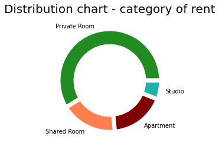
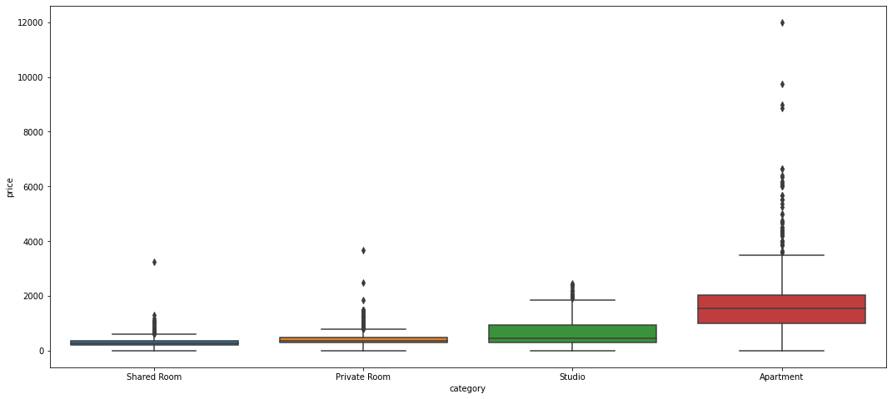
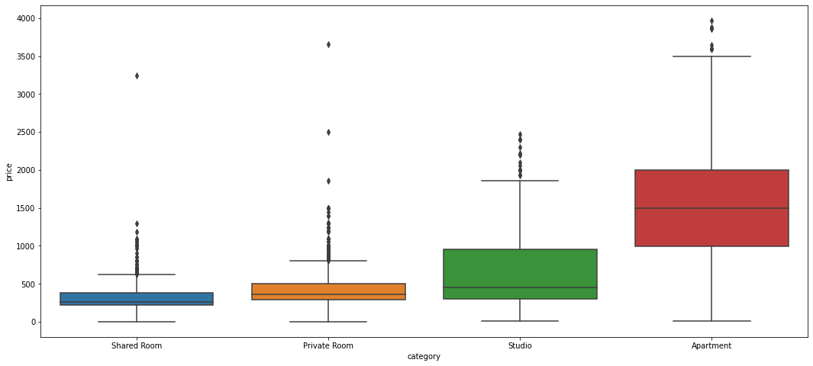
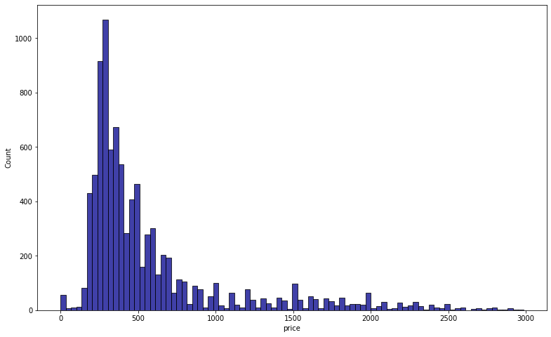
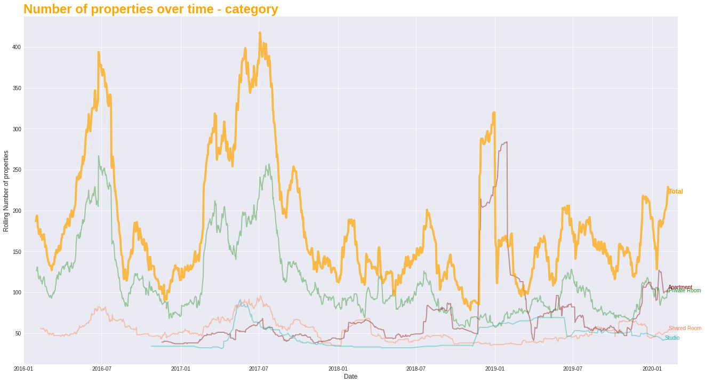
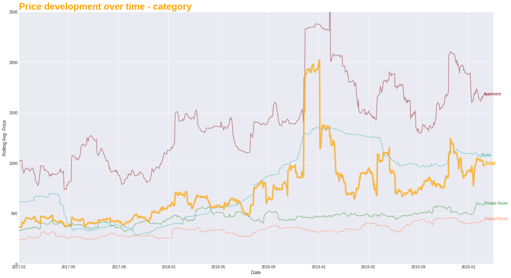
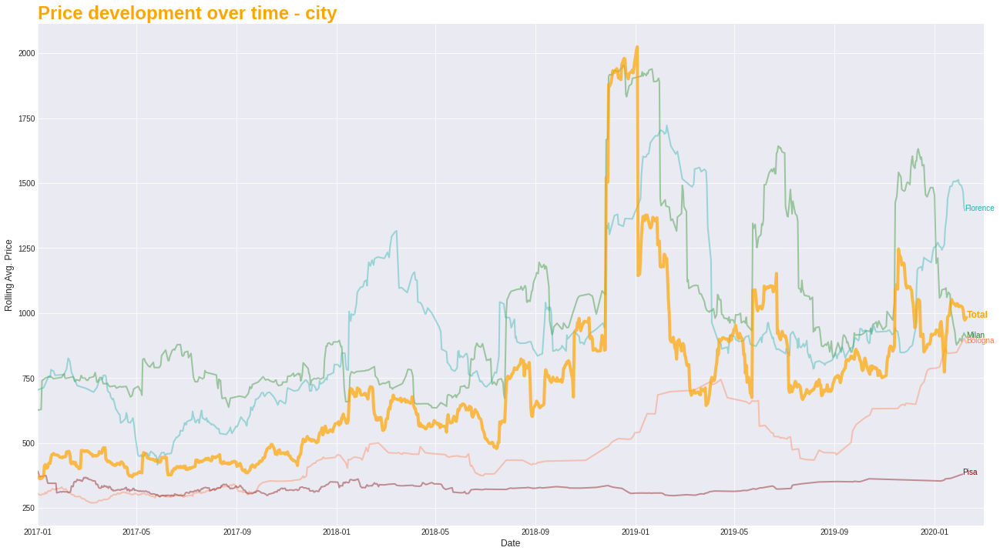
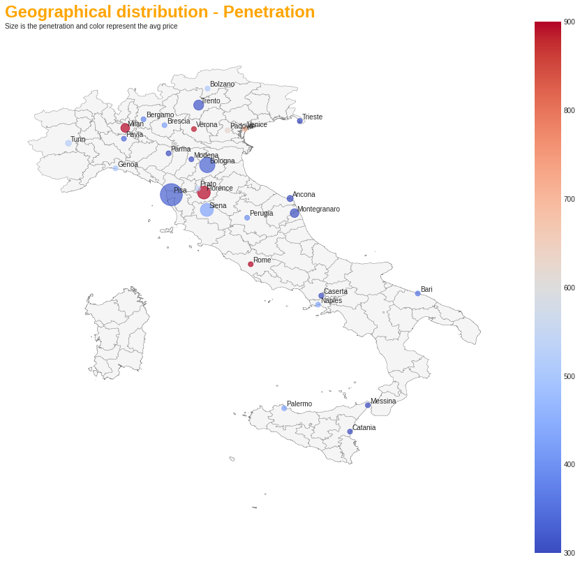
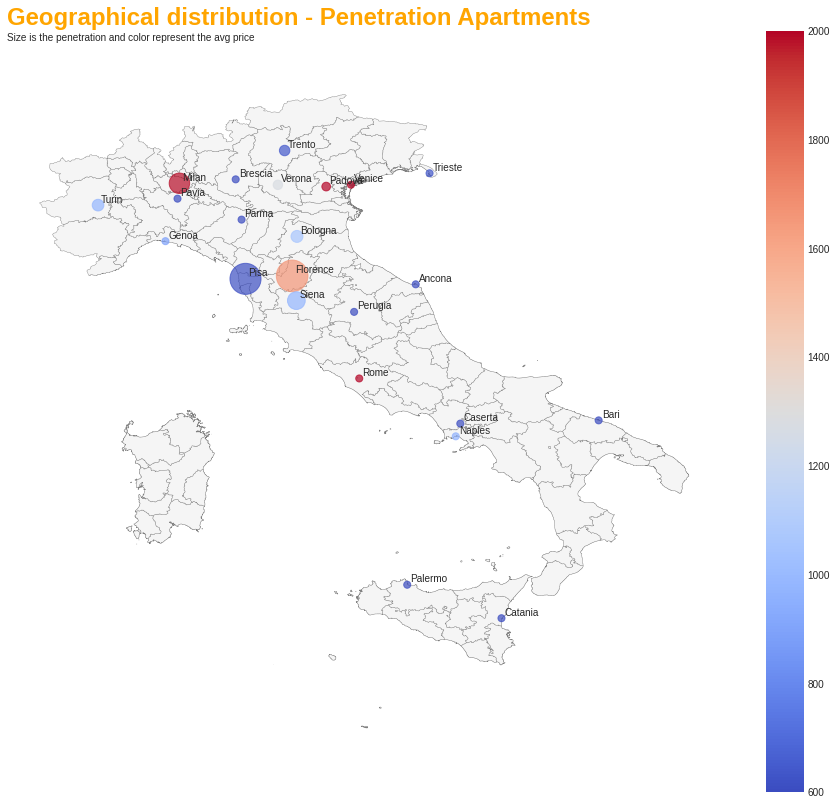
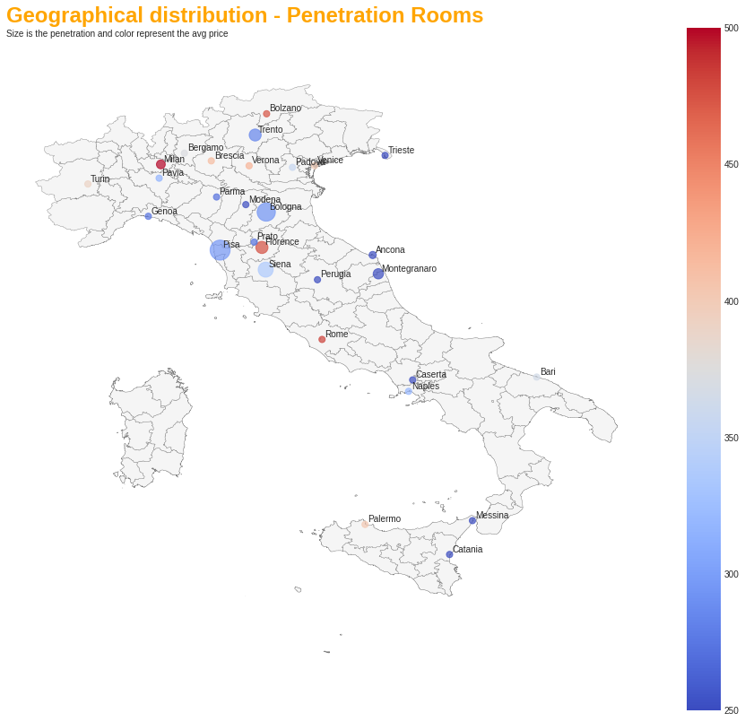

# Rental Market Analysis in Italy

> **TL;DR**
>
> - **Role:** Senior Data Analyst (Aug 2022)
> - **Question:** for a rental platform in Italy: which KPIs (key numbers to track) matter most, and what do prices and cities tell us?
> - **What I did:** cleaned the listings, drew prices over time, and mapped how many listings each city has per 100,000 people.
> - **Result:** proposed 3 KPIs: registration rate, conversion rate and churn (clients who leave). The average apartment rent went from about 1,000 to 1,700 euros a month, and private rooms from 350 to 600. Rome is the main city to grow in: the biggest city, with the most expensive apartments and very few listings per inhabitant.

## Data

The listings table has these columns:

- **city**: The city where the listing is located
- **category**: Private Room, Shared Room, Apartment, Studio
- **country_code**: Country code of the listing
- **created_at**: Timestamp of listing creation
- **price**: Monthly rent in euros
- **furnished**: Is the listing furnished [Yes/No]
- **total_size**: Size in square meters of the property
- **registration_possible**: Whether it is possible to use the listing's address for registering at the city's municipality
- **washing_machine**: Is there a washing machine available in the property
- **tv**: Is there a TV available in the property
- **balcony**: Is there a balcony available in the property
- **garden**: Is there a garden available in the property
- **terrace**: Is there a terrace available in the property

## Business questions

1. What are the 3 most important KPIs/metrics for RealEstateCompany and why?
2. Suggest an approach to improve the KPIs/metrics.
3. What are competitors doing better that RealEstateCompany is not?

## Programming Analysis and Data Visualization

**Task 1:** Clean the dataset, provide code and explain the steps.

**Task 2:** Create a graphical representation for the following topics and interpret the results:

- Price development over time
- Geographical distribution & defining cities of interest
- Any other interesting insights

## My answers to the business questions

RealEstateCompany is a home rental platform across Europe (this analysis looks only at Italy). It has 2 types of customers:

- **Tenants**: composed of students, expats and young professionals.
- **Landlords and property managers**: here the company works with universities, companies and recruitment and relocation agencies.

The company makes money from:

- **Commission fee**: when a home is rented, each side (tenant and landlord) pays 25% of the first month's rent (not of the whole contract), with a minimum of 150 euros. So the price matters a lot: more expensive homes bring more money (below 600 euros, every home pays the same minimum fee).
- **Card payment fees** (my guess): the company probably gets a small commission from card companies (like Mastercard) when people pay the deposit, the rent and extras through the platform. So it also earns money after the rental, not only at the moment of renting.

As a platform, the company deals with three kinds of people, one for each stage of the funnel (the path from first visit to paying client):

- **Visitors**: people who visit the site but have not signed up. They are the top of the funnel (**lead generation - Awareness**).
- **Users**: people who signed up as a tenant or landlord but have not paid anything yet. They are the middle of the funnel (**lead nurture - Consideration**). For example, a landlord can publish a place, but if it is never rented (or is rented on another site), the landlord never pays the company.
- **Clients**: when a contract is signed, users pay the commission and become clients. This is the bottom of the funnel (**sales - Conversions**). If we know how long the contract lasts, we can tell whether the client keeps working with the company.

A good KPI (Key Performance Indicator: a number that tells if the business is going well) follows the SMARTER rule:

- **Specific**: What exactly do you want to achieve?
- **Measurable**: How will you identify that you have achieved your goal?
- **Achievable**: Is your goal really attainable?
- **Relevant**: Is it relevant to you or, in other words, does it align with where you want to be?
- **Time-bound (or timely)**: When will you deliver your goal, and what are the key milestones?
- **Explainable**: Easy to understand for your peers.
- **Relative**: Measured in percentages, or other methods which avoid "vanity metrics".

Each KPI can be split (using Google Analytics, or our own platform data for registered people) by:

- Category of customer (tenant or landlord).
- City.
- Demographic variables such as age, gender, socioeconomic level, marital status.
- Some other indicator variables such as student or not, expat or local, professional or not.
- Time variables such as hour, day of the week, month, etc.
- Campaign (channel, publisher, etc.).

Keep in mind that campaigns have different goals: a campaign can have a good registration rate but a poor conversion rate, and still be doing its job.

**1. The 3 most important KPIs**, in my opinion:

- **Registration rate**: the share of visitors who sign up and become users. It tells us if our awareness campaigns work and, split by the dimensions above, where to invest more, less, or nothing.

- **Conversion rate**: the share of users looking for a home (we can see it from their visits) who become clients. It tells us if our conversion campaigns work and where to invest.

- **Churn**: the share of clients who stop working with us. It measures retention (keeping clients), so it tells us if our retention (CRM) campaigns work and where to invest.

**2. How to improve them:** use an optimization model that decides how to split the marketing budget between campaigns, based on the data we have and on limits like the total budget or the maximum number of times we want to contact a person.

**3. What competitors do better:** they let people buy and sell homes, not only rent them. Today, a landlord who wants to sell or a tenant who wants to buy has to go to a competitor. Adding this should be cheap, because most of what is needed is already built into the platform.

Finally, most of the company's reviews on Trustpilot complain that the home doesn't look like the photos. The company could offer, for an extra fee, someone who visits the home with the tenant on move-in day (or a few days before) to check that everything matches the photos.

## 0. Import libraries and data

> **In this section** we imported the libraries (pandas, numpy, matplotlib, seaborn, geopandas and shapely), mounted Google Drive (the code was first run in Google Colab) and read three files: the listings table (10,000 rows and 13 columns), a table of Italian cities with their population and position (3,373 rows and 9 columns; public data from https://simplemaps.com/data/it-cities) and a shapefile with the map of Italy (`stanford-mn871sp9778-shapefile.zip`). The first rows of the two tables are shown below.

**Output (listings table):**

|  | city | category | country_code | created_at | price | furnished | total_size | registration_possible | washing_machine | tv | balcony | garden | terrace |
|---|---|---|---|---|---|---|---|---|---|---|---|---|---|
| 0 | Trento | Shared Room | it | 2016-03-12 12:31:31 | 190.0 | "yes" | NaN | NaN | "no" | "yes" | "no" | "no" | "no" |
| 1 | Milan | Apartment | it | 2019-11-14 14:48:10 | 3200.0 | "yes" | "50" | "yes" | "yes" | "yes" | NaN | "no" | NaN |
| 2 | Milan | Shared Room | it | 2019-10-07 10:08:21 | 660.0 | "yes" | "180" | NaN | "yes" | NaN | NaN | NaN | NaN |
| 3 | Pisa | Shared Room | it | 2017-07-05 11:41:57 | 245.0 | "yes" | "140" | "no" | "yes" | "no" | NaN | "no" | NaN |
| 4 | Bologna | Private Room | it | 2017-11-16 08:55:46 | 500.0 | "yes" | "18" | NaN | "yes" | "no" | NaN | NaN | NaN |

**Output (population table of Italian cities):**

|  | city | lat | lng | country | iso2 | admin_name | capital | population | population_proper |
|---|---|---|---|---|---|---|---|---|---|
| 0 | Rome | 41.8931 | 12.4828 | Italy | IT | Lazio | primary | 2872800 | 2872800 |
| 1 | Milan | 45.4669 | 9.1900 | Italy | IT | Lombardy | admin | 1366180 | 1366180 |
| 2 | Naples | 40.8333 | 14.2500 | Italy | IT | Campania | admin | 966144 | 966144 |
| 3 | Turin | 45.0667 | 7.7000 | Italy | IT | Piedmont | admin | 870952 | 870952 |
| 4 | Palermo | 38.1157 | 13.3613 | Italy | IT | Sicilia | admin | 668405 | 668405 |

## 1. Cleaning the data

> **In this section** we applied the steps listed below to the listings table: 5 exact duplicate rows were removed (10,000 → 9,995), then the 595 rows without city (leaving 9,400) and, after splitting `created_at` into date parts, 118 repeated uploads (9,400 → 9,282). The tables show the data types, a summary of the text columns (computed before the rows without city were dropped), the first rows after cleaning and a summary of the numeric columns. The price outliers are handled in the "Outliers" and "Distribution chart - price" subsections.

When the data was read, `created_at` was set as a date and empty cells (`""`) were set as missing values (NA).

The cleaning steps:

- **Delete duplicates**: two listings with the same features uploaded in the same minute are the same listing, sent twice by mistake (for example, a browser or website glitch).
- Remove extra quotes (e.g. `"yes"` → `yes`).
- Turn `total_size` into a number.
- Keep only the day in `created_at`: the exact time doesn't matter (the hour and minute are kept in their own columns).
- Delete the 595 listings without a city: nobody can rent a place without knowing where it is.
- Delete `country_code`: it has only one value.
- Delete the one listing priced over 80,000 euros (an outlier): it looks like the sale price of the home, not a monthly rent.
- Delete the 49 listings priced at 10 euros or less per month. They deserve a closer look (it could be a price per day, or a trick to avoid paying commissions), but here they are removed.
- Sizes below 5 square meters are clearly wrong, so they are set to missing (NA).

<details>
<summary>Output (data types) (click to open)</summary>

```text
city                             object
category                         object
country_code                     object
created_at               datetime64[ns]
price                           float64
furnished                        object
total_size                      float64
registration_possible            object
washing_machine                  object
tv                               object
balcony                          object
garden                           object
terrace                          object
dtype: object
```

</details>

Most text columns have only 2 or 3 values (yes/no/shared), and many are mostly empty: for example, we only know for 1,388 listings whether there is a balcony. The company should encourage landlords to fill in these fields, for example by suggesting answers from the photos they upload (a photo of a balcony means the place probably has one).

**Output (summary of the text columns):**

|  | city | category | country_code | furnished | registration_possible | washing_machine | tv | balcony | garden | terrace |
|---|---|---|---|---|---|---|---|---|---|---|
| count | 9400 | 9396 | 9995 | 6037 | 4374 | 7754 | 6611 | 1388 | 5959 | 1233 |
| unique | 30 | 4 | 1 | 2 | 2 | 2 | 2 | 3 | 3 | 3 |
| top | Milan | Private Room | it | yes | yes | yes | yes | shared | no | no |
| freq | 2144 | 5558 | 9995 | 5151 | 3646 | 7357 | 4451 | 520 | 4455 | 771 |

**Output (first rows after cleaning):**

|  | city | category | created_at | price | furnished | total_size | registration_possible | washing_machine | tv | balcony | garden | terrace | year_created | month_created | day_created | hour_created | minute_created |
|---|---|---|---|---|---|---|---|---|---|---|---|---|---|---|---|---|---|
| 0 | Trento | Shared Room | 2016-03-12 | 190.0 | yes | NaN | NaN | no | yes | no | no | no | 2016 | 3 | 12 | 12 | 31 |
| 1 | Milan | Apartment | 2019-11-14 | 3200.0 | yes | 50.0 | yes | yes | yes | NaN | no | NaN | 2019 | 11 | 14 | 14 | 48 |
| 2 | Milan | Shared Room | 2019-10-07 | 660.0 | yes | 180.0 | NaN | yes | NaN | NaN | NaN | NaN | 2019 | 10 | 7 | 10 | 8 |
| 3 | Pisa | Shared Room | 2017-07-05 | 245.0 | yes | 140.0 | no | yes | no | NaN | no | NaN | 2017 | 7 | 5 | 11 | 41 |
| 4 | Bologna | Private Room | 2017-11-16 | 500.0 | yes | 18.0 | NaN | yes | no | NaN | NaN | NaN | 2017 | 11 | 16 | 8 | 55 |

**Output (summary of the numeric columns and dates):**

|  | created_at | price | total_size | year_created | month_created | day_created | hour_created | minute_created |
|---|---|---|---|---|---|---|---|---|
| count | 9282 | 9282.000000 | 4175.000000 | 9282.000000 | 9282.000000 | 9282.000000 | 9282.000000 | 9282.000000 |
| mean | 2017-11-27 13:10:25.985778944 | 661.114446 | 108.499401 | 2017.439237 | 6.137363 | 15.864253 | 13.344861 | 29.561086 |
| min | 2016-01-01 00:00:00 | 0.010000 | 0.000000 | 2016.000000 | 1.000000 | 1.000000 | 0.000000 | 0.000000 |
| 25% | 2016-12-14 06:00:00 | 285.000000 | 55.000000 | 2016.000000 | 4.000000 | 8.000000 | 10.000000 | 15.000000 |
| 50% | 2017-08-25 12:00:00 | 400.000000 | 85.000000 | 2017.000000 | 6.000000 | 16.000000 | 13.000000 | 29.000000 |
| 75% | 2018-11-29 00:00:00 | 650.000000 | 120.000000 | 2018.000000 | 9.000000 | 24.000000 | 17.000000 | 44.000000 |
| max | 2020-02-09 00:00:00 | 190205.000000 | 10000.000000 | 2020.000000 | 12.000000 | 31.000000 | 23.000000 | 59.000000 |
| std | NaN | 2321.904728 | 280.536044 | 1.161750 | 3.246505 | 8.632976 | 4.374741 | 17.053109 |

### Distribution chart - category of rent

> **In this section** we counted the listings of each category and drew a donut chart (a pie chart with a hole in the middle) with their shares.

Approximately 3 out of 4 properties are private or shared rooms.



### Outliers

> **In this section** we removed the listing with a price above 80,000 and drew boxplots of the price for each category: one over the whole price range and one keeping only the prices below 4,000, so that the boxes are easier to read.



The boxplot (a chart that shows where most prices fall, plus the extreme ones as dots) shows that shared and private rooms cost about the same: with the budget for a shared room, you can find a private one. Most rooms cost less than 600 euros, so the company gets the minimum commission: 300 euros per rental (150 from each side).

The most expensive half of the private rooms costs about the same as the cheapest quarter of the studios, and 75% of the apartments cost more than 1,000 euros. So it is hard to get an apartment with a studio budget.



### Distribution chart - price

> **In this section** we counted the 49 properties with a price of 10 euros or less, drew a histogram (bars that show how many listings fall in each price range) of the prices below 3,000 and then removed those 49 properties.



## 2. Price development over time

> **In this section** we drew three line charts using a rolling window of 30 days with listings: the number of listings per category, the average price per category (from 2017 onwards) and the average price in the 4 cities with the most listings (Milan, Bologna, Pisa and Florence). In all of them the thick orange line is the total of all the listings.

The number of listings went down over time, because private rooms dropped (after September 2017). Meanwhile, apartments went up, especially in the last 2 years. At the start the site had four private rooms for each apartment; at the end, one for one.

For prices, only data from 2017 onwards is used, because before that there were very few apartments and studios.



From January to September 2017 the average price stayed about the same. After that it climbed from 400 to 1,000 euros, because there were fewer (cheap) private rooms and apartments got more expensive.

Apart from seasonal ups and downs (driven by supply and demand), average prices went up a lot: apartments from 1,000 to 1,700 euros, studios from 400 to 1,100, private rooms from 350 to 600 and shared rooms from 250 to 450. In other words: the money that rented an apartment in 2017 now only rents a studio, a 2017 studio budget now gets a private room, and a 2017 private room budget now gets a shared room.



In the 4 cities with the most listings:

- Prices in Pisa stay the same over time.
- In 2019, prices in Bologna went up from 400-450 to 700-750 euros.



## 3. Geographical distribution & defining cities of interest

> **In this section** we calculated the average price and the number of properties of each city and joined them with the population of the city to get the penetration, i.e. the number of properties per 100,000 inhabitants (the 3 properties from Reggio Calabria are lost in this join, as noted in the code). The first rows of the resulting table are shown below; `penetration_per_100thousand_plot` is the penetration limited to between 50 and 1,000, used only to keep the dot sizes on the map readable. The map has one dot per city, with the size showing the penetration and the color showing the average price.

**Output (first rows of the city table):**

|  | city | price | properties | lat | lng | country | iso2 | admin_name | capital | population | population_proper | penetration_per_100thousand | geometry | penetration_per_100thousand_plot |
|---|---|---|---|---|---|---|---|---|---|---|---|---|---|---|
| 0 | Ancona | 225.194125 | 80 | 43.6167 | 13.5167 | Italy | IT | Marche | admin | 100924.0 | 100924.0 | 79.267568 | POINT (13.51670 43.61670) | 79.267568 |
| 1 | Bari | 362.045455 | 44 | 41.1253 | 16.8667 | Italy | IT | Puglia | admin | 323370.0 | 323370.0 | 13.606704 | POINT (16.86670 41.12530) | 50.000000 |
| 2 | Bergamo | 382.000000 | 10 | 45.6950 | 9.6700 | Italy | IT | Lombardy | minor | 120923.0 | 120923.0 | 8.269725 | POINT (9.67000 45.69500) | 50.000000 |
| 3 | Bologna | 330.685408 | 1873 | 44.4939 | 11.3428 | Italy | IT | Emilia-Romagna | admin | 389261.0 | 389261.0 | 481.168162 | POINT (11.34280 44.49390) | 481.168162 |
| 4 | Bolzano | 507.500000 | 10 | 46.5000 | 11.3500 | Italy | IT | Trentino-Alto Adige | minor | 107317.0 | 107317.0 | 9.318188 | POINT (11.35000 46.50000) | 50.000000 |



*Each dot is a city: its size is the penetration (properties per 100,000 inhabitants) and its color is the average monthly price in euros (scale from 300 to 900).*

## 4. Geographical distribution & defining cities of interest - Apartments

> **In this section** we repeated the same steps using only the apartments. Here `penetration_per_100thousand_plot` is the penetration multiplied by 10 and then limited to between 50 and 1,000, and the color scale goes from 600 to 2,000 euros. The whole city table is shown below, followed by the map.

<details>
<summary>Output (city table, apartments) (click to open)</summary>

|  | city | price | properties | lat | lng | country | iso2 | admin_name | capital | population | population_proper | penetration_per_100thousand | geometry | penetration_per_100thousand_plot |
|---|---|---|---|---|---|---|---|---|---|---|---|---|---|---|
| 0 | Ancona | 272.500000 | 4 | 43.6167 | 13.5167 | Italy | IT | Marche | admin | 100924.0 | 100924.0 | 3.963378 | POINT (13.51670 43.61670) | 50.000000 |
| 1 | Bari | 300.000000 | 1 | 41.1253 | 16.8667 | Italy | IT | Puglia | admin | 323370.0 | 323370.0 | 0.309243 | POINT (16.86670 41.12530) | 50.000000 |
| 2 | Bologna | 1055.133929 | 56 | 44.4939 | 11.3428 | Italy | IT | Emilia-Romagna | admin | 389261.0 | 389261.0 | 14.386234 | POINT (11.34280 44.49390) | 143.862344 |
| 3 | Brescia | 483.333333 | 3 | 45.5389 | 10.2203 | Italy | IT | Lombardy | minor | 196745.0 | 196745.0 | 1.524816 | POINT (10.22030 45.53890) | 50.000000 |
| 4 | Caserta | 550.000000 | 1 | 41.0667 | 14.3333 | Italy | IT | Campania | minor | 75561.0 | 75561.0 | 1.323434 | POINT (14.33330 41.06670) | 50.000000 |
| 5 | Catania | 391.666667 | 9 | 37.5027 | 15.0873 | Italy | IT | Sicilia | minor | 311584.0 | 311584.0 | 2.888467 | POINT (15.08730 37.50270) | 50.000000 |
| 6 | Florence | 1665.860830 | 470 | 43.7714 | 11.2542 | Italy | IT | Tuscany | admin | 380948.0 | 380948.0 | 123.376419 | POINT (11.25420 43.77140) | 1000.000000 |
| 7 | Genoa | 890.000000 | 3 | 44.4072 | 8.9340 | Italy | IT | Liguria | admin | 580097.0 | 580097.0 | 0.517155 | POINT (8.93400 44.40720) | 50.000000 |
| 8 | Milan | 1988.340647 | 572 | 45.4669 | 9.1900 | Italy | IT | Lombardy | admin | 1366180.0 | 1366180.0 | 41.868568 | POINT (9.19000 45.46690) | 418.685678 |
| 9 | Naples | 966.000000 | 10 | 40.8333 | 14.2500 | Italy | IT | Campania | admin | 966144.0 | 966144.0 | 1.035042 | POINT (14.25000 40.83330) | 50.000000 |
| 10 | Padova | 2122.828125 | 16 | 45.4064 | 11.8778 | Italy | IT | Veneto | minor | 210440.0 | 210440.0 | 7.603117 | POINT (11.87780 45.40640) | 76.031173 |
| 11 | Palermo | 600.000000 | 2 | 38.1157 | 13.3613 | Italy | IT | Sicilia | admin | 668405.0 | 668405.0 | 0.299220 | POINT (13.36130 38.11570) | 50.000000 |
| 12 | Parma | 500.000000 | 1 | 44.8015 | 10.3280 | Italy | IT | Emilia-Romagna | minor | 195687.0 | 195687.0 | 0.511020 | POINT (10.32800 44.80150) | 50.000000 |
| 13 | Pavia | 565.000000 | 2 | 45.1853 | 9.1550 | Italy | IT | Lombardy | minor | 72773.0 | 72773.0 | 2.748272 | POINT (9.15500 45.18530) | 50.000000 |
| 14 | Perugia | 516.666667 | 3 | 43.1121 | 12.3888 | Italy | IT | Umbria | admin | 165683.0 | 165683.0 | 1.810687 | POINT (12.38880 43.11210) | 50.000000 |
| 15 | Pisa | 610.126437 | 87 | 43.7167 | 10.4000 | Italy | IT | Tuscany | minor | 90118.0 | 90118.0 | 96.540092 | POINT (10.40000 43.71670) | 965.400919 |
| 17 | Rome | 2205.998640 | 125 | 41.8931 | 12.4828 | Italy | IT | Lazio | primary | 2872800.0 | 2872800.0 | 4.351156 | POINT (12.48280 41.89310) | 50.000000 |
| 18 | Siena | 976.176471 | 17 | 43.3183 | 11.3314 | Italy | IT | Tuscany | minor | 53901.0 | 53901.0 | 31.539304 | POINT (11.33140 43.31830) | 315.393035 |
| 19 | Trento | 639.615385 | 13 | 46.0667 | 11.1167 | Italy | IT | Trentino-Alto Adige | admin | 117997.0 | 117997.0 | 11.017229 | POINT (11.11670 46.06670) | 110.172293 |
| 20 | Trieste | 634.000000 | 5 | 45.6503 | 13.7703 | Italy | IT | Friuli-Venezia Giulia | admin | 204338.0 | 204338.0 | 2.446926 | POINT (13.77030 45.65030) | 50.000000 |
| 21 | Turin | 976.530672 | 119 | 45.0667 | 7.7000 | Italy | IT | Piedmont | admin | 870952.0 | 870952.0 | 13.663210 | POINT (7.70000 45.06670) | 136.632099 |
| 22 | Venice | 3337.134444 | 9 | 45.4397 | 12.3319 | Italy | IT | Veneto | admin | 261321.0 | 261321.0 | 3.444040 | POINT (12.33190 45.43970) | 50.000000 |
| 23 | Verona | 1273.913043 | 23 | 45.4386 | 10.9928 | Italy | IT | Veneto | minor | 257275.0 | 257275.0 | 8.939850 | POINT (10.99280 45.43860) | 89.398504 |

</details>



*Each dot is a city: its size is the penetration of apartments (properties per 100,000 inhabitants, multiplied by 10) and its color is the average monthly price of apartments in euros (scale from 600 to 2,000).*

## 5. Geographical distribution & defining cities of interest - Rooms

> **In this section** we repeated the same steps using only the private and shared rooms together. Here `penetration_per_100thousand_plot` is the penetration limited to between 50 and 500, and the color scale goes from 250 to 500 euros. The map is shown first, followed by the whole city table.



*Each dot is a city: its size is the penetration of rooms (properties per 100,000 inhabitants) and its color is the average monthly price of rooms in euros (scale from 250 to 500).*

<details>
<summary>Output (city table, rooms) (click to open)</summary>

|  | city | price | properties | lat | lng | country | iso2 | admin_name | capital | population | population_proper | penetration_per_100thousand | geometry | penetration_per_100thousand_plot |
|---|---|---|---|---|---|---|---|---|---|---|---|---|---|---|
| 0 | Ancona | 211.636364 | 66 | 43.6167 | 13.5167 | Italy | IT | Marche | admin | 100924.0 | 100924.0 | 65.395743 | POINT (13.51670 43.61670) | 65.395743 |
| 1 | Bari | 365.000000 | 42 | 41.1253 | 16.8667 | Italy | IT | Puglia | admin | 323370.0 | 323370.0 | 12.988218 | POINT (16.86670 41.12530) | 50.000000 |
| 2 | Bergamo | 372.857143 | 7 | 45.6950 | 9.6700 | Italy | IT | Lombardy | minor | 120923.0 | 120923.0 | 5.788808 | POINT (9.67000 45.69500) | 50.000000 |
| 3 | Bologna | 292.605762 | 1614 | 44.4939 | 11.3428 | Italy | IT | Emilia-Romagna | admin | 389261.0 | 389261.0 | 414.631828 | POINT (11.34280 44.49390) | 414.631828 |
| 4 | Bolzano | 474.166667 | 6 | 46.5000 | 11.3500 | Italy | IT | Trentino-Alto Adige | minor | 107317.0 | 107317.0 | 5.590913 | POINT (11.35000 46.50000) | 50.000000 |
| 5 | Brescia | 412.890625 | 64 | 45.5389 | 10.2203 | Italy | IT | Lombardy | minor | 196745.0 | 196745.0 | 32.529416 | POINT (10.22030 45.53890) | 50.000000 |
| 6 | Caserta | 216.250000 | 8 | 41.0667 | 14.3333 | Italy | IT | Campania | minor | 75561.0 | 75561.0 | 10.587472 | POINT (14.33330 41.06670) | 50.000000 |
| 7 | Catania | 245.102041 | 49 | 37.5027 | 15.0873 | Italy | IT | Sicilia | minor | 311584.0 | 311584.0 | 15.726096 | POINT (15.08730 37.50270) | 50.000000 |
| 8 | Florence | 477.440895 | 704 | 43.7714 | 11.2542 | Italy | IT | Tuscany | admin | 380948.0 | 380948.0 | 184.802125 | POINT (11.25420 43.77140) | 184.802125 |
| 9 | Genoa | 273.750000 | 8 | 44.4072 | 8.9340 | Italy | IT | Liguria | admin | 580097.0 | 580097.0 | 1.379080 | POINT (8.93400 44.40720) | 50.000000 |
| 10 | Messina | 216.153846 | 13 | 38.1936 | 15.5542 | Italy | IT | Sicilia | minor | 234293.0 | 234293.0 | 5.548608 | POINT (15.55420 38.19360) | 50.000000 |
| 11 | Milan | 590.557526 | 1346 | 45.4669 | 9.1900 | Italy | IT | Lombardy | admin | 1366180.0 | 1366180.0 | 98.522889 | POINT (9.19000 45.46690) | 98.522889 |
| 12 | Modena | 163.000000 | 1 | 44.6458 | 10.9257 | Italy | IT | Emilia-Romagna | minor | 185273.0 | 185273.0 | 0.539744 | POINT (10.92570 44.64580) | 50.000000 |
| 13 | Montegranaro | 248.847647 | 17 | 43.2332 | 13.6322 | Italy | IT | Marche | NaN | 12876.0 | 12876.0 | 132.028580 | POINT (13.63220 43.23320) | 132.028580 |
| 14 | Naples | 319.669259 | 54 | 40.8333 | 14.2500 | Italy | IT | Campania | admin | 966144.0 | 966144.0 | 5.589229 | POINT (14.25000 40.83330) | 50.000000 |
| 15 | Padova | 356.105263 | 95 | 45.4064 | 11.8778 | Italy | IT | Veneto | minor | 210440.0 | 210440.0 | 45.143509 | POINT (11.87780 45.40640) | 50.000000 |
| 16 | Palermo | 403.285714 | 14 | 38.1157 | 13.3613 | Italy | IT | Sicilia | admin | 668405.0 | 668405.0 | 2.094538 | POINT (13.36130 38.11570) | 50.000000 |
| 17 | Parma | 270.731707 | 82 | 44.8015 | 10.3280 | Italy | IT | Emilia-Romagna | minor | 195687.0 | 195687.0 | 41.903652 | POINT (10.32800 44.80150) | 50.000000 |
| 18 | Pavia | 315.964286 | 28 | 45.1853 | 9.1550 | Italy | IT | Lombardy | minor | 72773.0 | 72773.0 | 38.475808 | POINT (9.15500 45.18530) | 50.000000 |
| 19 | Perugia | 210.000000 | 1 | 43.1121 | 12.3888 | Italy | IT | Umbria | admin | 165683.0 | 165683.0 | 0.603562 | POINT (12.38880 43.11210) | 50.000000 |
| 20 | Pisa | 295.312191 | 1214 | 43.7167 | 10.4000 | Italy | IT | Tuscany | minor | 90118.0 | 90118.0 | 1347.122661 | POINT (10.40000 43.71670) | 500.000000 |
| 21 | Prato | 272.500000 | 2 | 43.8808 | 11.0966 | Italy | IT | Tuscany | minor | 193325.0 | 193325.0 | 1.034527 | POINT (11.09660 43.88080) | 50.000000 |
| 23 | Rome | 482.371501 | 393 | 41.8931 | 12.4828 | Italy | IT | Lazio | primary | 2872800.0 | 2872800.0 | 13.680033 | POINT (12.48280 41.89310) | 50.000000 |
| 24 | Siena | 335.618421 | 152 | 43.3183 | 11.3314 | Italy | IT | Tuscany | minor | 53901.0 | 53901.0 | 281.998479 | POINT (11.33140 43.31830) | 281.998479 |
| 25 | Trento | 283.650943 | 212 | 46.0667 | 11.1167 | Italy | IT | Trentino-Alto Adige | admin | 117997.0 | 117997.0 | 179.665585 | POINT (11.11670 46.06670) | 179.665585 |
| 26 | Trieste | 237.291667 | 96 | 45.6503 | 13.7703 | Italy | IT | Friuli-Venezia Giulia | admin | 204338.0 | 204338.0 | 46.980982 | POINT (13.77030 45.65030) | 50.000000 |
| 27 | Turin | 390.715714 | 441 | 45.0667 | 7.7000 | Italy | IT | Piedmont | admin | 870952.0 | 870952.0 | 50.634249 | POINT (7.70000 45.06670) | 50.634249 |
| 28 | Venice | 398.773333 | 75 | 45.4397 | 12.3319 | Italy | IT | Veneto | admin | 261321.0 | 261321.0 | 28.700334 | POINT (12.33190 45.43970) | 50.000000 |
| 29 | Verona | 419.913043 | 23 | 45.4386 | 10.9928 | Italy | IT | Veneto | minor | 257275.0 | 257275.0 | 8.939850 | POINT (10.99280 45.43860) | 50.000000 |

</details>

## 6. Cities of interest: conclusions

> **In this section** we read the three city tables and maps together, to decide which cities to focus on. Penetration = listings per 100,000 inhabitants.

- **Core cities (defend them):** Bologna, Milan, Pisa and Florence hold most of the listings (rooms: 1,614, 1,346, 1,214 and 704). They are university cities, which fits the company's main tenants (students and young professionals).
- **Small cities where the company is already strong:** Pisa (1,347 room listings per 100,000 inhabitants) and Siena (282) are small university towns with a very high penetration. There is little room to grow there; the goal is to keep the lead.
- **Big cities with room to grow:** Rome has the most people (2.9 million) but only about 14 room listings per 100,000 inhabitants, against 98 in Milan. Naples (about 6) and Turin (about 51) are in the same situation. Rome also has the most expensive apartments (2,206 euros a month on average), and since the commission is 25% of the first month's rent, each apartment rented there brings more money. **Rome is the main city of interest**, followed by Naples and Turin.
- **Apartments** are concentrated in Milan (572) and Florence (470), with Rome far behind (125) despite being the biggest city.
- **Not enough data:** the very high apartment prices in Venice (3,337 euros) and Padova (2,123 euros) come from only 9 and 16 listings, so they are not reliable.

## 7. Limitations

> **In this section** we list what I would do differently today.

- **The KPIs could not be measured**: the data only has listings, not visits, sign-ups or contracts. With that data, the next step would be to calculate the three KPIs per city and per channel.
- **The overall average price mixes categories**: when cheap private rooms disappear, the average goes up even if no price changes. The charts per category are the reliable ones for price trends.
- **Penetration uses the whole population of each city**, but most tenants are students and young professionals. Using the number of university students would show the real size of each market better.
- **Many features are mostly empty** (balcony, garden, terrace...), so they could not be used in the analysis.

## Appendix: Python code

The code below is the same as in [`analysis.py`](analysis.py), grouped by the sections of this report. The only difference: here the file path still points to the original Google Drive folder, while `analysis.py` reads from `data/`.

### A.1 Import libraries and data (section 0)

```python
# ELI5: a "library" is a box of ready-made tools that other people wrote.
# pandas = tables (like Excel, but in code), numpy = fast math on lists of numbers,
# matplotlib and seaborn = charts, geopandas and shapely = maps and points on a map.
# The lines about Google Colab and Google Drive only work inside Colab, so they are
# commented out here (outside Colab, install geopandas once with: pip install geopandas).
# !pip install geopandas
import pandas as pd
import numpy as np
import datetime as dt
import matplotlib.pyplot as plt
# ELI5: these two settings make print() show every column and the full text of long cells
# (None = "no limit"), instead of cutting them with "...".
pd.set_option('display.max_columns', None)
pd.set_option('max_colwidth', None)
import seaborn as sns
import geopandas as gpd
from IPython.display import display, Markdown, Latex

from shapely.geometry import Point, LineString, Polygon
from shapely import ops
from geopandas import GeoDataFrame


# from google.colab import drive
# drive.mount('/content/gdrive')

# ELI5: the folder where the three data files live. Change it to the folder on your own
# computer (or Google Drive) before running the code.
# user parameters
path = r'gdrive/My Drive/Data Science Project/RealEstateCompany/' 

# ELI5: read the three files into tables.
# map = the borders of Italy (a "shapefile" is a zipped file with the shapes drawn as polygons).
# df = the listings. parse_dates makes created_at a real date (not plain text) and na_values says
# that the text "" means "empty" (NA = not available, i.e. missing).
# pop = a public table of Italian cities with their population and position.
# map - shapefile
map = gpd.read_file('zip://'+path+'stanford-mn871sp9778-shapefile.zip')

# read the database assessment
df = pd.read_csv(path+'ha_data_assessement.csv',parse_dates=['created_at'],na_values='""') 

#Public data from cities from italy: https://simplemaps.com/data/it-cities
pop = pd.read_csv(path+'it.csv') 

# ELI5: .shape = (number of rows, number of columns); .head() = the first 5 rows, a quick look.
print(df.shape)
print(df.head())

# ELI5: the same quick look for the cities table.
print(pop.shape)
print(pop.head())
```

### A.2 Cleaning the database (section 1)

```python
# ELI5: a "duplicate" is a row that is exactly the same as another row. drop_duplicates removes them
# (keep='last' keeps the last copy), so one listing is not counted twice.
# Then we delete the quote marks around the values ("yes" becomes yes) and turn total_size into a real
# number; errors='coerce' means "if it is not a number, mark it as missing (NaN) instead of failing".
print(df.shape)
df.drop_duplicates(keep='last', inplace = True) 
print(df.shape) # we delete 5 duplicates

df.replace('"','', regex=True,inplace = True)
df['total_size'] =  pd.to_numeric(df.total_size, errors='coerce')

# ELI5: dtypes = what kind of data each column holds (object = text, float64 = number with decimals,
# datetime64 = date and time).
print(df.dtypes)

# ELI5: a quick summary of the text columns. count = how many cells are filled, unique = how many
# different values, top = the most common value, freq = how many times it appears.
print(df.describe(include=[object]))

# ELI5: keep only the rows that have a city, and drop the country_code column
# (every listing is from Italy, so that column says the same thing in every row).
df = df[df.city.notnull()]
df.drop(columns=['country_code'],inplace=True) #all the houses are from italy

# ELI5: split the creation date into separate columns (year, month, day, hour, minute), then keep only
# the day inside created_at, because the exact second the ad was posted does not matter.
# The new hour and minute columns are used in the next step to spot repeated uploads.
def get_day(x): return dt.datetime(x.year, x.month, x.day) #x.day if you want to have day too

# Create day column

df['year_created'] = df['created_at'].apply(lambda x: x.year)
df['month_created'] = df['created_at'].apply(lambda x: x.month)
df['day_created'] = df['created_at'].apply(lambda x: x.day)
df['hour_created'] = df['created_at'].apply(lambda x: x.hour)
df['minute_created'] = df['created_at'].apply(lambda x: x.minute)
df['created_at'] = df['created_at'].apply(get_day) 

# ELI5: if two rows match in ALL these columns, including the minute they were uploaded, we treat them
# as the same listing sent twice by mistake and keep only one (118 rows are removed here).
print(df.shape)
df.drop_duplicates(subset=['city', 'category', 'price', 'furnished', 'total_size', 'registration_possible', 'washing_machine', 'tv', 'balcony', 'garden',
       'terrace', 'day_created', 'month_created', 'year_created','hour_created','minute_created'], keep='last', inplace = True) 
print(df.shape)

# ELI5: the first 5 rows of the cleaned table.
print(df.head())

# ELI5: describe() gives a quick summary of the number columns: count, mean (the average), min, max,
# std (how spread out the values are) and the percentiles 25% / 50% / 75% (25% of the rows are below
# the 25% value; 50% is the median, the middle value). Newer pandas also includes the dates by default,
# older versions needed datetime_is_numeric=True for that.
print(df.describe())

# ELI5: a home smaller than 5 square meters is not realistic, so we mark that size as missing (NaN).
df['total_size'] = np.where(df.total_size<5, np.nan, df.total_size)

# ELI5: donut chart of how many listings each category has. value_counts() counts how many times each
# value appears, starting with the most frequent. The white circle in the middle turns the pie into a donut.
# create data
names=df['category'].value_counts().index.tolist()
color= ['forestgreen', 'coral','maroon','lightseagreen']
size=df['category'].value_counts().values.tolist()
 
# Create a circle for the center of the plot
my_circle=plt.Circle( (0,0), 0.7, color='white')

plt.pie(size, labels=names, wedgeprops = { 'linewidth' : 7, 'edgecolor' : 'white' }, colors=color)
p=plt.gcf()
p.gca().add_artist(my_circle)
plt.title('Distribution chart - category of rent',fontsize=20)
plt.show()

# ELI5: boxplot = one box per category showing the usual prices. The box holds the middle 50% of the
# prices, the line inside it is the median (the middle price), the "whiskers" are the normal range and
# the dots are outliers (unusually high or low values, maybe typing mistakes).
fig, ax = plt.subplots(1, figsize=(18, 8))
sns.boxplot(x = 'category', y = 'price', order=['Shared Room','Private Room', 'Studio',  'Apartment'], data = df)
plt.show()

# ELI5: remove the listing priced at 80000 or more (it looks like the price of a house, not a monthly rent),
# then draw the boxplot again, only for prices below 4000, so the boxes are easier to see.
df=df[df.price<80000]

# Create the box plot
fig, ax = plt.subplots(1, figsize=(18, 8))
sns.boxplot(x = 'category', y = 'price', order=['Shared Room','Private Room', 'Studio',  'Apartment'] , data = df[df.price<4000])
plt.show()

# ELI5: count the listings that cost 10 euros or less (suspiciously cheap), then draw a histogram:
# bars that show how many listings fall in each price range (only prices below 3000 here).
print(df[df.price<=10].shape)
fig = plt.figure(figsize=(13,8))
ax = sns.histplot(df[df.price<3000].price,color='darkblue');
plt.show()

# ELI5: delete the listings that cost 10 euros or less.
df = df[df.price>10]
```

### A.3 Price development over time

```python
# ELI5: line chart of how many listings were published over time, one line per category.
# groupby = make one group per (day, category) and add up what is inside each group.
# rolling(30).sum() = for each point, add up the last 30 values (a "moving window"); it smooths the
# zig-zags so the trend is easier to see. The thick orange line is the total of all categories.
# (The style is called 'seaborn-darkgrid' in older matplotlib versions.)
column = 'category'
categories=list(df[column].value_counts().index)

df_grouped=df.groupby(["created_at",column])[['price']].agg(['sum','count']).reset_index()    
df_grouped.columns = ["created_at",column,'price','properties']
df_total_per_day=df.groupby(["created_at"])[['price']].agg(['sum','count']).reset_index()  
df_total_per_day.columns = ["created_at" ,'price','properties'] 
colors= ['forestgreen', 'coral','maroon','lightseagreen']
plt.style.use('seaborn-v0_8-darkgrid')
fig, ax = plt.subplots(1, figsize=(22, 12))
i=0

# multiple line plot
for clase in categories:
    data_plot=df_grouped[df_grouped[column]==clase]
    plt.plot(data_plot.created_at, 
             data_plot.properties.rolling(30).sum(), 
             marker='',color=colors[i], linewidth=2, alpha=0.4);
    i+=1


# Now re do the interesting curve, but biger with distinct color
plt.plot(df_total_per_day.created_at, df_total_per_day.properties.rolling(30).sum(), marker='', color='orange', linewidth=4, alpha=0.7)


i=0
# Let's annotate the plot
for clase in categories:
    data_plot=df_grouped[df_grouped[column]==clase]
    value=( data_plot.properties.rolling(30).sum().iloc[-1])
    plt.text(max(data_plot.created_at), value, clase, horizontalalignment='left', size='medium', color=colors[i])
    i+=1


# And add a special annotation for the group we are interested in
plt.text(max(df_total_per_day.created_at), df_total_per_day.properties.rolling(30).sum().iloc[-1]
         , 'Total', horizontalalignment='left', size='large', weight='bold' ,color='orange')

plt.xlim(pd.to_datetime('2016-01-01 00:00:00'),pd.to_datetime('2020-03-01 00:00:00'));
 
# Add titles
plt.title("Number of properties over time - "+ column, loc='left',   fontsize=24, fontweight='bold', color='orange')
plt.xlabel("Date",   fontsize=12);
plt.ylabel("Rolling Number of properties",   fontsize=12); 
plt.show()

# ELI5: same idea, but the line is the average price: the sum of the prices of the last 30 values divided
# by the number of listings in them. The chart starts in 2017 (xlim = left and right limits of the chart)
# and the price axis stops at 2500 (ylim) so the lines are easy to read.
column = 'category'
categories=list(df[column].value_counts().index)

df_grouped=df.groupby(["created_at",column])[['price']].agg(['sum','count']).reset_index()    
df_grouped.columns = ["created_at",column,'price','properties']
df_total_per_day=df.groupby(["created_at"])[['price']].agg(['sum','count']).reset_index()  
df_total_per_day.columns = ["created_at" ,'price','properties']

colors= ['forestgreen', 'coral','maroon','lightseagreen']
plt.style.use('seaborn-v0_8-darkgrid')
fig, ax = plt.subplots(1, figsize=(22, 12))
i=0

# multiple line plot
for clase in categories:
    data_plot=df_grouped[df_grouped[column]==clase]
    plt.plot(data_plot.created_at, 
             data_plot.price.rolling(30).sum()/data_plot.properties.rolling(30).sum(), 
             marker='',color=colors[i], linewidth=2, alpha=0.4);
    i+=1


# Now re do the interesting curve, but biger with distinct color
plt.plot(df_total_per_day.created_at, df_total_per_day.price.rolling(30).sum()/df_total_per_day.properties.rolling(30).sum(), marker='', color='orange', linewidth=4, alpha=0.7)


i=0
# Let's annotate the plot
for clase in categories:
    data_plot=df_grouped[df_grouped[column]==clase]
    value=(data_plot.price.rolling(30).sum().iloc[-1]/data_plot.properties.rolling(30).sum().iloc[-1])
    plt.text(max(data_plot.created_at), value, clase, horizontalalignment='left', size='medium', color=colors[i])
    i+=1


# And add a special annotation for the group we are interested in
plt.text(max(df_total_per_day.created_at), df_total_per_day.price.rolling(30).sum().iloc[-1]/df_total_per_day.properties.rolling(30).sum().iloc[-1]
         , 'Total', horizontalalignment='left', size='large', weight='bold' ,color='orange')

plt.xlim(pd.to_datetime('2017-01-01 00:00:00'),pd.to_datetime('2020-03-01 00:00:00'));
plt.ylim(0,2500)
# Add titles
plt.title("Price development over time - "+ column, loc='left',   fontsize=24, fontweight='bold', color='orange')
plt.xlabel("Date",   fontsize=12);
plt.ylabel("Rolling Avg. Price",   fontsize=12); 
plt.show()

# ELI5: the same average-price chart, but with one line per city, only for the 4 cities with the most listings.
column = 'city'
categories=list(df[column].value_counts().index)[:4]

df_grouped=df.groupby(["created_at",column])[['price']].agg(['sum','count']).reset_index()   
df_grouped.columns = ["created_at",column,'price','properties']
df_total_per_day=df.groupby(["created_at"])[['price']].agg(['sum','count']).reset_index() 
df_total_per_day.columns = ["created_at" ,'price','properties']
##promedio_precuar=geohashes_sp[geohashes_sp.index<=pd.to_datetime('2020-03-24 00:00:00')].geo_hash_7_avg.mean()
colors= ['forestgreen', 'coral','maroon','lightseagreen']
plt.style.use('seaborn-v0_8-darkgrid')
fig, ax = plt.subplots(1, figsize=(22, 12))
i=0 

# multiple line plot
for clase in categories:
    data_plot=df_grouped[df_grouped[column]==clase]
    plt.plot(data_plot.created_at, 
             data_plot.price.rolling(30).sum()/data_plot.properties.rolling(30).sum(), 
             marker='', color=colors[i], linewidth=2, alpha=0.4);
    i+=1

# Now re do the interesting curve, but biger with distinct color
plt.plot(df_total_per_day.created_at, df_total_per_day.price.rolling(30).sum()/df_total_per_day.properties.rolling(30).sum(), marker='', color='orange', linewidth=4, alpha=0.7)

i=0 
# Let's annotate the plot
for clase in categories:
    data_plot=df_grouped[df_grouped[column]==clase]
    value=(data_plot.price.rolling(30).sum().iloc[-1]/data_plot.properties.rolling(30).sum().iloc[-1])
    plt.text(max(data_plot.created_at), value, clase, horizontalalignment='left', size='medium', color=colors[i])
    i+=1

# And add a special annotation for the group we are interested in
plt.text(max(df_total_per_day.created_at), df_total_per_day.price.rolling(30).sum().iloc[-1]/df_total_per_day.properties.rolling(30).sum().iloc[-1]
         , 'Total', horizontalalignment='left', size='large', weight='bold' ,color='orange')

plt.xlim(pd.to_datetime('2017-01-01 00:00:00'),pd.to_datetime('2020-03-01 00:00:00'));

# Add titles
plt.title("Price development over time - "+ column, loc='left',   fontsize=24, fontweight='bold', color='orange')
plt.xlabel("Date",   fontsize=12);
plt.ylabel("Rolling Avg. Price",   fontsize=12); 
plt.show()
```

### A.4 Geographical distribution & defining cities of interest

```python
# ELI5: one row per city with its average price (mean) and its number of listings (count).
# Then merge = glue the population and the position of each city (lat = latitude, lng = longitude)
# from the public table. how='left' keeps all our cities; dropna removes the ones not found there.
df_city=df.groupby(["city"])[['price']].agg(['mean','count']).reset_index()   
df_city.columns = ["city",'price','properties']
df_city = pd.merge(df_city, pop,  how='left', left_on =['city'], right_on = ['city'])
df_city.dropna(subset=['admin_name'],inplace = True) # drop 3 properties from regio calabria

# ELI5: "penetration" = listings per 100,000 inhabitants; a big number means many listings for the size
# of the city. geometry = a map point (longitude, latitude) for each city, and a GeoDataFrame is a table
# that knows where each row is on the map. crs = the coordinate system (epsg:4326 = plain latitude/longitude).
df_city['penetration_per_100thousand'] = 100000*df_city['properties']/df_city['population']
df_city['geometry'] = [Point(xy) for xy in zip(df_city.lng, df_city.lat)]

#create the geodataframe (useful to create the charts)
crs = {'init': 'epsg:4326'}
gdf_points = GeoDataFrame(df_city, geometry=df_city.geometry, crs=crs)

# ELI5: the first 5 rows of the city table.
#df_city['penetration_per_thousand_plot']=df_city['penetration_per_thousand']*1000
print(df_city.head())

# ELI5: a helper column used only to size the dots on the map. We keep it between 50 and 1000, so small
# values are still visible and huge ones do not cover the whole map.
##this field is created only for the plot purpouse
#df_city['penetration_per_thousand_plot']=df_city['penetration_per_thousand']*1000 
df_city['penetration_per_100thousand_plot']=np.where(df_city['penetration_per_100thousand']>1000, 1000,df_city['penetration_per_100thousand']) 
df_city['penetration_per_100thousand_plot']=np.where(df_city['penetration_per_100thousand_plot']<50, 50,df_city['penetration_per_100thousand_plot']) 
# ELI5: copy that helper column into the map table too. Newer pandas versions make the map table
# a separate copy, so a column added later to df_city would not reach it and the map would fail.
gdf_points['penetration_per_100thousand_plot'] = df_city['penetration_per_100thousand_plot']

# ELI5: draw the map of Italy (light grey) and put one dot per city on top: the dot size is the penetration
# and the color is the average price (blue = cheaper, red = more expensive). Each dot gets its city name.
plt.style.use('seaborn-v0_8-darkgrid')
fig, ax = plt.subplots(figsize=(16,14))
map.plot(ax=ax, color='whitesmoke', edgecolor='grey', linewidth=0.4)
gdf_points.plot('price', ax=ax, cmap='coolwarm',alpha=0.7, figsize=20,vmin=300,vmax=900,
                 markersize='penetration_per_100thousand_plot', legend=True ) 
ax.axis('off')
plt.axis('equal')

cities = gdf_points
for x, y, label in zip(cities.geometry.x, cities.geometry.y, cities.city):
    ax.annotate(label, xy=(x, y), xytext=(3, 3), textcoords="offset points")

plt.title("Geographical distribution - Penetration", loc='left', fontsize=24, fontweight='bold', color='orange')
fig.text(.34, .87, 'Size is the penetration and color represent the avg price', ha='right'); 
plt.show()
```

### A.5 Geographical distribution & defining cities of interest - Apartments

```python
# ELI5: the same steps as the previous map, but only for apartments. Here the helper column is the
# penetration multiplied by 10 (and then kept between 50 and 1000).
df_city=df[df.category=='Apartment'].groupby(["city"])[['price']].agg(['mean','count']).reset_index()   
df_city.columns = ["city",'price','properties']
df_city = pd.merge(df_city, pop,  how='left', left_on =['city'], right_on = ['city'])
df_city.dropna(subset=['admin_name'],inplace = True) # drop 3 properties from regio calabria

df_city['penetration_per_100thousand'] = 100000*df_city['properties']/df_city['population']
df_city['geometry'] = [Point(xy) for xy in zip(df_city.lng, df_city.lat)]

#create the geodataframe (useful to create the charts)
crs = {'init': 'epsg:4326'}
gdf_points = GeoDataFrame(df_city, geometry=df_city.geometry, crs=crs)

##this field is created only for the plot purpouse
df_city['penetration_per_100thousand_plot']=df_city['penetration_per_100thousand']*10 
df_city['penetration_per_100thousand_plot']=np.where(df_city['penetration_per_100thousand_plot']>1000, 1000,df_city['penetration_per_100thousand_plot']) 
df_city['penetration_per_100thousand_plot']=np.where(df_city['penetration_per_100thousand_plot']<50, 50,df_city['penetration_per_100thousand_plot']) 
# ELI5: copy that helper column into the map table too. Newer pandas versions make the map table
# a separate copy, so a column added later to df_city would not reach it and the map would fail.
gdf_points['penetration_per_100thousand_plot'] = df_city['penetration_per_100thousand_plot']

# ELI5: the whole city table for apartments.
print(df_city)

# ELI5: map for apartments (the color scale goes from 600 to 2000 euros).

plt.style.use('seaborn-v0_8-darkgrid')
fig, ax = plt.subplots(figsize=(16,14))
map.plot(ax=ax, color='whitesmoke', edgecolor='grey', linewidth=0.4)
gdf_points.plot('price', ax=ax, cmap='coolwarm',alpha=0.7, figsize=20,vmin=600,vmax=2000,
                 markersize='penetration_per_100thousand_plot', legend=True ) 
ax.axis('off')
plt.axis('equal')

cities = gdf_points
for x, y, label in zip(cities.geometry.x, cities.geometry.y, cities.city):
    ax.annotate(label, xy=(x, y), xytext=(3, 3), textcoords="offset points")

plt.title("Geographical distribution - Penetration Apartments", loc='left', fontsize=24, fontweight='bold', color='orange')
fig.text(.34, .87, 'Size is the penetration and color represent the avg price', ha='right'); 
plt.show()
```

### A.6 Geographical distribution & defining cities of interest - Rooms

```python
# ELI5: the same steps again, now only for private and shared rooms together
# (the helper column is kept between 50 and 500).
df_city=df[(df.category=='Private Room') | (df.category=='Shared Room')].groupby(["city"])[['price']].agg(['mean','count']).reset_index()   
df_city.columns = ["city",'price','properties']
df_city = pd.merge(df_city, pop,  how='left', left_on =['city'], right_on = ['city'])
df_city.dropna(subset=['admin_name'],inplace = True) # drop 3 properties from regio calabria

df_city['penetration_per_100thousand'] = 100000*df_city['properties']/df_city['population']
df_city['geometry'] = [Point(xy) for xy in zip(df_city.lng, df_city.lat)]

#create the geodataframe (useful to create the charts)
crs = {'init': 'epsg:4326'}
gdf_points = GeoDataFrame(df_city, geometry=df_city.geometry, crs=crs)

##this field is created only for the plot purpouse
df_city['penetration_per_100thousand_plot']=df_city['penetration_per_100thousand'] 
df_city['penetration_per_100thousand_plot']=np.where(df_city['penetration_per_100thousand_plot']>500, 500,df_city['penetration_per_100thousand_plot']) 
df_city['penetration_per_100thousand_plot']=np.where(df_city['penetration_per_100thousand_plot']<50, 50,df_city['penetration_per_100thousand_plot']) 
# ELI5: copy that helper column into the map table too. Newer pandas versions make the map table
# a separate copy, so a column added later to df_city would not reach it and the map would fail.
gdf_points['penetration_per_100thousand_plot'] = df_city['penetration_per_100thousand_plot']

# ELI5: map for rooms (the color scale goes from 250 to 500 euros).
plt.style.use('seaborn-v0_8-darkgrid')
fig, ax = plt.subplots(figsize=(16,14))
map.plot(ax=ax, color='whitesmoke', edgecolor='grey', linewidth=0.4)
gdf_points.plot('price', ax=ax, cmap='coolwarm',alpha=0.7, figsize=20,vmin=250,vmax=500,
                 markersize='penetration_per_100thousand_plot', legend=True ) 
ax.axis('off')
plt.axis('equal')

cities = gdf_points
for x, y, label in zip(cities.geometry.x, cities.geometry.y, cities.city):
    ax.annotate(label, xy=(x, y), xytext=(3, 3), textcoords="offset points")

plt.title("Geographical distribution - Penetration Rooms", loc='left', fontsize=24, fontweight='bold', color='orange')
fig.text(.34, .87, 'Size is the penetration and color represent the avg price', ha='right'); 
plt.show()

# ELI5: the whole city table for rooms.
print(df_city)
```
