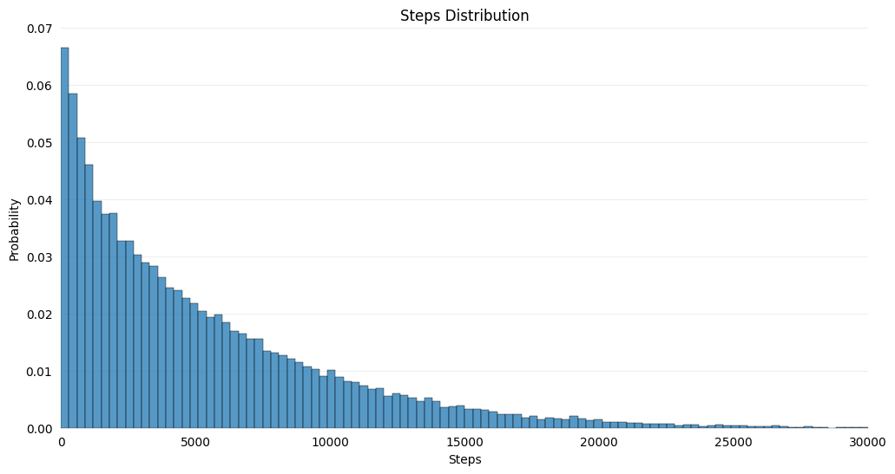
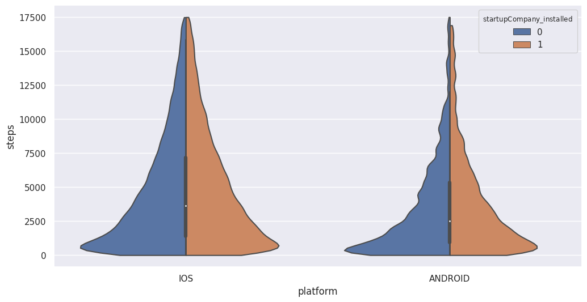
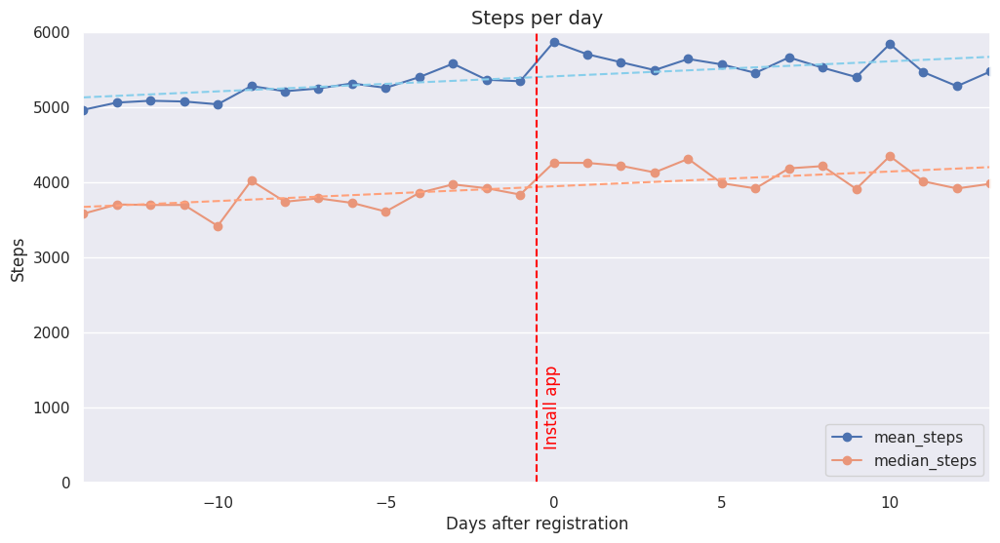
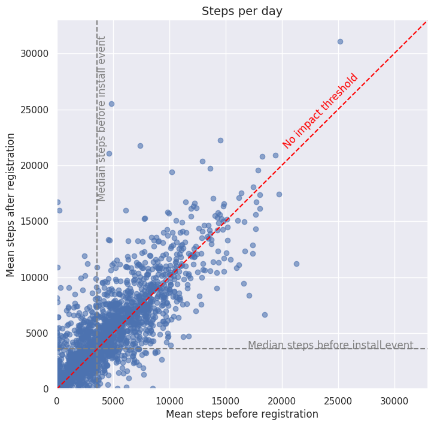
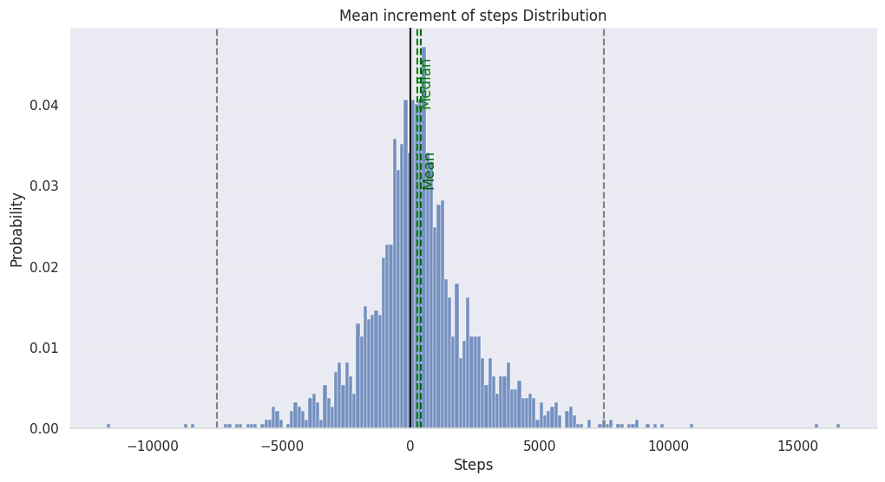
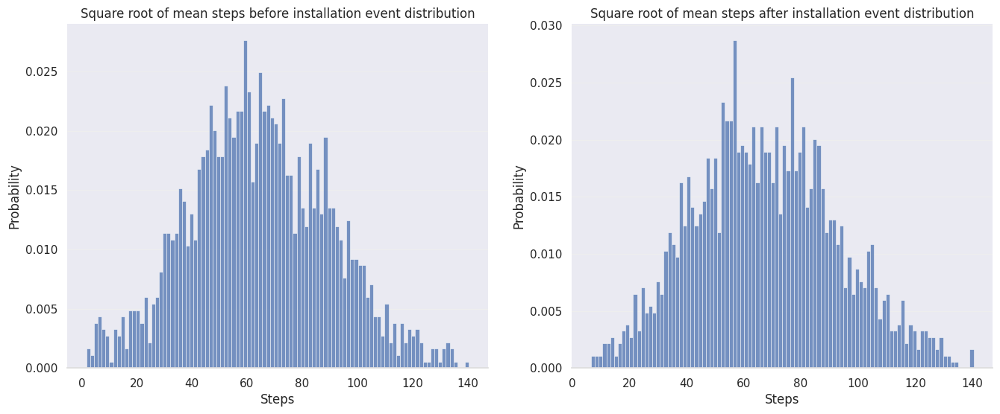
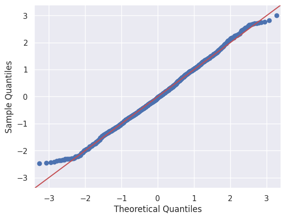
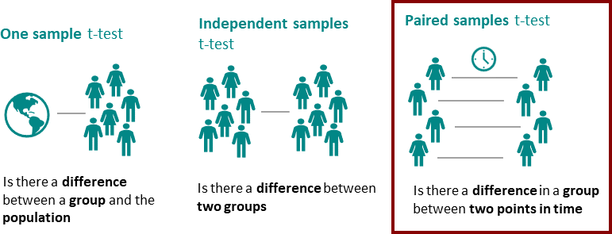
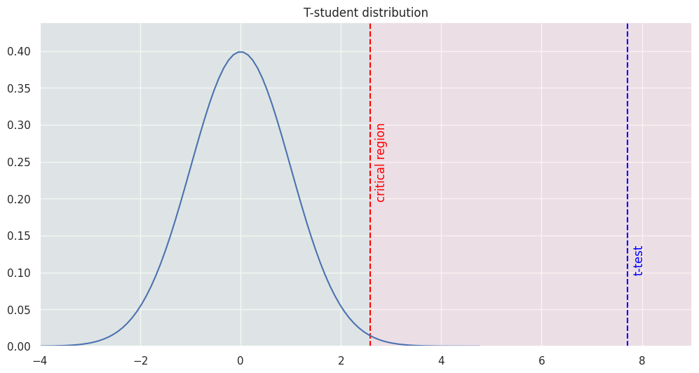

# startupCompany test challenge

Joaquin Amiel Marcora - 2023-04-23

## 0. Problem statement

**Goal**: check if users have an activity level increase after the startupCompany app installation.

The sample dataset contains daily steps of our users (±2 weeks from install date):

- **user_id**: unique id of a user
- **platform**: device platform
- **reg_date**: registration date
- **steps_date**: date of steps
- **steps**: amount of steps

## 1. Read the data and import libraries

> **In this section** we load the Python libraries and read the daily steps file (`test_task.csv`). The first rows of the data and the type of each column are shown below.

**Output (first rows):**

|   | user_id | platform | reg_date | steps_date | steps |
|---|---|---|---|---|---|
| 0 | 41785284 | IOS | 2021-04-21 | 2021-04-13 | 458 |
| 1 | 41792465 | IOS | 2021-04-21 | 2021-04-13 | 5750 |
| 2 | 41494466 | IOS | 2021-03-28 | 2021-04-01 | 5635 |
| 3 | 41583452 | IOS | 2021-04-02 | 2021-04-01 | 1840 |
| 4 | 41637532 | IOS | 2021-04-07 | 2021-04-01 | 3127 |

**Output (column types):**

```text
user_id                int64
platform              object
reg_date      datetime64[ns]
steps_date    datetime64[ns]
steps                  int64
```

## 2. Data cleansing, preprocessing and validations

> **In this section** we summarize the raw data and clean it: the records with 0 steps and the duplicated records are removed, and so are the 70 records without a platform. We also checked that no user has more than one platform and that no user has more than 28 days of data (some users have only one day), created the variables described below, and kept only the users with data before and after the app install event.

On the one hand, 60,000 steps correspond to between 60 and 70 kilometers. It is possible for a person who runs marathons, but it would be good to investigate this data.

On the other hand, 0 steps can happen if the user is in the hospital and cannot walk, but not in 23% of the cases: probably there was a problem in the system, or the user turned off the cellphone or left the battery charging. Records with 0 steps will be deleted in the analysis.

**Output (summary of the raw data):**

|       | user_id | steps |
|---|---|---|
| count | 8.154900e+04 | 81549.000000 |
| mean  | 4.120154e+07 | 3933.511607 |
| std   | 9.254097e+05 | 4826.587260 |
| min   | 1.666115e+07 | 0.000000 |
| 25%   | 4.098995e+07 | 104.000000 |
| 50%   | 4.123912e+07 | 2187.000000 |
| 75%   | 4.148435e+07 | 6026.000000 |
| max   | 4.180368e+07 | 60043.000000 |

**Output (percentage of records with 0 steps):**

```text
23.0474929183681
```

There are 5 users without a platform associated, so they are going to be deleted. The following checks show that these users are missing the platform in all of their records.

**Output (records per platform, after removing the records with 0 steps):**

| platform | records |
|---|---|
| IOS | 46604 |
| ANDROID | 16080 |
| NaN | 70 |

**Output (users per platform):**

| platform | users |
|---|---|
| ANDROID | 1344 |
| IOS | 2133 |

Some relevant variables were created:

- **Days after reg**: the difference in days between the record date and the user's installation date.
- **startupCompany installed**: dummy that measures if the user has the app installed when the record was registered. In this analysis only the users with data before and after the app install event are considered.

Finally, it was verified that there is no user with more than one record in one day.

From the 1,344 Android users that the database has, only 161 have data before and after the app installation event.

**Output (users per platform, after keeping only the users with data before and after the install):**

| platform | users |
|---|---|
| ANDROID | 161 |
| IOS | 1695 |

## 3. Descriptive analysis

> **In this section** we plot the distribution of steps per day and compare the steps before and after the install: a violin plot per platform, the daily mean and median steps, and a scatter plot of each user's mean steps before and after. The users whose mean steps before or after the install are above 20,000 per day are then removed (1,847 users remain: 1,689 IOS and 158 Android), and the mean increment of steps is computed for each user. Finally, we check how close to a normal distribution the square root of the mean steps is, with histograms and QQ plots.

The amount of steps per day looks like a geometric distribution with an exponential decay.



Looking at the following violin plot, there is an increase in the amount of steps walked after the app installation, more noticeable in the Android users (in IOS it is a small increment). It can also be observed that the median steps of the Android users is lower than that of the IOS users.



A positive correlation can be observed between the days after (or before) the app install event and the amount of steps. The chart uses only the users with data from 2 weeks before to 2 weeks after the install.



To analyse the impact of the app installation event, the result is considered at a user level, measuring if the user is walking more after the app installation event or not. Moreover, an analysis at record level would give different weights to each user, because the database does not have the steps walked on every day for each user, and the objective is to measure a general level of activity per user.

From the following chart, the amount of steps before and after the app install event can be compared. If we take the median steps before the install as a threshold that divides the chart into 4 quadrants, it looks like there are more users for whom the app had a positive effect (upper left quadrant) than users for whom the app had a negative effect (lower right quadrant).



To support the analysis, 2 variables were created:

- **Mean increment steps**: mean steps walked after the installation event minus mean steps walked before the installation event.
- **Positive increment steps**: a dummy variable that measures if the user walked more steps after the app installation event or not.

It can be seen that the mean increment of steps almost follows a Gaussian distribution with a positive mean and median. However, the distribution has extreme values, so it is not exactly a normal distribution.



*Black line: no change. Green dashed lines: median and mean of the increment. Grey dashed lines: -7,500 and +7,500 steps.*



*Both histograms show the square root of each user's mean steps (the horizontal axis is labeled "Steps" in the chart, but it shows the square root of the steps).*

**Output (QQ plots of the standardized square root of the mean steps, before and after the install):**




57.4% of the users experienced an increase in the steps walked per day after the app installation event.

**Output (summary of positive increment steps; the mean is the share of users who walk more):**

| statistic | value |
|---|---|
| count | 1847.000000 |
| mean | 0.574445 |
| std | 0.494561 |
| min | 0.000000 |
| 25% | 0.000000 |
| 50% | 1.000000 |
| 75% | 1.000000 |
| max | 1.000000 |

## 4. Experiments

### 4.1. Traditional Approach

> **In this section** we ran a one-sided binomial test on the share of users who walk more after the install (first against 50%, then against 60%) and a one-sided paired t-test on the square root of each user's mean steps before and after the install. The last chart shows the critical region of the t-test and its result.

First of all, it was tested that more than half of the users have a positive change, in other words:

- $H_0$: $p \le 0.5$
- $H_1$: $p > 0.5$

From the following result, the null hypothesis is rejected with a confidence of 99%, because the returned p-value is lower than the critical value of 0.01.

**Output (p-value):**

```text
8.456462424288589e-11
```

If we change the probability of success $p$ to 0.6, we can't reject the null hypothesis ($H_0$: $p \le 0.6$).

**Output (p-value):**

```text
0.988074335850311
```

In second place, a paired t-test is used (also known as a dependent sample test) to compare the means of two related samples. The samples belong to the same population and are analyzed under varied conditions, e.g., at different points in time. In our case, before and after the app installation event. This test is mostly popular for pretest/posttest type of experiments where a sample is studied before and after its conditions are varied with an experiment.

- Null Hypothesis ($H_0$): dependent sample means ($m_1$ before the installation and $m_2$ after it) are equal ($m_1=m_2$). In other words, the mean steps walked before the app installation is equal to the mean steps walked after the app installation event.
- Alternative Hypothesis ($H_a$): the mean steps walked after the app installation event are greater than the mean steps walked before it ($m_2>m_1$).



After running the paired t-test, the null hypothesis is rejected, thus there is an activity level increase after the startupCompany app installation with a 99% of confidence.

**Output (t statistic and p-value):**

```text
t=7.7148, p_value=0.0
```



*The curve is the t distribution expected if there were no change. The red line is the critical value (99.5th percentile) and the blue line is the t statistic of the test.*

### 4.2. Bayesian Approach

> **In this section** we ran the Bayesian test (100,000 simulations) on the square root of each user's mean steps before and after the install, for all users together, for IOS users and for Android users. The averages and expected losses in the tables are in steps (the square root was undone).

In certain cases, the Bayesian approach may provide useful results faster than the frequentist method. The main results are easier to understand for the business:

- **Interpretability**: probability to choose the best variation.
- **Scalability**: probabilities of being best scale to multiple variant tests.

Developing a whole algorithm to run a Bayesian A/B test can be tough and prone to errors, especially in a technical test. For this reason I will use a small package for a quick evaluation of A/B (or A/B/C/...) tests using a Bayesian approach. In this particular situation the data needs to have a normal distribution; for this reason the square root has been used to transform the inputs. The outputs are the following:

- **Probability of being best**: probability that a given variant is best among all variants.
- **Expected loss**: "risk" of choosing a particular variant over the other variants in the test, measured in the same units as the tested measure (e.g. positive rate or average value).

**Output (all users):**

| variant | avg_values | prob_being_best | expected_loss |
|---|---|---|---|
| Before app installation event | 4150.581914 | 0.00004 | 9.835629e+00 |
| After app installation event | 4564.415755 | 0.99996 | 2.601000e-11 |

**Output (IOS users):**

| variant | totals | avg_values | prob_being_best | expected_loss |
|---|---|---|---|---|
| Before app installation event - IOS | 1689 | 4413.254469 | 0.01871 | 3.114773 |
| After app installation event - IOS | 1689 | 4649.979749 | 0.98129 | 0.000033 |

**Output (Android users):**

| variant | totals | avg_values | prob_being_best | expected_loss |
|---|---|---|---|---|
| Before app installation event - Android | 158 | 1846.165667 | 0.0 | 318.895653 |
| After app installation event - Android | 158 | 3699.386238 | 1.0 | 0.000000 |

## 5. Conclusions and future steps

There is an activity level increment after the startupCompany app installation with a probability of 99.996%; on average the person walks about 414 more steps per day (about 290 calories per week - 2 cans of beer).

In the IOS users, there is an activity level increment after the startupCompany app installation with a probability of 98.129%; on average the person walks about 240 more steps per day (168 calories per week - 1 can of beer).

It is good to mention that the users that used Android have an increment of 1,850 steps per day on average while the IOS users only 240. However, the data for Android users was not the best: from the 1,344 Android users that the database has, only 161 have data before and after the app installation event (158 after removing the users with more than 20,000 mean steps per day, see section 3).

In future steps, it would be great to have more features to test if there is an increase in the activity level in certain populations, for instance age, sex, location, weather, user agent, source of install, etc. It would help the company to focus its campaigns on specific segments. Also, it would be great if somebody analysed why so much Android data was lost.

## Bibliography

- https://thedatascientist.com/how-to-do-a-t-test-in-python/
- https://towardsdatascience.com/python-package-for-bayesian-a-b-testing-86ea3ff5c963
- https://github.com/Matt52/bayesian-testing
- https://medium.com/vptech/introduction-to-bayesian-a-b-testing-in-python-df81a9b3f5fd

## Appendix: Python code

The same code, with step-by-step explanatory comments, is in the file `startupCompany challenge.py`.

### A.1 Read the data and import libraries

```python
# Colab-only line (it installs a package inside Google Colab). Outside Colab, run
# "pip install bayesian_testing" once in your terminal instead.
# pip install bayesian_testing

import pandas as pd  # pandas: works with tables of data (like Excel, but with code)
import numpy as np  # numpy: fast math on lists of numbers
import scipy.stats as stats  # scipy.stats: statistical tests (binomial test, t-test...)
from bayesian_testing.experiments import  NormalDataTest  # small package to run a Bayesian A/B test

import statsmodels.api as sm  # statsmodels: here we only use it to draw "QQ plots"
import pylab as py  # pylab: a shortcut to matplotlib, used to show the QQ plots
import warnings
warnings.filterwarnings("ignore")  # hide non-critical warning messages
import seaborn as sns  # seaborn: prettier statistical charts
import matplotlib.pyplot as plt  # matplotlib: the base library used to draw charts

# Colab-only lines (they connect Google Drive so Colab can see your files).
# Not needed when you run the script on your own computer.
# from google.colab import drive
# mount google drive information in a google colaboratory directory
# drive.mount('/content/gdrive')

# When we print a table, show up to 150 rows (the default would hide the middle rows).
pd.set_option('display.max_rows', 150)
# Also show every column, on wide lines, so printed tables are not cut with "..."
# (added: Colab showed full tables by itself, a plain script does not).
pd.set_option('display.max_columns', None)
pd.set_option('display.width', 200)

# Folder where the file "test_task.csv" is. Change it to the folder on your computer.
path = r'gdrive/MyDrive/Data Science Project/startupCompany/' # insert your path

# Read the CSV file into a table (a "dataframe", called df).
# parse_dates tells pandas that these two columns are dates and not plain text.
df = pd.read_csv(path+'test_task.csv',parse_dates= ['reg_date','steps_date'])
# The file has an extra column ("Unnamed: 0") that is just the old row number: remove it.
df.drop(columns= 'Unnamed: 0',inplace = True)

# Show the first 5 rows to check that the data was loaded well.
# (print was added: Colab showed the result automatically, a script does not.)
print(df.head())

# Show the type of every column (whole number, text, date...).
print(df.dtypes)
```

### A.2 Data cleansing, preprocessing and validations

```python
# Quick summary of the numeric columns: how many values (count), the average (mean),
# how spread out they are (std = standard deviation), the smallest and largest values (min, max),
# and the 25%, 50% (median, the middle value) and 75% points.
print(df.describe())

# What share (in %) of the rows have 0 steps?
print('Percentage of records with 0 steps: ',df[df.steps==0].shape[0]/df.shape[0]*100)

# Keep only rows with more than 0 steps. 0 steps in 23% of the days is most likely a
# problem (phone off, battery charging...) and not real life.
df = df[df.steps>0]

# Remove rows that are exact copies of another row (duplicates). keep='last' keeps the last copy.
print('check that there is no duplicates in the dataframe')
df.drop_duplicates(keep='last', inplace = True)

# How many rows does each platform (IOS = iPhone, ANDROID) have? NaN = platform missing.
print('Records per platform:')
# (replaces pd.value_counts(df.platform,dropna=False), which no longer works in new pandas versions)
print(df.platform.value_counts(dropna=False))

# How many different users does each platform have?
print('User per platform:')
print(df.groupby(['platform'])['user_id'].nunique())

# Do the users with a missing platform have a platform in some other row?
# If this table is empty, they are missing the platform in ALL their rows.
user_without_platform = list(np.unique(df[df.platform.isnull()].user_id))
print(df[df.user_id.isin(user_without_platform) & df.platform.notnull()])

# Remove the rows (users) without a platform.
df = df[df.platform.notnull()]

# Sanity checks: one platform per user, at most 28 days of data per user
# (2 weeks before + 2 weeks after the install), and the smallest number of days of a user.
print('There is no user with more than one platform associated, because the maximum number of different platforms associated with one person is'
,max(df.groupby(['user_id'])['platform'].nunique().sort_values(ascending=False)),'.')

print('There is no user with more than'
, max(df.groupby(['user_id'])['steps_date'].nunique().sort_values(ascending=False))
, 'days of information (2 weeks before till 2 weeks after the installation date).')

print('However, some users have only data for',min(df.groupby(['user_id'])['steps_date'].nunique().sort_values(ascending=False)),'one day.')

# New column days_after_reg: whole days between the day of the steps and the install day.
# Negative = before the install, 0 or more = after the install.
# (divmod divides by 86400, the seconds in a day, and [0] keeps the whole-days part)
df['days_after_reg'] = divmod((df.steps_date - df.reg_date).dt.total_seconds(), 86400)[0]
# New column startupCompany_installed: 1 if the app was already installed that day, 0 if not
# (np.where works like an IF: if days_after_reg >= 0 put 1, otherwise put 0).
df['startupCompany_installed'] = np.where(df.days_after_reg >=0 , 1, 0)

# Sort the rows by user and then by day, so each user's days are in order.
df.sort_values(by=['user_id','days_after_reg'], inplace = True)

# For each user: how many different days (nunique_), how many rows (count_),
# and the first (min_) and last (max_) day relative to the install.
data_per_user = df.groupby(['user_id']).agg({'days_after_reg': ['nunique', 'count','min','max']}).reset_index()
data_per_user.columns = ['user_id','nunique_', 'count_','min_','max_']

# Keep only users who have data BEFORE (min_ < 0) and AFTER (max_ >= 0) the install,
# because we can only compare "before vs after" for them.
users = list(data_per_user[(data_per_user.min_<0) & (data_per_user.max_>=0)].user_id)

df = df[df.user_id.isin(users)]

# Check that no user has two rows on the same day (different days < number of rows would mean that).
# An empty table means that everything is fine.
print(data_per_user[(data_per_user.nunique_ < data_per_user.count_ )])

# How many users are left per platform?
print(df.groupby(['platform'])['user_id'].nunique())
```

### A.3 Descriptive analysis

```python
# --- Distribution of steps per day -------------------------------------------------
# A histogram counts how many rows fall in each "bucket" of steps (200 buckets here).
# stat="probability" shows the share of rows in each bucket instead of the raw count.
plt.subplots(1, figsize=(12, 6))
ax=sns.histplot(df.steps, bins=200,stat="probability")
ax.set_xlim(0,30000)
ax.set_ylim(0,0.07)
ax.set_title('Steps Distribution')
ax.set_xlabel('Steps')
# The next lines only make the chart look cleaner (hide frame lines, light grid).
ax.spines['top'].set_visible(False)
ax.spines['right'].set_visible(False)
ax.spines['left'].set_visible(False)
ax.spines['bottom'].set_color('#DDDDDD')
ax.tick_params(bottom=False, left=False)
ax.set_axisbelow(True)
ax.yaxis.grid(True, color='#EEEEEE')
ax.xaxis.grid(False);
plt.show()

# --- Violin plot: steps before / after the install, per platform ----------------------
# A violin plot is a "mirrored histogram": the wider the shape, the more rows with that
# number of steps. Each platform is split in two halves: 0 = before install, 1 = after.
# We leave out the days with 17,500+ steps so the chart is easier to read.
sns.set(style="darkgrid")

plt.subplots(1, figsize=(12, 6))
# (bw was renamed bw_method in new seaborn versions; same meaning: how smooth the shape is)
sns.violinplot(hue="startupCompany_installed", y="steps", data=df[df.steps<17500],  x= 'platform',split=True , cut =0, bw_method=.1);
plt.show()

# --- Mean and median steps for each day before / after the install -----------------------
# We only use users who have data from 2 weeks before until 2 weeks after (min_ < -13 and
# max_ >= 13), so every day of the chart is built with the same group of users.
#chart per day
data_chart = df[df.user_id.isin(list(data_per_user[(data_per_user.min_<-13) & (data_per_user.max_>=13)].user_id))] \
.groupby(['days_after_reg']) \
.agg({'steps': ['mean','median']}).reset_index()

data_chart.columns = ['days_after_reg','mean_steps', 'median_steps']

plt.subplots(1, figsize=(12, 6))
plt.plot('days_after_reg', 'mean_steps', data=data_chart, linestyle='-', marker='o' )

# A trendline is the straight line that best fits the points. polyfit(..., 1) finds that
# line (degree 1 = a straight line) and poly1d turns it into a function we can draw.
#calculate equation for trendline
z = np.polyfit(data_chart.days_after_reg, data_chart.mean_steps, 1)
p = np.poly1d(z)
#add trendline to plot
plt.plot(data_chart.days_after_reg, p(data_chart.days_after_reg), linestyle='--', color='skyblue')

plt.plot('days_after_reg', 'median_steps', data=data_chart, linestyle='-', marker='o',color = 'darksalmon')

#calculate equation for trendline
z = np.polyfit(data_chart.days_after_reg, data_chart.median_steps, 1)
p = np.poly1d(z)
#add trendline to plot
plt.plot(data_chart.days_after_reg, p(data_chart.days_after_reg), linestyle='--', color='lightsalmon')

plt.title('Steps per day', loc='center', fontsize=14, fontweight=0)
plt.grid(axis='x')
plt.xlim(-14, 13)
plt.ylim(0, 6000)
# The red vertical line marks the moment of the install.
plt.axvline(x=-0.5,color='red',linestyle='--');
plt.text(-0.3,500,'Install app',rotation=90,color='red');
plt.legend(loc ="lower right")
plt.ylabel('Steps')
plt.xlabel('Days after registration');
plt.show()

# --- One row per user: average steps BEFORE and AFTER the install -------------------------
# We compare each user with themselves (their own average before vs after) so that users
# with many rows do not weigh more than users with few rows.
bf_install = df[df.startupCompany_installed == 0].groupby(['user_id','platform']).agg({'steps': ['mean','median']}).reset_index()
bf_install.columns = ['user_id','platform','bf_mean_steps', 'bf_median_steps']

aft_install = df[df.startupCompany_installed == 1].groupby(['user_id']).agg({'steps': ['mean','median']}).reset_index()
aft_install.columns = ['user_id','aft_mean_steps', 'aft_median_steps']

# Join both tables side by side using the user id (a "merge", like VLOOKUP in Excel).
df_user = pd.merge(bf_install, aft_install,  how='left', left_on=['user_id'], right_on = ['user_id'])

# --- Scatter plot: each dot is a user ---------------------------------------------------
# x = steps before, y = steps after. Dots ABOVE the red line walk more after the install,
# dots BELOW the red line walk less. The grey lines are the median steps before the install.
plt.subplots(1, figsize=(8, 8))
plt.scatter(x=df_user.bf_mean_steps, y=df_user.aft_mean_steps , cmap="viridis", alpha=0.6)
plt.title('Steps per day', loc='center', fontsize=14, fontweight=0)
plt.xlim(0, 33000)
plt.ylim(0, 33000)

plt.axvline(x=df[df.startupCompany_installed == 0].steps.median(),color='grey',linestyle='--');
plt.text(df[df.startupCompany_installed == 0].steps.median(),17000,'Median steps before install event',rotation=90,color='grey');


plt.axhline(y=df.steps[df.startupCompany_installed == 0].median(),color='grey',linestyle='--');
plt.text(17000,df.steps[df.startupCompany_installed == 0].median(),'Median steps before install event',rotation=0,color='grey');

plt.axline([0, 0], [25000, 25000],color='red',linestyle='--')
plt.text(20000,21500,'No impact threshold',rotation=45,color='red');

plt.ylabel('Mean steps after registration')
plt.xlabel('Mean steps before registration');
plt.show()

# Remove the few extreme users (average above 20,000 steps per day, before or after):
# they are far away from everybody else and could distort the results.
df_user = df_user[(df_user.bf_mean_steps<20000) & (df_user.aft_mean_steps<20000)]

# Two helper columns for each user:
# - mean_increment_steps: average steps after minus average steps before (positive = walks more).
# - positive_increment_steps: 1 if the user walks more after the install, 0 if not.
df_user['mean_increment_steps'] = (df_user['aft_mean_steps'] - df_user['bf_mean_steps'])
df_user['positive_increment_steps'] = np.where(df_user['aft_mean_steps'] > df_user['bf_mean_steps'], 1, 0)

# --- Histogram of the increment --------------------------------------------------------
# Black line = 0 (no change). Green lines = median and mean of the increment.
# Grey lines at -7,500 and +7,500 steps help to see the extreme values.
plt.subplots(1, figsize=(12, 6))
ax=sns.histplot(df_user.mean_increment_steps, bins=200,stat="probability")
ax.set_title('Mean increment of steps Distribution')
ax.set_xlabel('Steps')
ax.spines['top'].set_visible(False)
ax.spines['right'].set_visible(False)
ax.spines['left'].set_visible(False)
ax.spines['bottom'].set_color('#DDDDDD')
ax.tick_params(bottom=False, left=False)
ax.set_axisbelow(True)
ax.yaxis.grid(True, color='#EEEEEE')
ax.xaxis.grid(False);

ax.axvline(x=df_user.mean_increment_steps.median(),color='green',linestyle='--');
ax.text(df_user.mean_increment_steps.median(),0.04,'Median',rotation=90,color='green');

ax.axvline(x=df_user.mean_increment_steps.mean(),color='darkgreen',linestyle='--');
ax.text(df_user.mean_increment_steps.mean(),0.03,'Mean',rotation=90,color='darkgreen');


ax.axvline(x=-7500,color='gray',linestyle='--');
ax.axvline(x=7500,color='gray',linestyle='--');

ax.axvline(x=0,color='black',linestyle='-');
plt.show()

# --- Is the data "bell shaped" (normal) after taking the square root? ---------------------
# Step counts are very skewed (many low values, a few very high ones). Taking the square
# root squeezes the high values and makes the shape closer to a bell, which the tests
# in section 4 need. Left chart = before the install, right chart = after.
# (plt.figure replaces plt.subplots here: new matplotlib versions would keep an extra empty
# chart behind the two we draw, with stray numbers on the axes)
f=plt.figure(figsize=(16,6))

plt.subplot(1,2, 1)
ax=sns.histplot(np.sqrt(df_user['bf_mean_steps'].values), bins=100,stat="probability")
#ax.set_xlim(0,30000)
#ax.set_ylim(0,0.07)
ax.set_title('Square root of mean steps before installation event distribution')
ax.set_xlabel('Steps')
ax.spines['top'].set_visible(False)
ax.spines['right'].set_visible(False)
ax.spines['left'].set_visible(False)
ax.spines['bottom'].set_color('#DDDDDD')
ax.tick_params(bottom=False, left=False)
ax.set_axisbelow(True)
ax.yaxis.grid(True, color='#EEEEEE')
ax.xaxis.grid(False);

plt.subplot(1,2, 2)
ax=sns.histplot(np.sqrt(df_user['aft_mean_steps'].values), bins=100,stat="probability")
#ax.set_xlim(0,30000)
#ax.set_ylim(0,0.07)
ax.set_title('Square root of mean steps after installation event distribution')
ax.set_xlabel('Steps')
ax.spines['top'].set_visible(False)
ax.spines['right'].set_visible(False)
ax.spines['left'].set_visible(False)
ax.spines['bottom'].set_color('#DDDDDD')
ax.tick_params(bottom=False, left=False)
ax.set_axisbelow(True)
ax.yaxis.grid(True, color='#EEEEEE')
ax.xaxis.grid(False);
plt.show()

# --- QQ plots: a second way to check for a bell shape ----------------------------------------
# A QQ plot compares our data with a perfect bell curve. If the dots follow the red
# diagonal line, the data is (almost) a bell curve. First chart = before, second = after.
# "Standardize" = subtract the mean and divide by the standard deviation, so the data is
# centered on 0 and has a typical spread of 1 (this makes it comparable with the red line).
y = np.sqrt(df_user['bf_mean_steps'].values)
data_points = (y -y.mean())/y.std()

sm.qqplot(data_points, line ='45')
py.show()

y = np.sqrt(df_user['aft_mean_steps'].values)
data_points = (y -y.mean())/y.std()

sm.qqplot(data_points, line ='45')
py.show()

# Share of users that walk more after the install: the mean of a column of 0s and 1s
# is the share of 1s (e.g. 0.57 = 57% of the users).
print(df_user['positive_increment_steps'].describe())
```

### A.4 Experiments

```python
# --- 4.1 Traditional approach --------------------------------------------------------
# Binomial test. Question: do MORE than half of the users walk more after the install?
# Null hypothesis (H0, "nothing special is going on"): p <= 0.5. Alternative (H1): p > 0.5.
# The p-value is the chance of seeing a result like ours if H0 were true. If it is smaller
# than 0.01 (1%), we reject H0 with 99% confidence.
# (stats.binom_test was removed from new scipy versions; stats.binomtest(...).pvalue is its replacement)
print(stats.binomtest(np.sum(df_user['positive_increment_steps']),
                 n=df_user['positive_increment_steps'].shape[0], p=0.5, alternative='greater').pvalue)

# Same test, but now H0 says the share is 0.6 or less (p <= 0.6).
print(stats.binomtest(np.sum(df_user['positive_increment_steps']),
                 n=df_user['positive_increment_steps'].shape[0], p=0.6, alternative='greater').pvalue)

# Paired t-test: compares the AVERAGE steps of the same users before and after the install.
# "Paired" = the before and after numbers belong to the same person.
# We use the square root of the steps because the t-test works best with bell-shaped data.
# t_stat says how many "standard errors" apart the two averages are (bigger = more different).
# alternative='greater' tests that "after" is bigger than "before".
# dof = "degrees of freedom", a number that sets the exact shape of the t curve we draw below
# (with this many users the difference between n-1 and n-2 is invisible).
dof=df_user.shape[0]-2
t_stat, p = stats.ttest_rel(np.sqrt(df_user.aft_mean_steps.values),
                            np.sqrt(df_user.bf_mean_steps.values),
                            alternative = 'greater')

print(f't={round(t_stat,4)}, p_value={round(p,4)}')
# Draw the t curve (what we would expect if there were NO change). The red line is the start
# of the "critical region" (very unlikely values if H0 were true) and the blue line is our result.
rv = stats.t(df=dof, loc=0, scale=1)
x = np.linspace(rv.ppf(0.000001), rv.ppf(0.999999), 100)
y = rv.pdf(x)

plt.subplots(1, figsize=(12, 6))

plt.axvline(x=rv.ppf(0.995),color='red',linestyle='--')
plt.text(rv.ppf(0.995)+0.1,rv.pdf(0)/2,'critical region',rotation=90,color='red')

plt.axvline(x=t_stat,color='blue',linestyle='--')
plt.text(t_stat+0.1,rv.pdf(0)/4,'t-test',rotation=90,color='blue')

plt.title('T-student distribution')
plt.xlim(-4,9)
plt.ylim(0,rv.pdf(0)*1.1)
plt.plot(x,y)

plt.axvspan(-4, rv.ppf(0.995), color='green', alpha=0.05, lw=0)
plt.axvspan( rv.ppf(0.995),9, color='red', alpha=0.05, lw=0);
plt.show()

# --- 4.2 Bayesian approach -----------------------------------------------------------
# Instead of a yes/no answer, the Bayesian test says how PROBABLE it is that each option
# ("before" or "after") is the best one. We simulate 100,000 possible worlds (sim_count)
# and count in how many of them each option wins. seed=1988 makes the result repeatable.
# The package needs bell-shaped data, so again we use the square root of the steps.
# prob_being_best = chance that this option has the higher average.
# expected_loss = how many steps we would lose, on average, if we picked this option and
# it was the wrong choice. Squaring (**2) at the end undoes the square root, so that
# the numbers are in steps again.

# All users together
test = NormalDataTest()
before_install = np.sqrt(df_user.bf_mean_steps.values)
after_install = np.sqrt(df_user.aft_mean_steps.values)

test.add_variant_data("Before app installation event", before_install)
test.add_variant_data("After app installation event", after_install)

results = test.evaluate(sim_count=100000, seed=1988, min_is_best=False)
results = pd.DataFrame(results)
results['avg_values'] = results['avg_values']**2
results['posterior_mean'] = results['posterior_mean']**2
results['expected_loss'] = results['expected_loss']**2
print(results[['variant', 'avg_values', 'prob_being_best', 'expected_loss']])

# Only IOS users (same test, filtering the table first)
test = NormalDataTest()
before_install = np.sqrt(df_user[df_user.platform == 'IOS'].bf_mean_steps.values)
after_install = np.sqrt(df_user[df_user.platform == 'IOS'].aft_mean_steps.values)

test.add_variant_data("Before app installation event - IOS", before_install)
test.add_variant_data("After app installation event - IOS", after_install)

results = test.evaluate(sim_count=100000, seed=1988, min_is_best=False)
results = pd.DataFrame(results)
results['avg_values'] = results['avg_values']**2
results['posterior_mean'] = results['posterior_mean']**2
results['expected_loss'] = results['expected_loss']**2
print(results[['variant','totals', 'avg_values', 'prob_being_best', 'expected_loss']])

# Only Android users
test = NormalDataTest()
before_install = np.sqrt(df_user[df_user.platform == 'ANDROID'].bf_mean_steps.values)
after_install = np.sqrt(df_user[df_user.platform == 'ANDROID'].aft_mean_steps.values)

test.add_variant_data("Before app installation event - Android", before_install)
test.add_variant_data("After app installation event - Android", after_install)

results = test.evaluate(sim_count=100000, seed=1988, min_is_best=False)
results = pd.DataFrame(results)
results['avg_values'] = results['avg_values']**2
results['posterior_mean'] = results['posterior_mean']**2
results['expected_loss'] = results['expected_loss']**2
print(results[['variant', 'totals','avg_values', 'prob_being_best', 'expected_loss']])
```

