# Air Quality API, Sales Forecast and Campaign Dashboard

Joaquin Amiel

> **TL;DR**
>
> - **Role:** Data Automation Specialist (Jun 2023)
> - **Question:** 3 tasks: pull air quality data from an API, forecast units sold, and analyse marketing campaigns.
> - **What I did:** called the API with Python, built a SARIMA forecast (a model that learns trend and yearly patterns) inside a function that updates itself with each new month, and made a Tableau dashboard.
> - **Result:** the forecast misses by about 13 units on months of about 525 units. Only 149 of 277 campaigns (54%) earn back more than they cost, so spending can be cut.

## The assignment

### Handling an API
 - Pull out Air Quality data from this [website](https://operator-ict.gitlab.io/golemio/documentation/)
 - Show the evolution of NO2 and PM10 particles for past 1000 observations

### Forecasting
 - Using data in data_units_forecasting.csv predict next 3 values. Use methodology of your choice
    - How are you confident in your predictions? What kind of error can we expect?

- Extend your methodology so it can run daily or per request. Demonstrate it by updating your forecasting by first, data_units_forecasting_t1.csv and second, by data_units_forecasting_t2.csv. Those are simulating the growing data as time goes. Imagine that every day you receive new observations.

### Analysis

- Load the file data_campaigns_task.csv
- You will see data from marketing campaigns
- Your task is to analyze what is going on there and show it us as a comprehensive analysis. It should be in a form of a dashboard. We would like to see some Power BI/Tableau or similar.
- Do you have any suggestions in terms of the profitability?

---

## 1. Handling an API

### 1.1 Pull out Air Quality data

> **In this section** we install and import the `requests` library, set the API key in a header and call the Golemio endpoint `airqualitystations/history` asking for 1,000 observations. The answer comes back as JSON and is kept in memory for the next section.

To pull the air quality data by hand:
1. Create a user [here](https://api.golemio.cz/api-keys/auth/sign-in), then generate an API key (a password that lets a program use the API) and copy it (YOUR_ACCESS_TOKEN).
2. Install [Postman](https://www.postman.com/downloads/) and create an account there.
3. Create a new request:
 - Command: GET
 - URL: https://api.golemio.cz/v2/airqualitystations/history
 - in authorization, select type API Key and then fill it with the following values:
    - Key: X-Access-Token
    - Value: YOUR_ACCESS_TOKEN
    - Add to: Header
4. Click the button **Send**, to send the request and pull out the data.
5. Save the response as a JSON file (air_quality.json).

Here I did the same with Python and the `requests` package (the code is in appendix A.1).

### 1.2 Evolution of NO2 and PM10 particles

> **In this section** we walk through the JSON answer and pull out, for every observation, the NO2 and the PM10 value (a `None` is stored when that particle is not in the record). We also check which stations the data comes from, and then plot the two series and a scatterplot of one against the other.

The API lets you ask for up to 1,000 observations, a date range (ISO 8601 format, like 2023-06-01) and a sensor id (the station). More details in the [API documentation](https://api.golemio.cz/v2/docs/public-openapi/#/%F0%9F%8C%A6%20Air%20Quality/get_airqualitystations_history_).

The JSON answer is deeply nested, so you have to dig into it to get the values, and not every observation has the same fields.

All the data comes from a single station:

**Output (station ids found):**

```text
ASUCA
```

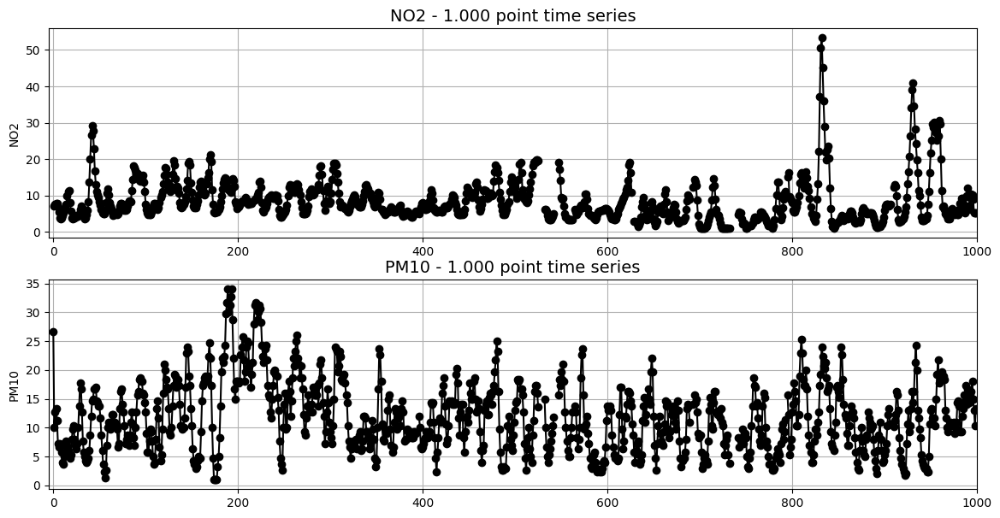

*Both charts: the horizontal axis is the position of the observation in the series (0 to 1,000, in the order the API returned them) and the vertical axis is the concentration measured for that particle.*

At first sight there is no clear relationship between NO2 and PM10 (the API always returns the latest 1,000 observations, so this may change with new data).

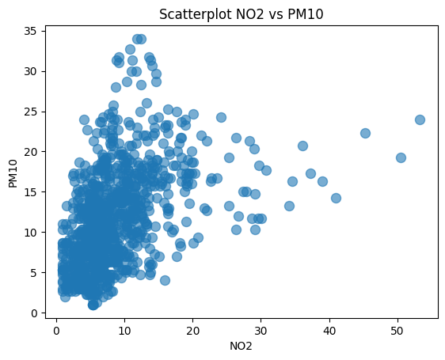

---

## 2. Forecasting

### 2.1 Build a model to predict data

Using data in data_units_forecasting.csv predict next 3 values. Use methodology of your choice.

> **In this section** we read the sales file, drop duplicated rows, check that the data is monthly and look at it over time. Then we split the time series into trend, seasonality and the rest (decomposition) to replace two outliers and the missing months by an estimate built from the trend plus the seasonality. After that we remove the trend and the seasonality by differencing (checking with the Dickey-Fuller test that the series is stable), read the ACF and PACF charts to guess the model orders, and try 40 SARIMA models ranked by AIC (a score that rewards a good fit and punishes extra parameters), keeping the third best because it is the first one whose coefficients are all significant. Finally we measure the error on the last 3 months, which were held out on purpose, and refit the model on the full series to predict the three months that come next.

First, duplicate rows were deleted (number of rows before and after):

**Output (rows, columns):**

```text
(148, 2)
(140, 2)
```

The data has 3 missing values:

**Output (`describe` of units_sold):**

|       | units_sold |
| ----- | ---------- |
| count | 137.000000 |
| mean  | 277.635036 |
| std   | 123.106116 |
| min   | 104.000000 |
| 25%   | 172.000000 |
| 50%   | 264.000000 |
| 75%   | 360.000000 |
| max   | 622.000000 |

The time series has only one record per month, so the data is monthly.

The chart below shows a trend (sales go up over the years) and seasonality (a pattern that repeats every year). With that, and almost 12 years of monthly data, a [SARIMA model](https://www.wisdomgeek.com/development/machine-learning/sarima-forecast-seasonal-data-using-python/) is a good fit: it is built for series with trend and seasonality.

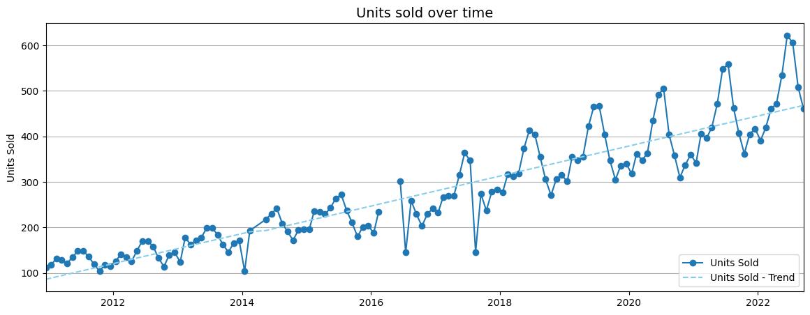

The last 3 months are held out (not used for training), to check how well the model predicts data it has never seen.

The month is set as the index, and for now the missing months are filled with the previous month's value (we can only use the past, never the future):

**Output (first rows after reindexing):**

| year_month | units_sold |
| ---------- | ---------- |
| 2010-12-01 | 112.0 |
| 2011-01-01 | 118.0 |
| 2011-02-01 | 132.0 |
| 2011-03-01 | 129.0 |
| 2011-04-01 | 121.0 |

The decomposition (splitting the series into trend, seasonality and the rest) shows an upward trend, a yearly seasonality (lag = 12 months) and two points that look like outliers: one in 2016 and one in 2017.

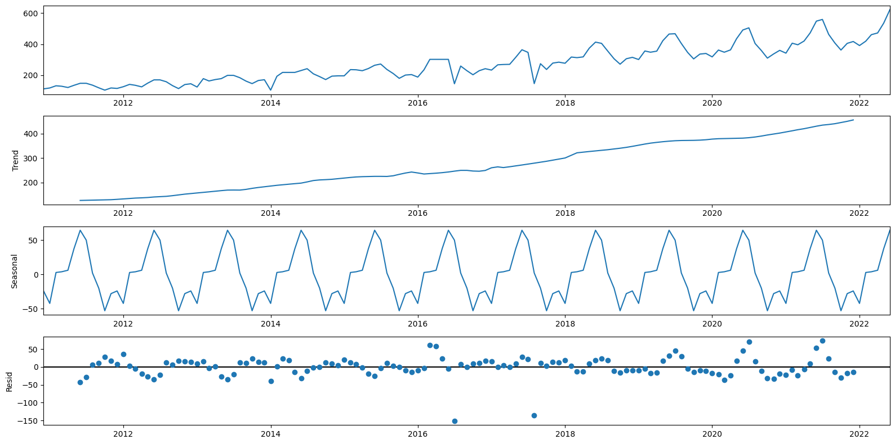

*From top to bottom: the original series, the trend, the yearly seasonality and the residual (what is left once trend and seasonality are taken out). The horizontal axis is the month.*

The outliers are replaced by an estimate: the trend plus the seasonality of that month.

**Output (outliers before the imputing):**

| year_month | units_sold |
| ---------- | ---------- |
| 2016-07-01 | 145.0 |
| 2017-08-01 | 146.0 |

**Output (same months after the imputing):**

| year_month | units_sold |
| ---------- | ---------- |
| 2016-07-01 | 297.0 |
| 2017-08-01 | 282.0 |

The missing months, filled before with the previous value, are now also replaced by the trend plus the seasonality (like the outliers).

**Output (values that had been filled with the previous non missing value):**

| year_month | units_sold |
| ---------- | ---------- |
| 2014-03-01 | 218.0 |
| 2014-04-01 | 218.0 |
| 2016-03-01 | 302.0 |
| 2016-04-01 | 302.0 |
| 2016-05-01 | 302.0 |

**Output (new values):**

| year_month | units_sold |
| ---------- | ---------- |
| 2014-03-01 | 195.0 |
| 2014-04-01 | 200.0 |
| 2016-03-01 | 241.0 |
| 2016-04-01 | 245.0 |
| 2016-05-01 | 278.0 |

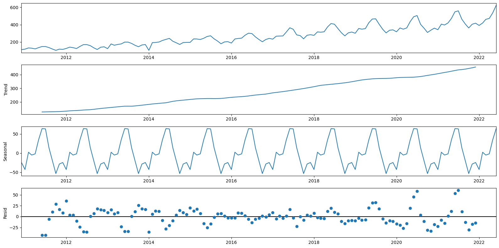

*Same four panels as before, now on the series with the outliers and the missing months replaced.*

To read the ACF and PACF charts (used to choose the model settings), the trend and the seasonality must be removed first. The trend is removed by differencing (subtracting from each month the month before), and the ADF (Augmented Dickey-Fuller) test checks whether a trend is still there.

**Output (Dickey-Fuller test on the original series):**

```text
Results of Dickey-Fuller Test:
Test Statistic                   1.453513
p-value                          0.997344
#Lags Used                      13.000000
Number of Observations Used    125.000000
dtype: float64
```

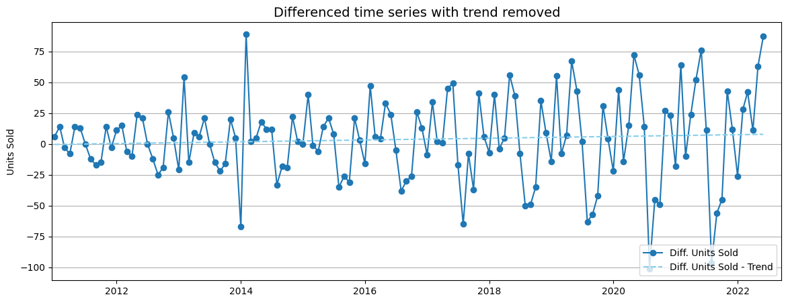

With the trend removed, the chart below shows that each month sells differently, which confirms the seasonality: August, September and October sell less than the rest of the year.

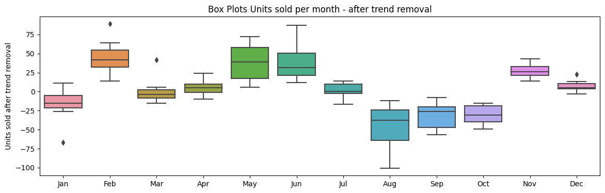

Now the p-value is below 0.05, so the series is stationary (no trend left: its average stays stable over time). More about the [Dickey-Fuller test](https://en.wikipedia.org/wiki/Dickey%E2%80%93Fuller_test).

**Output (Dickey-Fuller test on the differenced series):**

```text
Results of Dickey-Fuller Test:
Test Statistic                  -3.206467
p-value                          0.019613
#Lags Used                      12.000000
Number of Observations Used    125.000000
dtype: float64
```

Since the data has a yearly seasonality, it is also differenced at lag 12 (each month minus the same month one year before).

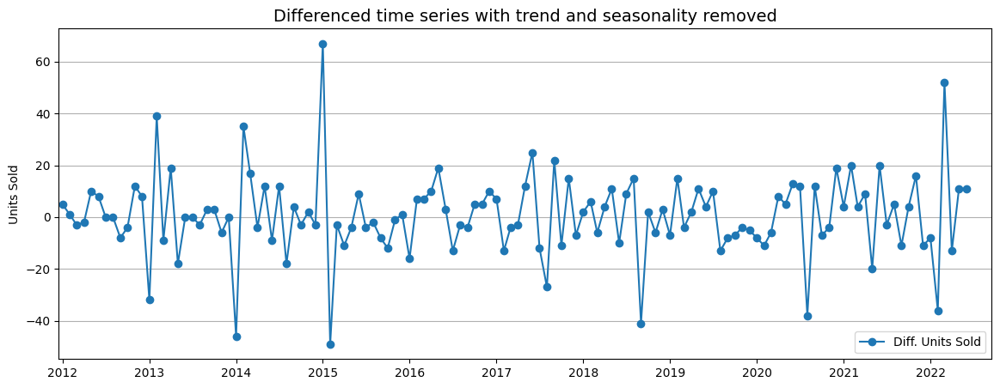

The ACF and PACF charts (how much the series is correlated with its own past values) help to choose the settings of the SARIMA model, which is written like this:

- $SARIMA\ (p,d,q)\times(P,D,Q)_{12}$

The parameters for these types of models are as follows:

- $p$ and seasonal $P$: number of AR terms (how many past values the model uses)
- $d$ and seasonal $D$: how many times the series is differenced
- $q$ and seasonal $Q$: number of MA terms (how many past forecast errors the model uses)

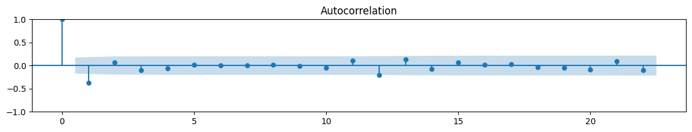

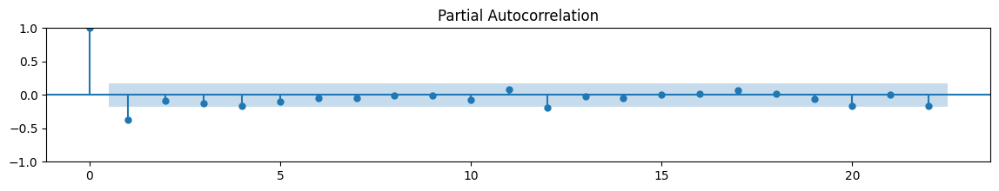

*In both charts the horizontal axis is the lag in months and the vertical axis is the correlation of the series with itself at that lag; the shaded band is the range where a value can be considered noise.*

From the charts:

- **ACF**: a clear negative spike at lag 1 and another one at lag 12. In the ACF, spikes point to MA terms, so this suggests $q = 1$ and a seasonal $Q = 1$.

- **PACF**: a spike at lag 1 (and a weak one at lag 4), and a small one at lag 12. In the PACF, spikes point to AR terms, so this suggests $p = 1$ (maybe up to 4) and a seasonal $P$ of 0 or 1.

So a first guess for the model is:

- $SARIMA\ (1,1,1)\times(1,1,1)_{12}$

This is very close to the model finally chosen by the search below, $SARIMA\ (1,1,1)\times(0,1,1)_{12}$.

Then 40 combinations of settings were tried and ranked by AIC (a score that rewards a good fit and punishes extra parameters; lower is better). These are the best five:

**Output (top 5 models by AIC, lower is better):**

| | (p,d,q)x(P,D,Q) | AIC |
| - | --------------- | --- |
| 0 | SARIMA(0, 1, 3) x (0, 1, 1) 12 | 1033.431123 |
| 1 | SARIMA(0, 1, 3) x (1, 1, 0) 12 | 1033.561890 |
| 2 | SARIMA(1, 1, 1) x (0, 1, 1) 12 | 1033.728556 |
| 3 | SARIMA(1, 1, 2) x (0, 1, 1) 12 | 1033.781165 |
| 4 | SARIMA(1, 1, 1) x (1, 1, 0) 12 | 1033.867959 |

<details>
<summary>Output (best model by AIC, SARIMA(0, 1, 3) x (0, 1, 1) 12) (click to open)</summary>

```text
                                      SARIMAX Results                                       
============================================================================================
Dep. Variable:                           units_sold   No. Observations:                  139
Model:             SARIMAX(0, 1, 3)x(0, 1, [1], 12)   Log Likelihood                -511.716
Date:                              Mon, 07 Aug 2023   AIC                           1033.431
Time:                                      08:07:30   BIC                           1047.613
Sample:                                  12-01-2010   HQIC                          1039.193
                                       - 06-01-2022                                         
Covariance Type:                                opg                                         
==============================================================================
                 coef    std err          z      P>|z|      [0.025      0.975]
------------------------------------------------------------------------------
ma.L1         -0.4551      0.085     -5.327      0.000      -0.622      -0.288
ma.L2         -0.0008      0.107     -0.007      0.994      -0.211       0.209
ma.L3         -0.1883      0.106     -1.769      0.077      -0.397       0.020
ma.S.L12      -0.1911      0.053     -3.583      0.000      -0.296      -0.087
sigma2       195.8689     17.824     10.989      0.000     160.935     230.803
===================================================================================
Ljung-Box (L1) (Q):                   0.00   Jarque-Bera (JB):                34.79
Prob(Q):                              0.98   Prob(JB):                         0.00
Heteroskedasticity (H):               0.91   Skew:                             0.01
Prob(H) (two-sided):                  0.77   Kurtosis:                         5.57
===================================================================================
```

</details>

I used the 3rd best model, because it is the first one whose coefficients are all significant (clearly different from zero); the two better ones had coefficients that were not.

The Jarque-Bera test says the residuals (the model's mistakes) are not normally distributed. The problem is kurtosis (too many big mistakes), not symmetry, probably because of a couple of months with big residuals.

<details>
<summary>Output (model used, SARIMA(1, 1, 1) x (0, 1, 1) 12) (click to open)</summary>

```text
                                     SARIMAX Results                                      
==========================================================================================
Dep. Variable:                         units_sold   No. Observations:                  139
Model:             SARIMAX(1, 1, 1)x(0, 1, 1, 12)   Log Likelihood                -512.864
Date:                            Mon, 07 Aug 2023   AIC                           1033.729
Time:                                    08:07:38   BIC                           1045.074
Sample:                                12-01-2010   HQIC                          1038.338
                                     - 06-01-2022                                         
Covariance Type:                              opg                                         
==============================================================================
                 coef    std err          z      P>|z|      [0.025      0.975]
------------------------------------------------------------------------------
ar.L1          0.3836      0.124      3.096      0.002       0.141       0.626
ma.L1         -0.7893      0.105     -7.536      0.000      -0.995      -0.584
ma.S.L12      -0.2052      0.054     -3.822      0.000      -0.310      -0.100
sigma2       199.3890     18.402     10.835      0.000     163.322     235.456
===================================================================================
Ljung-Box (L1) (Q):                   0.32   Jarque-Bera (JB):                32.04
Prob(Q):                              0.57   Prob(JB):                         0.00
Heteroskedasticity (H):               0.91   Skew:                             0.01
Prob(H) (two-sided):                  0.75   Kurtosis:                         5.47
===================================================================================
```

</details>

The diagnostic charts show a couple of residuals with unusual values (outside -3 to 3), which probably cause the non-normality. The correlogram (bottom right) shows no autocorrelation in the residuals: they look like white noise (random, with no pattern left to learn), which is what we want.

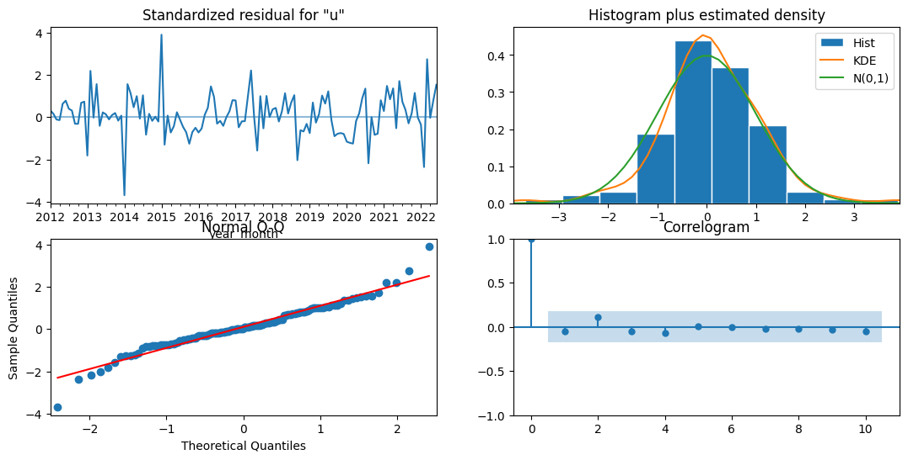

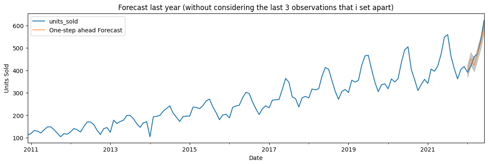

On the 3 held-out months, the RMSE (root mean squared error: the typical size of a mistake) is 12.87, so we can expect errors of about $\pm 13$ units sold. With an average of 525 units in those months, that is a 2.45% error.

**Output (error on the 3 months held out):**

```text
The Mean Squared Error is 165.6
The Root Mean Squared Error is 12.87
-----
The mean of the last 3 observations is 525.0
The expected error in the predictions is 2.45 %
```

To predict the next 3 months, the model is trained again, now including the 3 held-out months. Then it is saved in a pickle file (a file that stores the Python object as it is), to reuse it later.

Months predicted (2022/10 to 2022/12):

**Output (prediction, confidence interval and real value):**

| | Units Sold Predicted | Lower CI Units Sold | Upper CI Units Sold | Units Sold |
| ---------- | ----- | ----- | ----- | ----- |
| 2022-09-01 | 457.0 | 430.0 | 484.0 | 461.0 |
| 2022-10-01 | 415.0 | 388.0 | 443.0 | NaN |
| 2022-11-01 | 455.0 | 423.0 | 486.0 | NaN |
| 2022-12-01 | 468.0 | 434.0 | 502.0 | NaN |

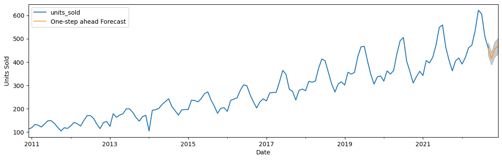

### 2.2 Extend the methodology

> **In this section** we wrap the whole thing in one function that can be called every day or on demand: it loads the saved model and the saved data, reads the new file, compares what the model had predicted against what really happened (absolute and percentage error), adds the new observation, refits the model, predicts the next 3 months and saves the updated model and data. The function is then run twice, first with `data_units_forecasting_t1.csv` and then with `data_units_forecasting_t2.csv`.

Note: the data is monthly, not daily, so the routine runs once per new month. Each time, it:
1. Checks how good the previous prediction was.
2. Updates the model with the new data.
3. Predicts the next 3 months.
4. Saves the updated model and data.

**Output (run 1, `data_units_forecasting_t1.csv` — how the previous prediction did):**

| | Units Sold Predicted | Lower CI Units Sold | Upper CI Units Sold | Units Sold | Absolute Error | Relative Error Percentage |
| ---------- | ----- | ----- | ----- | --- | ---- | ---- |
| 2022-10-01 | 415.0 | 388.0 | 443.0 | 390 | 25.0 | 6.41 |

**Output (run 1 — next 3 months predicted):**

| | Units Sold Predicted | Lower CI Units Sold | Upper CI Units Sold |
| ---------- | ----- | ----- | ----- |
| 2022-11-01 | 440.0 | 412.0 | 467.0 |
| 2022-12-01 | 457.0 | 425.0 | 489.0 |
| 2023-01-01 | 435.0 | 400.0 | 469.0 |

**Output (run 2, `data_units_forecasting_t2.csv` — how the previous prediction did):**

| | Units Sold Predicted | Lower CI Units Sold | Upper CI Units Sold | Units Sold | Absolute Error | Relative Error Percentage |
| ---------- | ----- | ----- | ----- | --- | --- | ---- |
| 2022-11-01 | 440.0 | 412.0 | 467.0 | 432 | 8.0 | 1.85 |

**Output (run 2 — next 3 months predicted):**

| | Units Sold Predicted | Lower CI Units Sold | Upper CI Units Sold |
| ---------- | ----- | ----- | ----- |
| 2022-12-01 | 453.0 | 425.0 | 480.0 |
| 2023-01-01 | 431.0 | 399.0 | 464.0 |
| 2023-02-01 | 468.0 | 434.0 | 502.0 |

### 2.3 Future steps

- Compare the results against a baseline (a simple forecast, like the trend, or the trend plus the seasonality) to see how much the model really adds.
- Fix the non-normal residuals and the outliers.
- Ask the right teams (marketing, sales, etc.) why some months are missing.
- Add a test for seasonality: so far only the Dickey-Fuller test was used, and it only checks the trend.

---

## 3. Analysis

The dashboard was made in Tableau and is on [Tableau Public](https://public.tableau.com/views/MarketingCampaignPerformance-JoaquinAmiel/MarketingCampaignPerformance?:language=en-US&:display_count=n&:origin=viz_share_link); the analysis is below. All amounts are in euros.

I used last touch attribution (LTA): all the credit for a conversion goes to the last ad the customer touched, ignoring the rest of their journey. This is not ideal, because some campaigns aim at awareness (making people know the brand), and this model can't measure their impact. But it is a good starting point.

The analysis would improve with more fields, such as source, medium, publisher/channel, country or region, target segment, platform and campaign objective (awareness or conversions).

The data has these fields:
- **id_banner**: banner id; each row is one banner.
- **id_campaign**: campaign id; some campaigns have more than one banner.
- **Impressions**: how many times the banner was displayed.
- **Clicks**: how many times someone clicked the banner.
- **Spent**: money spent on the banner.
- **Total Conversions**: how many people became clients.
- **LTV (Lifetime Value)**: how much money a client is expected to bring over their whole time as a client. It is given per campaign.

From these, I calculated:
- **CTR (Click-Through Rate)**: the share of times the ad was shown that ended in a click, $CTR = \frac{Clicks}{Impressions}*100$.
- **CPM (cost per 1,000 impressions)**: the cost of showing the banner 1,000 times, $CPM = \frac{Spent}{Impressions}*1000$.
- **CPC (cost per click)**: the average price paid for each click, $CPC = \frac{Spend}{Clicks}$.
- **Conversion Rate**: the share of clicks that end with a new client, $Conversion\ Rate = \frac{Total\ Conversions}{Clicks}$.
- **CAC (Customer Acquisition Cost)**: how much each new client costs, $CAC = \frac{Spent}{Total\ Conversions}$.
- **ROAS (Return on Ad Spend)**: the return on the marketing money. Here it is $ROAS = \frac{LTV}{CAC} - 1$: above 0 means a client brings more than they cost.

These numbers show where campaigns and banners work and where they don't. For example, some are great at getting people interested but bad at turning them into clients, or the other way around. And some bring many clients, but clients with a low LTV, while others bring fewer but better clients.

The first part of the dashboard shows that:

- The company has 277 campaigns, but only 149 (53.7%) have a positive ROAS. Since all these campaigns aim at conversions, the company can start by cutting campaigns. Keeping only the campaigns with a positive ROAS, the ROAS goes up from 0.21% to 8.54%. But, interestingly, the CAC also goes up, from 20.86 € to 23.33 €: the company should care about the quality of new clients, not only their number.

- 37 campaigns bring 50.5% of the revenue, and the same 37 campaigns take 50.0% of the spend, but some of them have a negative ROAS. So spending can be optimized: start with the campaigns with the most revenue or spend, put more money in those with a high ROAS, and stop spending on those with a negative ROAS.

- Along the conversion funnel: the CTR is 0.0176%, which is low (even for Google Ads), but the conversion rate is 7.4%, which is not bad. It would help to know if the company pays per click or per impression: if it pays per impression, targeting the ads better would cut costs.

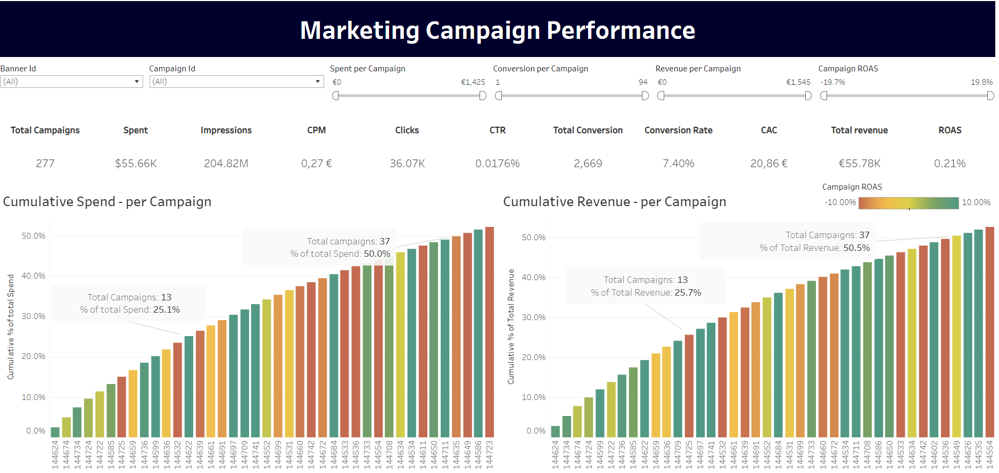

The second part of the dashboard helps the marketing team dig into the performance of each campaign.

In the CTR vs Conversion Rate chart, each quadrant (corner) points to a different action:

| Result      | Action |
| ----------- | ----------- |
| Low CTR, Low Conversion Rate | People see the banner but are not interested in the product. Maybe the target audience is wrong. |
| Low CTR, High Conversion Rate | The people who click are very likely to convert, so the audience looks right. Check if something is wrong with the banners themselves. |
| High CTR, Low Conversion Rate | Clickbait: find out why people click but don't convert (probably the wrong target audience). |
| High CTR, High Conversion Rate | Campaigns to keep and copy. |

In the ROAS vs Spent chart:
  - Campaigns split into profitable and unprofitable, and into big and small spenders. To improve, the company could spend more on the campaigns that already have a positive ROAS and a big budget (managing a lot of small campaigns is hard work).

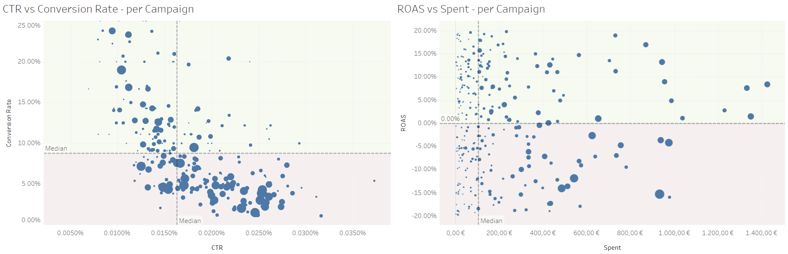

Finally, this view shows, for each campaign, the banners that get money but have a negative ROAS. That makes it easy to cut costs and raise revenue: spend more on banners with a high ROAS, and look into what is going wrong with the negative ones. In campaign 144724, banners 1122202 and 1122205 are a good example.

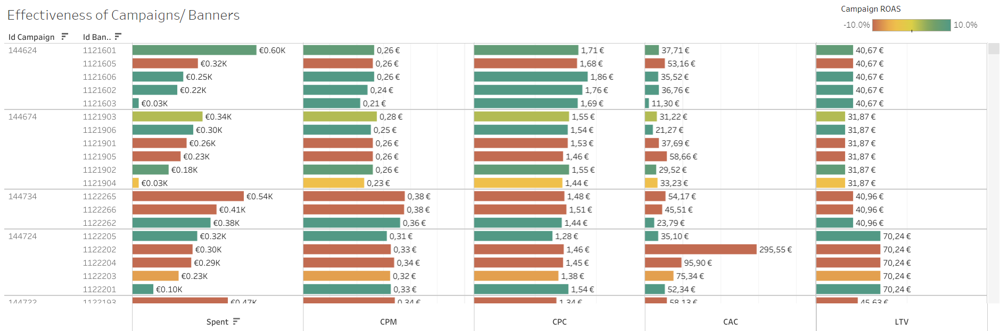

## 4. Limitations

> **In this section** we list what I would do differently today.

- **The forecast was tested on only 3 months.** A backtest (predicting each month of the last 1-2 years using only the data before it) would give a much more reliable idea of the error.
- **The model was not compared with a simple baseline** (for example, "same month last year"), so we don't know how much SARIMA really adds (see section 2.3).
- **The "daily" process is a function you call by hand.** In production it would need a scheduler (so it runs on its own), tests, logs and a safe place for the API key.
- **The dashboard uses last touch attribution**, which ignores the effect of awareness campaigns (see section 3).

---

## Appendix: Python code

The code below is the same as in [`analysis.py`](analysis.py), grouped by the sections of this report. The only difference: here the file paths still point to the original Google Drive folder, while `analysis.py` reads from `data/` and saves to `outputs/`.

### A.1 Pull out Air Quality data

```python
# %%
# ---------------------------------------------------------------------
# 1.1 Pull out Air Quality data
# ---------------------------------------------------------------------
# Colab-only line: uncomment it if the `requests` package is missing.
# pip install requests

import requests
import matplotlib.pyplot as plt

import warnings

warnings.filterwarnings("ignore")

# %%
# The token is the key that identifies us against the air quality API.
# Replace it with your own key (you get one for free after signing up).
# Keeping a key inside the code is not the safest way: better to read it
# from an encrypted file or ask the user for it. Here the data is public
# and the account is free, so the risk is small.
# not the most secure way, I should have the key in other encripted file or ask the user with a input function. however data is public and create an user is free.
token = 'YOUR_ACCESS_TOKEN'
URL = "https://api.golemio.cz/v2/airqualitystations/history?limit=1000"  # api-endpoint
headers = {'X-Access-Token': token}

req = requests.get(URL, headers=headers)

# The API answers with JSON: text organised as nested lists and
# dictionaries, which Python can read directly.
# extracting data in json format
data = req.json()
```

### A.2 Evolution of NO2 and PM10 particles

```python
# %%
# ---------------------------------------------------------------------
# 1.2 Evolution of NO2 and PM10 particles
# ---------------------------------------------------------------------
# Every record of the answer can carry several "components" (the
# particles measured at that moment). We walk through all of them and
# keep the value of NO2 and of PM10. Not every record has both, so when
# one is missing we store `None` (an empty slot) to keep both lists the
# same length as the number of records.
NO2 = []
PM10 = []

l = 1
for i in range(0, len(data)):
    NO2_null = 1
    PM10_null = 1
    if (len(data[i]['measurement']['components']) > 0):

        for j in range(0, len(data[i]['measurement']['components'])):
            if (data[i]['measurement']['components'][j]['type'] == 'NO2'):
                NO2.append(data[i]['measurement']['components'][j]['averaged_time']['value'])
                l += 1
                NO2_null = 0
            elif (data[i]['measurement']['components'][j]['type'] == 'PM10'):
                PM10.append(data[i]['measurement']['components'][j]['averaged_time']['value'])
                PM10_null = 0
    if NO2_null == 1:
        NO2.append(None)
    if PM10_null == 1:
        PM10.append(None)

# %%
# Sanity check: print the id of every station that appears in the data.
# If only one line is printed, all the readings come from one station.
print(data[0]['id'])
for i in range(1, len(data)):
    if data[i - 1]['id'] != data[i]['id']:
        print(data[i]['id'])

# %%
# Two charts, one on top of the other: how each pollutant moved along the
# 1,000 readings.
plt.subplots(1, figsize=(14, 7))

plt.subplot(2, 1, 1)
plt.plot(NO2, linestyle='-', marker='o', label='Total', color='black')
plt.title('NO2 - 1.000 point time series', loc='center', fontsize=14, fontweight=0)
plt.grid()
plt.xlim(-5, 1000)
plt.ylabel('NO2')

plt.subplot(2, 1, 2)
plt.plot(PM10, linestyle='-', marker='o', label='Total', color='black')

plt.title('PM10 - 1.000 point time series', loc='center', fontsize=14, fontweight=0)
plt.grid()
plt.xlim(-5, 1000)
plt.ylabel('PM10')
plt.show()

# %%
# A scatterplot puts one pollutant against the other: each dot is one
# reading. If the dots drew a line, the two would move together.
plt.scatter(x=NO2, y=PM10, s=75, alpha=0.6)
plt.title('Scatterplot NO2 vs PM10')
plt.xlabel('NO2')
plt.ylabel('PM10')
plt.show()
```

### A.3 Build a model to predict data

```python
# %%
# ---------------------------------------------------------------------
# 2.1 Build a model to predict data
# ---------------------------------------------------------------------
# import libraries and create functions

# Colab-only line: it connects the notebook to Google Drive.
# from google.colab import drive

import seaborn as sns
import matplotlib.pyplot as plt
from pylab import rcParams
rcParams['figure.figsize'] = 16, 8

import warnings
warnings.filterwarnings("ignore")

import statsmodels.api as sm
from statsmodels.graphics.tsaplots import plot_acf, plot_pacf
from statsmodels.tsa.stattools import adfuller
from statsmodels.tsa.statespace.sarimax import SARIMAX

from itertools import product
from tqdm.notebook import tqdm

import sys
import os
import pickle

import numpy as np
import pandas as pd
pd.set_option('display.max_rows', None)

import datetime as dt
from dateutil.relativedelta import relativedelta


# ts tests:
def adf_test(timeseries):
    """Dickey-Fuller test: it answers "does this series keep drifting up
    or down?". A small p-value (under 0.05) means it does not drift any
    more, which is what a SARIMA model needs."""
    # Perform Dickey-Fuller test:
    print('Results of Dickey-Fuller Test:')
    dftest = adfuller(timeseries, autolag='AIC')
    dfoutput = pd.Series(dftest[0:4], index=['Test Statistic', 'p-value', '#Lags Used', 'Number of Observations Used'])
    # for key,value in dftest[4].items():
    #   dfoutput['Critical Value (%s)'%key] = value
    print(dfoutput)


def get_month(x):
    """Move any date to the 1st day of its month, so every month has one
    single label (2014-03-17 and 2014-03-28 both become 2014-03-01)."""
    return dt.datetime(x.year, x.month, 1)


def optimize_SARIMA(parameters_list, d, D, s, exog):
    """
        Return dataframe with parameters, corresponding AIC and SSE

        parameters_list - list with (p, q, P, Q) tuples
        d - integration order
        D - seasonal integration order
        s - length of season
        exog - the exogenous variable

        It trains one model per combination of parameters and keeps its
        AIC. AIC is a score that mixes how well the model fits with how
        many parameters it uses: the lower, the better, because a model
        with many parameters that fits only a bit better is punished.
    """

    results = []

    for param in tqdm(parameters_list):
        try:
            model = SARIMAX(exog, order=(param[0], d, param[1]), seasonal_order=(param[2], D, param[3], s)).fit(disp=-1)
        except:
            continue
        results.append(['SARIMA{} x {} {}'.format((param[0], d, param[1]), (param[2], D, param[3]), s), model.aic])

    result_df = pd.DataFrame(results)
    result_df.columns = ['(p,d,q)x(P,D,Q)', 'AIC']

    # Sort in ascending order, lower AIC is better
    result_df = result_df.sort_values(by='AIC', ascending=True).reset_index(drop=True)

    return result_df.head()  # return the top 5 models


# Colab-only line: mount google drive information in a google colaboratory directory
# drive.mount('/content/gdrive')

path = r'gdrive/MyDrive/Data Science Project/antiVirusCompany/Data/'  # insert your path

# %%
# Check if the file is there
print(os.path.isfile(path + 'data_units_forecasting.csv'))

# %%
# Read the sales file and remove repeated rows (the same month appearing
# twice). The shapes printed before and after say how many rows were
# dropped.
df = pd.read_csv(path + 'data_units_forecasting.csv', sep=',', parse_dates=['dt'])
print(df.shape)
df.sort_values(by='dt', inplace=True)
df.drop_duplicates(inplace=True)
print(df.shape)

df_copy = df

# %%
# Check the column types: `dt` must be a real date, not text.
print(df.dtypes)

# %%
# describe() gives the usual summary: how many values there are, the
# average, the smallest and the largest, and the percentiles (the 25%
# line is the value that leaves a quarter of the months below it).
# The "count" being lower than the number of rows is how we see that
# some months have no value.
print(df.describe())

# %%
# Create year month column, because the information is monthly
df['year_month'] = df.dt.apply(get_month)

# %%
# Sanity check: True means there is one single record per month.
print(df['year_month'].nunique() == df['year_month'].size)

# %%
# Units sold over time, with a straight line on top (the trend) built by
# fitting a first-degree polynomial: it shows the general direction.
plt.subplots(1, figsize=(14, 5))
plt.plot(df.dt, df.units_sold, linestyle='-', marker='o', label='Units Sold')

# calculate equation for trendline
# clean null values
idx = np.isfinite(df.units_sold) & np.isfinite(df.dt)

z = np.polyfit(np.array(range(0, df.shape[0]))[idx], df.units_sold[idx], 1)
p = np.poly1d(z)

# add trendline to plot
plt.plot(df.dt[idx], p(np.array(range(0, df.shape[0]))[idx]), linestyle='--', color='skyblue', label='Units Sold - Trend')

# look and feel
plt.title('Units sold over time', loc='center', fontsize=14, fontweight=0)
plt.grid(axis='y')
plt.legend(loc="lower right")
plt.xlim(dt.date(2010, 12, 17), dt.date(2022, 9, 16))
plt.ylabel('Units Sold')
plt.show()

# %%
# Hold out the last 3 months: the model never sees them, so later we can
# compare its predictions against what really happened.
df_last_3 = df.tail(3)
df = df[:-3]

# %%
# Use the year-month as the index and ask pandas for one row per month
# ('MS' = month start). Months that were not in the file appear now as
# empty rows. We remember where the empty values are, and fill them for
# the moment with the next known value, because the decomposition below
# does not work with holes.
df.set_index('year_month', inplace=True)
df.drop(columns=['dt'], inplace=True)  # i have the year-month in the index
df = df.asfreq('MS')  # needed to use decomposition function
# save null values
nulls_values = df.units_sold.isnull()

df.bfill(inplace=True)  # Backfill Missing Values - Using value of previous row to fill the missing value
print(df.head())

# %%
# Decomposition splits the series into three pieces: the trend (the slow
# movement up or down), the seasonality (the pattern that repeats every
# 12 months) and the residual (what is left, the noise).
decomposition = sm.tsa.seasonal_decompose(df, model='additive')
fig = decomposition.plot()
plt.show()

# %%
# Outliers are months whose value is far from what trend + seasonality
# would expect. Here: residual below -100 units.
print('Values (outliers) before the imputing:')
print(df[decomposition.resid < -100])

# %%
# Replace each outlier by trend + seasonality of that month, rounded up.
# (.loc is used to write straight into the table: writing through
# df.units_sold[...] silently changes a copy in recent pandas versions.)
df.loc[decomposition.resid < -100, 'units_sold'] = np.ceil(decomposition.trend[decomposition.resid < -100] + decomposition.seasonal[decomposition.resid < -100])

# %%
print('Values after the imputing:')
print(df[decomposition.resid < -100])

# %%
print('This values (missing) were replaced by the previous non missing value:')
print(df[nulls_values])

# %%
# Same idea for the months that had no value: instead of copying the
# neighbour, use trend + seasonality.
df.loc[nulls_values, 'units_sold'] = np.ceil(decomposition.trend[nulls_values] + decomposition.seasonal[nulls_values])

# %%
print('New values:')
print(df[nulls_values])

# %%
# Decompose again, now on the cleaned series.
decomposition = sm.tsa.seasonal_decompose(df, model='additive')
fig = decomposition.plot()
plt.show()

# %%
# Test the original series: a high p-value says it still drifts.
print(adf_test(df))

# %%
# Differencing: replace each month by the difference with the month
# before. That removes the long-term direction and leaves the changes.
df_adj = df - df.shift(1)
df_adj = df_adj.dropna()

plt.subplots(1, figsize=(14, 5))
plt.plot(df_adj, linestyle='-', marker='o', label='Diff. Units Sold')

# calculate equation for trendline
# clean null values

z = np.polyfit(np.array(range(0, df_adj.shape[0])), df_adj.units_sold, 1)
p = np.poly1d(z)

# add trendline to plot
plt.plot(df_adj.index, p(np.array(range(0, df_adj.shape[0]))), linestyle='--', color='skyblue', label='Diff. Units Sold - Trend')

# look and feel
plt.title('Differenced time series with trend removed', loc='center', fontsize=14, fontweight=0)
plt.grid(axis='y')
plt.legend(loc="lower right")
plt.xlim(dt.date(2010, 12, 17), dt.date(2022, 9, 16))
plt.ylabel('Units Sold')
plt.show()

# %%
# One box per month. A box shows where the middle half of the values of
# that month falls, the line inside is the middle value, and the dots are
# unusual months. Low boxes mean months that sell less than the one
# before.
plt.figure(figsize=(14, 4))
ax = sns.boxplot(x=pd.DatetimeIndex(df_adj.index).strftime('%b'), y=df_adj.units_sold)
ax.set_title("Box Plots Units sold per month - after trend removal")
ax.set_xlabel('')
ax.set_ylabel('Units sold after trend removal')
plt.show()

# %%
# apply adf test on the series
print(adf_test(df_adj))

# %%
# Difference again, now against the same month of the previous year
# (lag 12), to take the yearly pattern out.
df_s_adj = df_adj - df_adj.shift(12)
df_s_adj = df_s_adj.dropna()

plt.subplots(1, figsize=(14, 5))
plt.plot(df_s_adj, linestyle='-', marker='o', label='Diff. Units Sold')

# look and feel
plt.title('Differenced time series with trend and seasonality removed', loc='center', fontsize=14, fontweight=0)
plt.grid(axis='y')
plt.legend(loc="lower right")
plt.xlim(dt.date(2011, 12, 17), dt.date(2022, 9, 16))
plt.ylabel('Units Sold')
plt.show()

# %%
# ACF and PACF measure how much the series looks like itself some months
# back (that distance is called the "lag"). Bars that stick out of the
# shaded band are the lags that matter, and they suggest how many terms
# the model needs.
rcParams['figure.figsize'] = 14, 2
plot_acf(df_s_adj)
plt.show()

plot_pacf(df_s_adj)
plt.show()

# %%
# Build the list of parameter combinations to try:
#   p, q  = terms of the normal part of the model
#   P, Q  = terms of the yearly part
#   d, D  = the two differencings we did above (normal and yearly)
#   s     = 12, the length of the season (12 months)
p = range(0, 2, 1)
q = range(0, 5, 1)
P = range(0, 2, 1)
Q = range(0, 2, 1)

d = 1
D = 1
s = 12
parameters = product(p, q, P, Q)
parameters_list = list(parameters)
print(len(parameters_list))

# %%
print(optimize_SARIMA(parameters_list, d, D, s, df))

# %%
# Best model by AIC. In the summary, the column P>|z| is what tells if a
# coefficient is really doing something: over 0.05 means it could be
# zero, so the term is not adding information.
# SARIMA(0, 1, 3) x (0, 1, 1) 12
best_model = SARIMAX(df, order=(0, 1, 3), seasonal_order=(0, 1, 1, 12)).fit()  # method = 'powell',dis=-1
print(best_model.summary())

# %%
# Third best model, chosen because all its coefficients are significant.
# SARIMA(1, 1, 1) x (0, 1, 1) 12
best_model = SARIMAX(df, order=(1, 1, 1), seasonal_order=(0, 1, 1, 12)).fit()  # method = 'powell',dis=-1
print(best_model.summary())

# %%
# Diagnostic charts of the errors the model makes: they should look like
# pure noise, with no pattern left.
best_model.plot_diagnostics(figsize=(13, 6))
plt.show()

# %%
# Predict 2022 month by month and draw it over the real values. The grey
# band is the confidence interval: the range where the real value is
# expected to fall.
pred = best_model.get_prediction(start=pd.to_datetime('2022-01-01'), dynamic=False)
pred_ci = pred.conf_int()
ax = df.plot(label='Observed')
pred.predicted_mean.plot(ax=ax, label='One-step ahead Forecast', alpha=.7, figsize=(14, 4))
ax.fill_between(pred_ci.index,
                pred_ci.iloc[:, 0],
                pred_ci.iloc[:, 1], color='k', alpha=.2)
ax.set_xlabel('Date')
ax.set_ylabel('Units Sold')
ax.set_title('Forecast last year (without considering the last 3 observations that i set apart)')
plt.legend()
plt.show()

# %%
# Now the error on the 3 months held out at the start.
# MSE  = average of the squared errors.
# RMSE = its square root, so it is back in units sold and can be read as
#        "the prediction misses by about this much".
y_forecasted = best_model.get_prediction(start=pd.to_datetime('2022-07-01'),
                                         end=pd.to_datetime('2022-09-01'),
                                         dynamic=False).predicted_mean

y_truth = df_last_3.units_sold

mse = ((np.array(y_forecasted) - np.array(y_truth)) ** 2).mean()
print('The Mean Squared Error is {}'.format(round(mse, 2)))
print('The Root Mean Squared Error is {}'.format(round(np.sqrt(mse), 2)))
print('-----')

print('The mean of the last 3 observations is {}'.format(df_last_3.units_sold.mean()))
print('The expected error in the predictions is {} %'.format(round(100 * np.sqrt(mse) / df_last_3.units_sold.mean(), 2)))


# %%
def model_application(data, order=(1, 1, 1), seasonal_order=(0, 1, 1, 12)):
    '''Built the SARIMAX model with a new set of data.

    It repeats the cleaning done above (one row per month, fill holes and
    outliers with trend + seasonality), adds three empty months at the
    end so the model has slots to predict, and fits the model.'''
    data['year_month'] = data.dt.apply(get_month)
    data.set_index('year_month', inplace=True)
    data.drop(columns=['dt'], inplace=True)
    data = data.asfreq('MS')
    # save null values
    nulls_values = data.units_sold.isnull()

    data.bfill(inplace=True)

    decomposition = sm.tsa.seasonal_decompose(data, model='additive')

    # replace null values and outliers before fit the model based in trend + seasonality
    data.loc[decomposition.resid < -100, 'units_sold'] = np.ceil(decomposition.trend[decomposition.resid < -100] + decomposition.seasonal[decomposition.resid < -100])
    data.loc[nulls_values, 'units_sold'] = np.ceil(decomposition.trend[nulls_values] + decomposition.seasonal[nulls_values])

    # adding 3 new dots
    data.loc[pd.to_datetime('2022-10-01')] = np.nan
    data.loc[pd.to_datetime('2022-11-01')] = np.nan
    data.loc[pd.to_datetime('2022-12-01')] = np.nan
    best_model = SARIMAX(data, order=order, seasonal_order=seasonal_order).fit()
    return (data, best_model)


# %%
# Refit the model with the full series (the 3 months held out included)
# and save it. Pickle writes a Python object to a file, so the trained
# model can be loaded later without training it again.
df_copy, best_model = model_application(df_copy)

# save the model in a pkl model
with open(os.path.join(r'gdrive/MyDrive/Data Science Project/antiVirusCompany/Model/', 'best_model.pkl'), 'wb') as f:
    pickle.dump(best_model, f)

df_copy.to_csv('gdrive/MyDrive/Data Science Project/antiVirusCompany/Data/dataframe_modified.csv')

# %%
# Table with the prediction, its confidence interval and the real value
# where we have it. np.ceil rounds up, because units sold are whole
# numbers.
print(pd.concat([pd.DataFrame(np.ceil(best_model.get_prediction(start=pd.to_datetime('2022-09-01'),
                                                                end=pd.to_datetime('2022-12-01'),
                                                                dynamic=False).predicted_mean)).rename(columns={'predicted_mean': 'Units Sold Predicted'}),
                 np.ceil(best_model.get_prediction(start=pd.to_datetime('2022-09-01'),
                                                   end=pd.to_datetime('2022-12-01'),
                                                   dynamic=False).conf_int()).rename(columns={'lower units_sold': 'Lower CI Units Sold',
                                                                                              'upper units_sold': 'Upper CI Units Sold'}),
                 df_copy.tail(4).rename(columns={'units_sold': 'Units Sold'})
                 ], axis=1, join='inner'))

# %%
y_forecasted = best_model.get_prediction(start=pd.to_datetime('2022-09-01'),
                                         end=pd.to_datetime('2022-12-01'),
                                         dynamic=False)

pred_ci = y_forecasted.conf_int()
ax = df_copy.plot(label='Observed')
np.ceil(y_forecasted.predicted_mean).plot(ax=ax, label='One-step ahead Forecast', alpha=.7, figsize=(14, 4))
ax.fill_between(pred_ci.index,
                pred_ci.iloc[:, 0],
                pred_ci.iloc[:, 1], color='k', alpha=.2)
ax.set_xlabel('Date')
ax.set_ylabel('Units Sold')
plt.legend()
plt.show()
```

### A.4 Extend the methodology

```python
# %%
# ---------------------------------------------------------------------
# 2.2 Extend the methodology
# ---------------------------------------------------------------------
def new_data(filename,
             order=(1, 1, 1),
             seasonal_order=(0, 1, 1, 12)):
    """Run the whole routine when a new month of data arrives.

    Steps: load the saved model and data, read the new file, compare what
    the model had predicted against what really happened, add the new
    month, train the model again, predict the next 3 months and save the
    updated model and data."""
    # Colab-only line: mount google drive information in a google colaboratory directory
    # drive.mount('/content/gdrive')
    path = r'gdrive/MyDrive/Data Science Project/antiVirusCompany/'  # usual path, the user should put the data in this file (can be a bucket in hte future)

    # read data
    with open(path + 'Model/best_model.pkl', 'rb') as fp:
        best_model = pickle.load(fp)

    df_copy = pd.read_csv(path + 'Data/dataframe_modified.csv', sep=',', parse_dates=['year_month']).set_index('year_month')

    if os.path.isfile(path + filename):
        new_df = pd.read_csv(path + filename, sep=',', parse_dates=['dt'])
        print('new data was read')
    else:
        sys.exit('filename error, please check the name or where you put the file')

    new_df['year_month'] = new_df.dt.apply(get_month)
    new_df.set_index('year_month', inplace=True)
    new_df.drop(columns=['dt'], inplace=True)

    # 1.Look at how the prediction was
    # Absolute Error = how many units we missed by.
    # Relative Error Percentage = that miss as a percentage of the real
    # value, so months of different size can be compared.
    pred = best_model.get_prediction(start=pd.to_datetime(new_df.index[0]), dynamic=False)
    results = pd.concat([pd.DataFrame(np.ceil(pred.predicted_mean)).rename(columns={'predicted_mean': 'Units Sold Predicted'}),
                         np.ceil(pred.conf_int()).rename(columns={'lower units_sold': 'Lower CI Units Sold',
                                                                  'upper units_sold': 'Upper CI Units Sold'}),
                         new_df.rename(columns={'units_sold': 'Units Sold'})
                         ], axis=1, join='inner')

    results['Absolute Error'] = np.abs(results['Units Sold Predicted'] - results['Units Sold'])
    results['Relative Error Percentage'] = round(100 * np.abs(results['Units Sold Predicted'] - results['Units Sold']) / results['Units Sold'], 2)
    print('Results was generated')

    # 2.Update the model with the new data
    df_copy.loc[new_df.index] = new_df.loc[new_df.index]  # insert the new data

    df_copy.loc[new_df.index[0] + relativedelta(months=3)] = np.nan

    updated_model = SARIMAX(df_copy, order=(1, 1, 1), seasonal_order=(0, 1, 1, 12)).fit()

    # 3.Predict the next 3 month based in the model + new data

    new_pred = updated_model.get_prediction(start=pd.to_datetime(new_df.index[0] + relativedelta(months=1)), dynamic=False)
    new_pred = pd.concat([pd.DataFrame(np.ceil(new_pred.predicted_mean)).rename(columns={'predicted_mean': 'Units Sold Predicted'}),
                          np.ceil(new_pred.conf_int()).rename(columns={'lower units_sold': 'Lower CI Units Sold',
                                                                       'upper units_sold': 'Upper CI Units Sold'})
                          ], axis=1, join='inner')

    # 4.save model and data updated
    with open(os.path.join(path + 'Model/', 'best_model.pkl'), 'wb') as f:
        pickle.dump(updated_model, f)

    df_copy.to_csv(path + 'Data/dataframe_modified.csv')

    return (results, new_pred)


# %%
# First new month.
results, new_pred = new_data(filename='data_units_forecasting_t1.csv')

print(results)

print(new_pred)

# %%
# Second new month: same call, the model keeps learning.
results, new_pred = new_data(filename='data_units_forecasting_t2.csv')

print(results)

print(new_pred)
```
